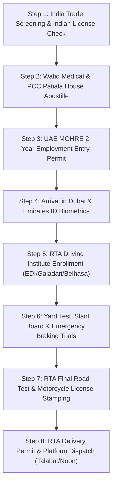

# Gulf Bike Delivery Rider Jobs 2026: Dubai & Saudi Delivery Rider Visa, RTA Bike License, Talabat/Noon Earnings, Commission vs Fixed Salary & Legal Employment Guide

The rapid expansion of hyper-convenience e-commerce, quick-commerce (Q-commerce), and on-demand food delivery applications across the Gulf Cooperation Council (GCC) has created an unprecedented surge in demand for professional two-wheeler delivery couriers. In global commercial powerhouses like Dubai, Abu Dhabi, Riyadh, Jeddah, Doha, and Kuwait City, motorcycle delivery riders represent the indispensable lifeline connecting restaurants, supermarkets, dark stores, and logistics warehouses with millions of residential consumers.

For job seekers in India—particularly across Uttar Pradesh, Bihar, Punjab, Haryana, Rajasthan, and Kerala—a **Gulf Bike Delivery Rider Visa** represents one of the most accessible and financially rewarding international employment opportunities. Unlike specialized engineering or certified industrial welding trades that mandate formal diplomas and years of workshop apprenticeships, two-wheeler delivery roles prioritize physical endurance, navigational aptitude, road safety compliance, and the ability to operate a motorcycle efficiently under demanding metropolitan conditions.

However, moving to the Gulf as a delivery rider involves far more than simply riding a motorbike. The industry has undergone extensive statutory regulation over the past two years:
- In the United Arab Emirates, the **Roads and Transport Authority (RTA)** and the **Ministry of Human Resources and Emiratisation (MOHRE)** have enforced stringent licensing standards, mandatory delivery rider occupational cards, regulated delivery thermo-boxes, and strict summer midday heat bans.
- In the Kingdom of Saudi Arabia, the **Ministry of Human Resources and Social Development (MHRSD)** has integrated food delivery under the **Qiwa Electronic Contract** platform and **Ajeer** licensing frameworks, mandating **Baladiya (Municipality) Occupational Health Cards** and authenticated Saudi motorcycle licenses via **Dallah Driving Schools**.

This comprehensive 2026 master manual provides the definitive, transparent, and legally verified roadmap to securing a motorcycle delivery rider career in Dubai and Saudi Arabia. From license testing protocols and 3PL fleet sponsorship contracts to commission-versus-salary calculations, daily operational budgets, and anti-fraud protections, this guide details everything Indian candidates need to know before boarding a flight to the Gulf.

---

## 1. The 2026 GCC Quick-Commerce Boom & Delivery Ecosystem

The food delivery and quick-commerce market across the Arabian Gulf has expanded into a multi-billion-dollar enterprise. Urban density, high disposable household incomes, and extreme summer temperatures make home delivery the default consumer choice across the Middle East.

### Major Delivery Platforms Operating in the GCC

| Platform | Primary Markets | Operational Sectors | Key Fleet Partners (3PL) |
| :--- | :--- | :--- | :--- |
| **Talabat (Delivery Hero)** | UAE, Qatar, Kuwait, Bahrain, Oman, KSA | Food delivery, Talabat Mart (15-min groceries), flowers, pharmaceuticals | Authorized 3PL logistics fleets (Transguard, Continental, Alsaad, etc.) |
| **Deliveroo** | UAE, Kuwait, Qatar | Premium dining, Deliveroo Hop dark stores, retail delivery | Certified third-party logistics contractors |
| **Noon Food & Noon Minutes** | UAE, Saudi Arabia, Egypt | E-commerce parcels, 15-minute grocery deliveries, restaurant orders | In-house logistics fleets and dedicated outsourced riders |
| **Careem (Careem Now / Captains)** | UAE, Saudi Arabia, Jordan | Multi-service "Everything App" (food, groceries, bike courier, document delivery) | 3PL fleet partners and licensed Careem Captains |
| **Jahez & Hungerstation** | Saudi Arabia, Bahrain | National Saudi food delivery leaders commanding 65%+ market share | Sponsoring Saudi logistics establishments via Qiwa/Ajeer |
| **Keeta (Meituan)** | Saudi Arabia (Riyadh, Jeddah) | Rapidly expanding global delivery powerhouse offering competitive incentives | Authorized Saudi transport & delivery fleets |
| **Amazon Prime Now / Amazon Logistics** | UAE, Saudi Arabia | Same-day and next-day express retail e-commerce packages | Contracted delivery service providers (DSPs) |

### The Role of 3PL (Third-Party Logistics) Fleets

A critical structural reality that candidates must understand is: **Delivery platforms like Talabat, Deliveroo, and Jahez rarely issue direct corporate employment visas to foreign riders.** 

Instead, they operate through a network of government-licensed **Third-Party Logistics (3PL) companies**. These 3PL companies:
1. Hold statutory corporate quotas (*MOHRE approval* in the UAE or *Qiwa/MHRSD approval* in Saudi Arabia) to recruit foreign manpower.
2. Sponsor the rider's 2-year employment residence visa and national identity cards (Emirates ID or Saudi Iqama).
3. Purchase or lease the motorcycle fleet, handle commercial vehicle registration, and arrange comprehensive third-party liability insurance.
4. Manage the rider's RTA or Dallah driving school admission, theoretical training, and practical track tests.
5. Provide shared bachelor labor accommodation, subsidized mobile SIM cards with unlimited GPS data packages, and payroll disbursement via the **Wage Protection System (WPS)**.

When you work as a delivery rider in Dubai or Riyadh, you are legally an employee of your sponsoring 3PL logistics company, while being assigned to fulfill deliveries on platforms like Talabat, Deliveroo, Noon, or Jahez.

---

## 2. UAE (Dubai) Delivery Rider Visa: RTA Licensing, MOHRE Regulations & Costs

Securing a delivery rider job in Dubai is governed by two regulatory authorities: the **Ministry of Human Resources and Emiratisation (MOHRE)**, which regulates the employment contract and residence visa, and the **Roads and Transport Authority (RTA)**, which controls driver testing, vehicle registration, and delivery permits.



### Can You Ride in Dubai on an Indian Two-Wheeler License?

> [!IMPORTANT]
> **No.** Under UAE Federal Traffic Law, an Indian motorcycle driving license **cannot be directly exchanged or converted** into an official UAE Motorcycle Driving License. Every candidate must enroll in an accredited driving institute in Dubai and pass the mandatory RTA computer theory and practical road tests.

However, holding a valid, verifiable Indian Two-Wheeler Commercial/Transport License (with at least 1 to 2 years of driving history) provides a massive financial and temporal advantage:
- **Beginner Applicants (Without Indian License):** Mandated to complete **30 practical training classes** before attempting the RTA road test.
- **Experienced Applicants (With Valid Indian License):** Eligible for the **20-class or 15-class reduced course**, cutting training duration by half and substantially lowering license fees.

### RTA Motorcycle License Step-by-Step Testing Lifecycle

1. **Traffic File Opening & Eye Test:** Upon receiving your Emirates ID (or entry employment visa with medical fitness), the 3PL sponsor opens an RTA Traffic File at an accredited institute such as **Emirates Driving Institute (EDI)**, **Galadari Motor Driving Centre (GMDC)**, **Belhasa Driving Center (BDC)**, or **Dubai Driving Center (DDC)**. An authorized computerized eye exam verifies 6/6 visual acuity and color differentiation.
2. **RTA Theory Lectures & Computer Exam:** Candidates attend 8 mandatory interactive theory lectures covering UAE road signs, highway lane discipline, defensive riding strategies, roundabouts, and hazard recognition. Candidates must clear the computerized RTA Knowledge Test (35 multiple-choice questions with English, Hindi, Urdu, and Arabic audio support).
3. **Internal Yard Training & Yard Test (Smart Yard):** The practical training begins on closed closed-circuit test tracks inside the institute:
   - **Figure-8 Maneuver:** Testing balance and clutch-throttle synchronization at low speeds.
   - **Slant Board (Incline Balance):** Riding along a narrow elevated steel plank without putting feet down.
   - **Zig-Zag Cone Slalom:** Swerving smoothly through closely spaced traffic cones.
   - **Emergency Braking:** Accelerating to 50 km/h and executing a sudden, controlled stop within marked boundaries without locking the wheels or skidding.
4. **Initial Road Training & Mock Assessment:** Once the Yard Test is cleared, instructors take candidates onto public roads to master highway merging, lane changes, blind-spot checks, roundabout navigation, and pedestrian crossing protocols.
5. **Final RTA Road Test:** An official RTA traffic police examiner evaluates the candidate in real-world Dubai traffic. If the rider demonstrates smooth gear changes, mandatory shoulder checks before lane shifts, proper distance maintenance, and speed limit compliance, the examiner approves the file immediately.
6. **Commercial License & Delivery Rider Permit Issuance:** The physical UAE Motorcycle Driving License is printed instantly at the driving school kiosk. Next, the 3PL company registers the rider for the **RTA Delivery Permit (Occupational Card)**, certifying that the courier has completed specialized training on food hygiene, temperature control, and customer service.

### License Costs & Payment Arrangements in Dubai

The total cost to acquire a UAE motorcycle driving license through EDI or Galadari typically ranges between **AED 4,200 and AED 6,200** (approx. ₹96,000 to ₹1,42,000 INR), depending on whether the candidate clears the road test on their first attempt or requires re-tests.

In the 2026 recruitment market, 3PL logistics companies handle this expenditure through two standard models:
- **Company-Financed Installment Model (Most Common):** The 3PL company pays the upfront driving school fees to the RTA. Once the rider obtains the license and begins delivering orders, the company deducts an agreed fixed installment (e.g., **AED 350 to AED 500 per month**) from the rider's monthly earnings over a period of 10 to 14 months until the training cost is fully recovered.
- **Candidate Self-Funded Package:** The candidate pays the license costs directly in India or upon arrival in Dubai. Under this structure, 100% of the rider's subsequent delivery earnings remain untouched, leading to significantly higher net savings from day one.

---

## 3. Saudi Arabia Delivery Rider Visa: Qiwa Contracts, Baladiya Health Cards & Dallah Schools

Saudi Arabia has emerged as the largest and most rapidly accelerating delivery market in the Middle East. Through the Vision 2030 digital transformation, platforms like **Jahez**, **Hungerstation**, **ToYou**, and **Keeta** handle hundreds of thousands of daily transactions across Riyadh, Jeddah, Mecca, Medina, Dammam, and the emerging gigaproject hubs.

### The Saudi Regulatory Framework

Securing a motorcycle delivery job in the Kingdom requires compliance with three governmental pillars:
1. **Qiwa Digital Employment Contract:** Before travel, the sponsoring Saudi logistics establishment issues an authenticated employment offer on the official Qiwa portal (qiwa.sa). The contract outlines the job designation (*Motorcycle Courier / Delivery Representative*), base salary or commission rates, working hours, and medical insurance coverage.
2. **Baladiya (Municipality) Health Card:** Because riders handle hot food, packaged groceries, and beverages, the Saudi Ministry of Municipal and Rural Affairs (Baladiya) mandates that all delivery workers undergo comprehensive infectious disease screenings (Chest X-ray for Tuberculosis, Hepatitis B & C serology, Salmonella stool tests). Upon clearance, a digital **Baladiya Health Certificate** is issued on the Balady portal, which must be displayed on the rider's smartphone at all times.
3. **Ajeer Rider Electronic Authorization:** Sponsoring delivery companies issue Ajeer permits authorizing foreign workers to operate legally on designated delivery platforms, protecting riders from labor inspection violations.

### Saudi Motorcycle Driving License via Dallah Driving School

1. **Medical Fitness & Blood Grouping:** Completed at a Ministry of Health accredited clinic in Riyadh, Jeddah, or Dammam.
2. **Dallah School Enrollment:** Candidates register for the motorcycle license program via the **Absher** portal (absher.sa).
3. **Theory Exam & Yard Evaluation:** Dallah test tracks evaluate balance, stop-sign compliance, figure-8 steering, and emergency stopping.
4. **License Cost:** Total fees at Dallah Driving Schools range between **SAR 1,200 and SAR 2,200** (approx. ₹27,000 to ₹50,000 INR), making the Saudi motorcycle license considerably less expensive and faster to obtain than in Dubai.

---

## 4. Earnings Architecture: Commission Per Order vs. Fixed Monthly Salary

Income in the Gulf delivery sector depends entirely on the contractual remuneration model adopted by your sponsoring 3PL fleet. Candidates must review their contract terms thoroughly before signing.

```
┌────────────────────────────────────────────────────────────────────────┐
│                   GULF DELIVERY REMUNERATION MODELS                   │
├───────────────────────────────────┬────────────────────────────────────┤
│ MODEL A: COMMISSION PER ORDER     │ MODEL B: FIXED SALARY + TARGET     │
├───────────────────────────────────┼────────────────────────────────────┤
│ • Dubai: AED 7.50 – 10.50 / order │ • Basic Salary: AED 1,500 – 2,000  │
│ • Saudi: SAR 12.00 – 18.00 / order│ • Target Quota: 300 – 380 orders/mo│
│ • No ceiling on daily earnings    │ • Incentive: AED 5 – 7 / extra order│
│ • Dependent on rider speed & hours│ • Protected monthly basic wage     │
│ • High-performance riders earn    │ • Safer for beginners during their │
│   AED 4,500 – 6,000+ / mo         │   first 3 months of learning routes│
└───────────────────────────────────┴────────────────────────────────────┘
```

### Comprehensive Real-World Earnings Simulation (Dubai vs. Riyadh)

To understand realistic earnings, let us analyze actual 2026 performance benchmarks for a dedicated rider completing an average of **20 deliveries per day** over **26 working days per month** (520 total monthly orders):

| Financial Component | Dubai, UAE (AED) | Saudi Arabia (SAR) | Equivalent in INR (₹) |
| :--- | :--- | :--- | :--- |
| **Average Commission per Order** | AED 8.50 | SAR 14.00 | ₹195 – ₹320 per delivery |
| **Gross Monthly Commission (520 orders)** | **AED 4,420** | **SAR 7,280** | **₹1,01,660 – ₹1,67,440** |
| **Platform Peak-Hour & Weekend Incentives** | + AED 350 | + SAR 500 | + ₹8,050 – ₹11,500 |
| **Direct Customer Cash Tips (Estimated)** | + AED 250 | + SAR 300 | + ₹5,750 – ₹6,900 |
| **TOTAL GROSS MONTHLY INCOME** | **AED 5,020** | **SAR 8,080** | **₹1,15,460 – ₹1,85,840** |

---

## 5. Itemized Monthly Expenses & Realistic Net Savings Breakdown

Many unregulated agents deceive candidates by claiming that riders take home the entire gross earnings. In reality, delivery riders operate as semi-independent field contractors and must cover daily operational running costs. 

Here is the realistic, line-by-line itemized monthly expenditure sheet for a delivery rider in Dubai and Saudi Arabia:

| Monthly Expense Category | Dubai, UAE (AED) | Saudi Arabia (SAR) | Operational Explanation & Tips |
| :--- | :--- | :--- | :--- |
| **Motorcycle Fuel (Petrol)** | AED 450 – 600 | SAR 350 – 480 | High-mileage 125cc/150cc delivery bikes (Honda, Yamaha, Bajaj) average 45–55 km per liter. Riders cover 120–180 km daily. |
| **Mobile SIM & Unlimited 5G Data** | AED 125 – 160 | SAR 120 – 150 | Mandatory continuous GPS navigation (Google Maps, Waze), platform rider apps, and customer call minutes. |
| **Shared Room Bed Space (Housing)** | AED 350 – 500 | SAR 300 – 450 | Air-conditioned shared bachelor accommodation (typically 4 to 6 riders per room in areas like Sonapur, Al Quoz, Deira, or Batha Riyadh). Many 3PL fleets provide free housing. |
| **Food & Self-Cooking Mess** | AED 400 – 550 | SAR 350 – 500 | Shared cooking with fellow Indian room-mates (rice, dal, roti, chicken) keeps food budgets highly economical. |
| **License Recovery Deduction (if financed)**| AED 350 – 450 | SAR 150 – 250 | Monthly installment deducted by the 3PL sponsor to recover upfront RTA/Dallah driving school tuition. Stops after 10–14 months! |
| **Motorbike Maintenance & Oil Changes** | AED 80 – 120 | SAR 70 – 100 | Engine oil change required every 1,500–2,000 km, brake shoe adjustments, tire punctures, and chain lubrication. |
| **Traffic Fine & Salik/Toll Contingency** | AED 100 – 150 | SAR 80 – 120 | Prudent financial buffer for minor speed camera infractions or bus lane violations. |
| **TOTAL MONTHLY OPERATING EXPENSES** | **AED 1,855 – 2,530**| **SAR 1,420 – 2,050** | **Total expenses required to maintain operations** |
| **REALISTIC NET REMITTANCE HOME TO INDIA** | **AED 2,500 – 3,400**| **SAR 4,500 – 6,000** | **₹58,000 – ₹92,000 INR (Dubai) / ₹95,000 – ₹1,35,000 INR (KSA)** |

> [!TIP]
> **Maximizing Monthly Savings:**
> 1. Once the driving license tuition installments finish after Year 1, your net take-home income automatically increases by **AED 350 to AED 500 / SAR 200 per month**.
> 2. Riders who cook their own meals in the morning and carry a thermal water flask save over AED 300 monthly compared to eating at roadside cafeterias.
> 3. Mastering secondary neighborhood shortcuts and avoiding toll roads (Salik gates) preserves delivery margins.

---

## 6. Daily Life, Shift Management & GCC Heat Ban Protections

Operating as a professional courier in the Gulf requires physical stamina, defensive driving reflexes, and disciplined schedule management.

### Typical Daily Working Schedule

- **Morning Shift (10:30 AM – 3:00 PM):** Capturing the lucrative lunchtime rush across commercial office parks (Business Bay, DIFC, Dubai Media City, Olaya Riyadh, King Abdullah Financial District). Fast-paced office deliveries commanding peak-hour incentives.
- **Mid-Afternoon Break (3:00 PM – 6:00 PM):** Lunch, rest in air-conditioned company quarters or shaded cooling stations, vehicle inspection, and smartphone charging.
- **Evening & Late-Night Shift (6:30 PM – 12:30 AM / 1:30 AM):** The busiest period of the day. Families ordering dinners, grocery runs via Talabat Mart / Noon Minutes, and late-night cravings. Cooler ambient evening temperatures make riding smoother and more comfortable.

### Statutory Midday Summer Work Ban Laws

Under UAE Federal Decree-Law and Saudi MHRSD Ministerial Decisions, all outdoor work under direct sunlight is strictly prohibited during peak summer months (**June 15 to September 15 between 12:30 PM and 3:00 PM**).

To safeguard delivery couriers while maintaining continuous consumer services, the GCC delivery ecosystem has instituted cutting-edge protective solutions:
1. **Air-Conditioned Delivery Vans During Midday:** During the mandatory 12:30 PM – 3:00 PM ban, 3PL fleets switch motorcycle couriers to air-conditioned logistics vans or four-wheeler vehicles for order fulfillment.
2. **Permanent Rider Rest Hubs:** Delivery platforms have constructed hundreds of air-conditioned rest stations across Dubai and Riyadh equipped with cold drinking water, mobile fast-charging docks, and comfortable seating.
3. **Cooling Vests & Smart Helmets:** Riders are issued breathable hydration vests containing phase-change cooling packs that lower skin temperatures by up to 10°C, alongside UV-reflective tinted helmet visors.

---

## 7. Step-by-Step Recruitment & Visa Processing Protocol

For an Indian candidate applying from Uttar Pradesh, Bihar, Punjab, Haryana, or Delhi NCR, the complete recruitment journey follows a strict, legally compliant 6-stage lifecycle:

### Step 1: Pre-Screening & Indian Two-Wheeler License Verification
The candidate submits their original Indian passport (minimum 18 months validity) and original Indian Driving License (Motorcycle with Gear - MCWG). WorkWise Visa verifies your license credentials on the **mParivahan / Sarathi** national transport database. Basic English reading ability (for reading apartment numbers, customer names, and GPS prompts) is evaluated.

### Step 2: Client Interview & Technical Riding Assessment
Candidates attend physical recruitment drives conducted by visiting delegates from Dubai and Saudi 3PL logistics corporations. The trial includes basic balance trials on test motorcycles, clutch-throttle control demonstrations, and navigational problem-solving tests.

### Step 3: Wafid (GAMCA) Pre-Departure Medical Examination
The candidate receives an electronic medical appointment slip through the sovereign **Wafid Medical Portal (wafid.com)**. Testing is conducted at an accredited GCC diagnostic hospital in Delhi, Patna, Lucknow, Gorakhpur, Mumbai, or Kolkata:
- **Chest X-Ray:** Mandatory check for active or latent Pulmonary Tuberculosis (scarring).
- **Serology Blood Tests:** HIV 1 & 2, Hepatitis B (HBsAg), Hepatitis C (Anti-HCV), VDRL/Syphilis.
- **Biochemical Screening:** Blood sugar, kidney function, liver enzymes, and blood pressure.
- **Physical Fitness:** Visual acuity, hearing, hernia screening, and limb motor control.

### Step 4: Police Clearance Certificate (PCC) & MEA Apostille
Because delivery couriers handle high-value merchandise and interact directly with residential families, GCC security bureaus require a certified **Police Clearance Certificate (PCC)** issued by the **Passport Seva Kendra (PSK)** under the Ministry of External Affairs. For Saudi Arabia, original trade credentials receive MEA CPV Division attestation at Patiala House Courts, New Delhi.

### Step 5: Sovereign Entry Employment Visa & eMigrate POE Clearance
The 3PL employer processes the electronic employment visa through **GDRFA Dubai / MOHRE** or the **Saudi Ministry of Foreign Affairs (MOFA)**:
- **ECR Passport Holders:** Must obtain statutory Emigration Clearance from the **Protector of Emigrants (POE)** on the government of India's **eMigrate portal (emigrate.gov.in)**.
- **Pravasi Bharatiya Bima Yojana (PBBY):** Every worker is enrolled in statutory PBBY overseas insurance, providing **₹10,00,000 (10 Lakh INR)** in life and disability coverage, hospital reimbursement, and emergency repatriation flight expenses.

### Step 6: Flight Dispatch, RTA/Dallah Admission & Final Onboarding
The candidate flies to Dubai International Airport (DXB) or Riyadh King Khalid Airport (RUH). Sponsoring 3PL logistics representatives receive the candidate, arrange airport shuttle transport, check them into furnished bachelor quarters, issue a local SIM card, open a corporate bank account for salary disbursal, and enroll the candidate into EDI/Dallah driving schools.

---

## 8. Anti-Fraud Advisory: How to Avoid Delivery Rider Visa Scams

Due to the immense popularity of Gulf delivery rider jobs, fraudulent agents operating across North India exploit job seekers through calculated deceptive tactics. Protect your family's savings by memorizing these statutory safeguards:

> [!WARNING]
> ### The Top 4 Delivery Rider Recruitment Scams:
> 
> 1. **The "Visit Visa / Tourist Visa Conversion" Trap:**
>    - *The Scam:* An agent tells you, *"Take a 30-day or 60-day tourist visa to Dubai for ₹45,000. Once you reach Dubai, our partner company will convert it into a Talabat Rider Visa in two days."*
>    - *The Reality:* **This is 100% illegal.** UAE labor statutes prohibit foreign visitors from driving commercially or converting tourist visas without exiting the country. Unregistered individuals caught driving on visit visas face immediate arrest, hefty fines (AED 10,000+), detention, and deportation with a lifetime Schengen-style GCC entry ban. **Never travel on a visit visa for a delivery job.**
>
> 2. **The "Direct Talabat Corporate Employee Visa" Lie:**
>    - *The Scam:* Agents show you an offer letter bearing the colorful corporate logo of "Talabat Official" or "Deliveroo Corporate" promising an air-conditioned office desk and direct tech company payroll.
>    - *The Reality:* Delivery platforms do not hire foreign delivery drivers directly. All riders are hired through registered **3PL logistics fleet operators**. Your employment contract must state the legal trade license name of the licensed 3PL logistics company, authenticated on the official **MOHRE** or **Qiwa** portals.
>
> 3. **The "Guaranteed Free Driving License Without Test" Fraud:**
>    - *The Scam:* An intermediary promises that for an extra ₹50,000, you will get a direct Dubai RTA bike license without appearing for the yard test or road test.
>    - *The Reality:* **Impossible.** RTA Dubai and Dallah Saudi driving tests utilize biometric facial recognition, automated sensor tracks, and in-vehicle examiner dashcams. There is zero human shortcutting. You must practice and pass the test legitimately.
>
> 4. **Inflated "Fixed 7,000 AED Starting Salary" Promises:**
>    - *The Scam:* Deceptive promotional posters claiming guaranteed ₹1,50,000 INR basic fixed salary for fresh Indian riders with zero fuel deductions.
>    - *The Reality:* Legitimate starting basic wages for fixed contracts range between AED 1,500 and AED 2,200 (or commission equivalent). Net earnings exceeding AED 4,500 require logging 20 to 25+ daily deliveries with high operational discipline.

---

## 9. Frequently Asked Questions (2026 Authoritative FAQs)

### Q1. Can I apply for a Dubai delivery rider job if I do not know how to ride a motorcycle?
**Ans:** No. Candidates must possess practical, confident motorcycle balance and clutch-gear riding experience. While driving schools in Dubai teach local traffic rules and safety maneuvers, they expect candidates to know the fundamental mechanics of operating a two-wheeler. Possessing an Indian Driving License (MCWG) is mandatory for registration.

### Q2. How much does a Dubai delivery rider earn per single completed delivery?
**Ans:** Under standard 3PL commission agreements in 2026, riders earn between **AED 7.50 and AED 10.50 per completed order** on platforms like Talabat and Deliveroo. During peak rain conditions, extreme heat, or weekend midnight surges, platforms offer performance top-ups ranging from **AED 1.50 to AED 3.00 extra per order**.

### Q3. Who pays for the motorcycle in Dubai—the rider or the company?
**Ans:** Sponsoring 3PL logistics companies purchase, license, and insure the motorcycle (typically a Honda 125cc/150cc, Yamaha, or Bajaj Pulsar). In most agreements, the company provides the motorcycle for a monthly lease/maintenance fee (AED 300–450/month), or offers a 2-year lease-to-own arrangement where the bike becomes the rider's personal property upon completing the contract.

### Q4. What happens if a delivery rider gets into a road traffic accident?
**Ans:** Legitimate 3PL logistics fleets are legally obligated under UAE Federal Decree-Law No. 33 of 2021 to provide comprehensive third-party commercial vehicle insurance, mandatory **MOHRE Health Insurance**, and coverage under the **Workplace Injury Compensation Scheme**. If an accident occurs while on duty, medical hospitalization is 100% covered, and riders receive paid injury leave until medically certified to resume work.

### Q5. How long does it take from landing in Dubai to earning money on the bike?
**Ans:** The average transition duration is **4 to 8 weeks**. This timeframe includes completing Emirates ID biometrics (1 week), RTA driving institute theory and practical yard/road training (3 to 5 weeks), license printing, and platform onboarding with uniform/delivery bag issuance (3 to 5 days). Riders must carry personal subsistence funds (approx. AED 600–900 / ₹15,000–20,000 INR) to cover personal food during this training period.

### Q6. Is there an age limit for motorcycle delivery couriers in the Gulf?
**Ans:** Yes. The legal working age range for commercial two-wheeler riders in the UAE and Saudi Arabia is **21 to 39 years old**. Candidates must possess sharp visual acuity, quick physical reflexes, and healthy lumbar/spine condition to withstand daily road vibrations.

### Q7. Can an ECR (10th fail) passport holder get a delivery rider visa?
**Ans:** Yes. Delivery rider categories are open to both ECR (Emigration Check Required) and ECNR passport holders. For ECR candidates, WorkWise Visa coordinates direct **eMigrate POE Emigration Clearance** under the Ministry of External Affairs, complete with mandatory **Pravasi Bharatiya Bima Yojana (PBBY)** insurance cover.

### Q8. What language skills are required for Gulf delivery riders?
**Ans:** Candidates do not need fluent or advanced English. However, you must possess **functional basic English reading ability**—specifically understanding street names, building numbers, app prompts ("Order Picked Up", "Delivered", "Cash on Delivery", "Customer Calling"), and basic conversational politeness ("Good morning", "Thank you", "Your order has arrived").

### Q9. Can a delivery rider change companies (transfer visa) after 1 or 2 years?
**Ans:** Yes. Under revised UAE MOHRE and Saudi Qiwa labor mobility regulations, after completing your statutory 2-year employment contract (or during formal contract expiration), you have the legal right to transfer your sponsorship to another 3PL fleet, transition into light commercial car/van driving, or move into warehouse logistics management without requiring a No Objection Certificate (NOC) from your previous employer.

### Q10. How are delivery rider salaries paid—cash or bank transfer?
**Ans:** Under statutory GCC regulations, all wages must be disbursed digitally through the sovereign **Wage Protection System (WPS)** directly into the rider's personal bank account or authorized payroll card (e.g., C3Pay, Al Ansari Exchange card in the UAE, or Urpay/Mada in Saudi Arabia). Employers cannot withhold salaries or pay in untraceable cash.

### Q11. Which country is better for Indian delivery riders: Dubai or Saudi Arabia?
**Ans:** Both markets offer outstanding advantages depending on candidate priorities:
- **Choose Dubai (UAE)** if you prioritize modern urban infrastructure, world-class road safety enforcement, cosmopolitan multicultural lifestyle, and familiar English-language platform apps.
- **Choose Saudi Arabia (KSA)** if you prioritize **higher gross per-order commission rates (SAR 12–18/order)**, lower driving license acquisition costs (SAR 1,500 vs AED 5,000+), lower living costs, and immense high-volume delivery demand across expanding Riyadh and Jeddah neighborhoods.

### Q12. How can I start my verified delivery rider application with WorkWise Visa?
**Ans:** You can begin by submitting your original passport copy, valid Indian driving license, and contact details through the consultation booking portal on this website. Our dedicated overseas logistics placement desk will conduct an immediate eligibility review, schedule you for upcoming 3PL client recruitment trials, and guide you through verified Wafid medicals and MEA attestation.

---

## 10. Conclusion: Build a Lucrative, Legal Overseas Career with WorkWise Visa

The demand for disciplined, safety-conscious delivery riders across the Arabian Gulf is at an all-time high. By choosing the legal, sovereign-backed pathway—securing authentic MOHRE or Qiwa employment contracts, clearing genuine RTA or Dallah driving tests, and bypassing deceptive tourist visa rackets—Indian workers can earn between **₹65,000 and ₹1,10,000+ INR in clean monthly net savings** to build houses, pay off familial debts, and secure their financial independence.

At **WorkWise Visa**, our overseas driver and logistics recruitment division manages every phase with zero-subagent transparency:
- Verification of authentic 3PL employer quotas registered on destination ministry portals.
- Practical riding assessments and defensive driving orientation at recognized test tracks in India.
- Sovereign Wafid GAMCA medical appointments and PSK Police Clearance Certificate (PCC) processing.
- Direct eMigrate POE emigration clearance with ₹10 Lakh PBBY insurance protection.
- Pre-departure briefings on GCC traffic codes, smartphone GPS optimization, and money management.

### Visit Our Regional Placement Centers
Connect directly with our overseas recruitment specialists for an immediate profile audit:
- **Corporate Regional HQ:** [Urbtech Trade Centre, Sector 132, Noida / Delhi NCR](/locations/noida) | Phone: +91 81301 61603
- **Delhi Capital Desk:** [Connaught Place & South Delhi Candidate Hub](/locations/delhi)
- **Faridabad Placement Desk:** [Faridabad Industrial & Automotive Candidate Hub](/locations/faridabad)
- **Bihar Regional Headquarters:** [WorkWise Visa Branch, Patna](/locations/patna)
- **District Counseling Centers:** [Siwan](/locations/siwan) • [Gopalganj](/locations/gopalganj) • [Gorakhpur](/locations/gorakhpur) • [Muzaffarpur](/locations/muzaffarpur) • [Chhapra](/locations/chhapra)
- **Explore Live Vacancies:** [View 500+ Overseas Job Openings on our Live Portal](/jobs)
- **Related Guides:** [UAE Country Guide](/countries/uae) • [Saudi Arabia Country Guide](/countries/saudi-arabia) • [NEOM Mega Recruitment Guide 2026](/blogs/neom-project-latest-updates-mega-recruitment-2026-jobs-salary-qiwa-epc) • [PCC & MEA Apostille Guide](/blogs/police-clearance-certificate-pcc-gulf-european-visas-psk-apostille-guide-2026)

