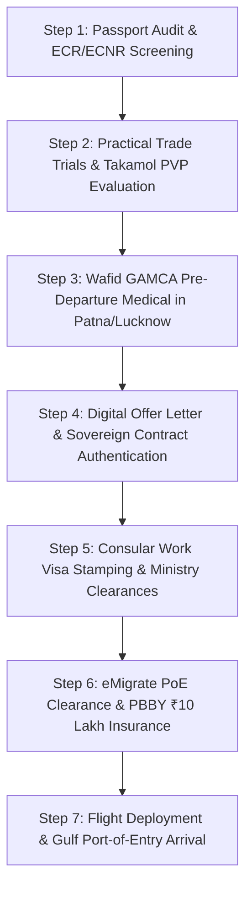

# Bihar & UP Gulf Work Visa Master Guide 2026: Official Deployment Process, MEA eMigrate Rules, Wafid GAMCA Medical & Scam Protection

**Bihar (Patna, Siwan, Gopalganj, Chhapra, Muzaffarpur, Darbhanga, Gaya, Bhagalpur)** and **Eastern Uttar Pradesh (Gorakhpur, Deoria, Azamgarh, Basti, Kushinagar, Mau, Lucknow, Varanasi)** represent the primary economic powerhouse of India’s overseas workforce across the **Gulf Cooperation Council (GCC)**. Every year, hundreds of thousands of certified trade technicians, 6G/3G welders, heavy commercial drivers, building electricians, commercial plumbers, scaffolders, and industrial construction helpers migrate from these regions to secure tax-free livelihoods in **Saudi Arabia, the United Arab Emirates (Dubai/Abu Dhabi), Qatar, Kuwait, Oman, and Bahrain**.

However, this massive labor corridor is also heavily targeted by **unregistered sub-agents, middleman networks, and predatory visa rackets**. Deceptive practices—such as dispatching job seekers on short-term tourist visas, circulating fabricated WhatsApp offer letters, extorting inflated medical fees, and locking candidates into unapproved supply contracts—continue to cost rural families their life savings.

This authoritative master guide by **WorkWise Visa** delivers an end-to-end statutory roadmap for job seekers across Bihar and Eastern UP:
- The **7-step legal deployment pipeline** from preliminary trade evaluation to international flight departure.
- The **Ministry of External Affairs (MEA) eMigrate 2.0 regulations** governing ECR versus ECNR passport holders.
- **Wafid (GAMCA) medical examination protocols**, approved lab centers in Patna and Lucknow, and preventive measures against the dreaded 2-year GCC medical ban.
- Real-time online verification workflows for **Saudi Qiwa digital contracts** and **UAE MOHRE offer letters**.
- The **Top 5 warning signs** of fraudulent recruitment agents.
- Verified 2026 salary scales, overtime benchmarks, and statutory employee protections under GCC labour laws.

---

## WorkWise Visa: Authorized Regional Support & Document Verification Hubs

Candidates and corporate recruitment partners across Bihar and Eastern Uttar Pradesh do not need to rely on unauthorized village sub-agents. Visit our authorized regional verification centers for verified documentation, practical trade trials, and eMigrate counseling:

- **[Patna Corporate Branch (Bihar)](/locations/patna)** — 6th Floor, Office No. 606, Varma Centre, Boring Road Crossing, Sri Krishna Puri, Patna, Bihar 800001. Hotline: +91 81301 61603.
- **[Noida Corporate HQ (Delhi NCR)](/locations/noida)** — Urbtech Trade Centre, D-701 C, Sector 132, Noida, Uttar Pradesh 201304.
- **[Siwan Regional Support Desk](/locations/siwan)** — Fast-track trade evaluation for Mairwa, Barharia, Maharajganj, and Siwan rural centers.
- **[Gopalganj Candidate Hub](/locations/gopalganj)** — Document vetting for Mirganj, Kuchaikote, Thawe, and Gopalganj aspirants.
- **[Gorakhpur Branch (Purvanchal Desk)](/locations/gorakhpur)** — Dedicated overseas placement for Gorakhpur, Deoria, Kushinagar, and Maharajganj.
- **[Lucknow Regional Office (UP)](/locations/lucknow)** — Alambagh & Hazratganj service desk for central Uttar Pradesh candidates.
- **[Muzaffarpur Hub](/locations/muzaffarpur)** | **[Chhapra Desk](/locations/chhapra)** | **[Darbhanga Office](/locations/darbhanga)** | **[Gaya Branch](/locations/gaya)** | **[Bhagalpur Desk](/locations/bhagalpur)**
- **Explore Destination Hubs & Vacancies:**
  - **[Live Verified Overseas Job Vacancies](/jobs)** — Browse active employer demands for civil construction, MEP trades, heavy transport, and facility management.
  - **[Track Your Visa Status Live](/track)** — Real-time tracking for medical fitness, biometric appointments, and consular visa stamping.
  - **[Saudi Arabia Work Visa Guide](/countries/saudi-arabia)** | **[UAE & Dubai Work Visa Guide](/countries/uae)** | **[Qatar Work Visa Guide](/countries/qatar)**

---

## 1. Master Directory: Official Sovereign Portals for Document Verification

Before paying any administrative processing fees, candidates must verify employer accreditation, work permits, and visa validity through the official digital platforms established by the respective sovereign governments:

| Sovereign Authority & Jurisdiction | Official Digital Portal | Primary Mobile App | Core Verification Functions |
| :--- | :--- | :--- | :--- |
| **India: MEA eMigrate** | [emigrate.gov.in](https://emigrate.gov.in) | **eMigrate App** | Recruiting Agent (RA) license validity, Foreign Employer (FE) accreditation, PoE clearance |
| **Saudi Arabia: Ministry of HR (Qiwa)** | [qiwa.sa](https://qiwa.sa) | **Qiwa App** | Digital employment contracts, basic wages, housing allowance, authenticated profession |
| **Saudi Arabia: Muqeem Portal** | [muqeem.sa](https://muqeem.sa) | **Muqeem App** | Work visa issuance status, single-entry employment validity, official entry prints |
| **UAE: Ministry of Human Resources (MOHRE)** | [mohre.gov.ae](https://mohre.gov.ae) | **MOHRE UAE App** | MB-1 electronic offer letter, 14-digit labor contract number, quota approval validation |
| **UAE: Federal Identity & Citizenship (ICP)** | [smartservices.icp.gov.ae](https://smartservices.icp.gov.ae) | **UAEICP App** | 60-day electronic employment entry visa, file status, overstay fines |
| **Qatar: Ministry of Interior (MOI)** | [moi.gov.qa](https://portal.moi.gov.qa) | **Metrash2** | Visa approval status, QVC medical result, QID civil identity card validation |
| **GCC Health Council (GAMCA / Wafid)** | [wafid.com](https://wafid.com) | **Wafid Online** | Original diagnostic appointment slips, electronic \"FIT\" / \"UNFIT\" certificates |

---

## 2. Unregulated Sub-Agent Scams: Top 5 Red Flags to Watch Out For

Unlicensed intermediaries across rural districts frequently exploit prospective candidates through the following deceptive patterns:

### Red Flag 1: The \"Visit Visa\" or \"Tourist Visa\" Trap
Unregistered agents often persuade candidates: *\"Travel on a 30-day or 60-day tourist visa to Dubai, Sharjah, or Riyadh first; the company will convert it to an employment visa upon arrival.\"*
- **The Reality:** Working on a tourist, visit, or transit visa is strictly illegal under GCC immigration statutes. If apprehended during an unannounced Ministry of Labour or CID inspection, the worker faces immediate detention, criminal fines, and a **permanent lifetime entry ban (blacklisting) across all GCC member states**. Genuine work permits must always originate as an **Employment Entry Visa** issued prior to departing India.

### Red Flag 2: Counterfeit WhatsApp PDF Offer Letters
Agents share colorful PDF letters displaying logos of high-profile multinational conglomerates (e.g., Saudi Aramco, ADNOC, Binladin Group, or Drake & Scull) promising unrealistic basic wages of ₹80,000 to ₹1,50,000 for semi-skilled trades.
- **The Reality:** Authentic GCC job offers are never issued via generic graphic templates. In Saudi Arabia, contracts are generated directly inside the sovereign **Qiwa digital portal** and require OTP validation by the worker. In the UAE, the contract is issued on the standardized **MOHRE MB-1 bilingual format** bearing a verifiable 14-digit government barcode.

### Red Flag 3: Unregulated Cash Demands via Personal UPI Without Tax Invoices
Unregistered recruiters demand cash deposits or personal digital transfers (Google Pay, PhonePe) into individual bank accounts without providing a legally binding recruitment agreement or serialized GST tax invoice.
- **The Reality:** Licensed recruitment agencies operating under the Indian Emigration Act 1983 process all financial transactions through corporate corporate accounts accompanied by serialized tax invoices clearly detailing statutory charges.

### Red Flag 4: Inflated Wafid (GAMCA) Appointment Charges
Agents routinely charge rural candidates between ₹12,000 and ₹18,000 for \"booking a government medical appointment.\"
- **The Reality:** The statutory booking fee for an electronic Wafid appointment slip on **[wafid.com](https://wafid.com)** is fixed at **$10 USD (approximately ₹850 INR)**, while the approved medical screening fee at accredited diagnostic clinics is capped at standard institutional rates (typically ₹5,500 to ₹6,500 INR).

### Red Flag 5: Coercive Passport Retention (Confiscation)
Unscrupulous sub-agents hold candidates' original passports under the guise of \"document checking\" and subsequently demand exorbitant cancellation fees (₹25,000 to ₹50,000) if the worker attempts to withdraw from an unverified deployment.
- **The Reality:** Confiscating or retaining another citizen's passport is a criminal offense under Section 12 of the Indian Passports Act 1967. Candidates should never surrender original passports without receiving a physical, stamped acknowledgment receipt from an authorized MEA agency.

---

## 3. The Official 7-Step Gulf Work Visa Deployment Roadmap (2026 Framework)

A genuine overseas deployment conducted through an authorized MEA-registered agency follows a transparent, phased lifecycle:

### Step 1: Passport Audit & Emigration Category Determination
Before initiating documentation, the candidate's passport is audited:
- **ECR Status (Emigration Check Required):** Assigned to citizens who have not submitted a verified Class 10 (Matriculation) pass certificate to the Regional Passport Office (RPO).
- **ECNR Status (Non-ECR):** Granted to candidates who have passed Class 10 or higher, or who have completed three or more cumulative years of documented overseas employment.
- **Crucial Rule:** ECR passport holders traveling for employment to 18 notified countries (including all GCC states) **must obtain statutory clearance through the Protector of Emigrants (PoE) via the MEA eMigrate portal**.

### Step 2: Practical Trade Testing & Skill Verification (Takamol PVP)
Technical workers (pipefitters, 6G welders, industrial electricians, scaffolders, and commercial drivers) complete practical competency evaluations:
- **Saudi Arabia Deployment:** Mandatory practical testing through the **Takamol Professional Verification Program (PVP)** at accredited centers in Patna or New Delhi. Testing validates blueprint interpretation, three-phase electrical termination, or root-run pipe welding.
- **Driver Recruitment:** Evaluation on heavy articulated vehicle tracks, hydraulic checks, and reverse maneuvers.

### Step 3: Wafid (GAMCA) Medical Examination
The candidate generates an appointment slip via **[wafid.com](https://wafid.com)** ($10 USD fee) and attends an accredited diagnostic clinic in **Patna** (Boring Road / Kankarbagh) or **Lucknow** (Charbagh / Alambagh). Comprehensive serological testing (HIV, Hepatitis B & C, VDRL) and high-resolution digital chest radiography (tuberculosis screening) are performed. The electronic \"FIT\" certificate is synchronized into sovereign GCC immigration servers within 24 to 48 hours.

### Step 4: Digital Contract Generation (Qiwa & MOHRE MB-1)
The sponsoring foreign enterprise issues an electronic employment agreement:
- **Saudi Arabia:** Sponsoring entities submit the contract via **[qiwa.sa](https://qiwa.sa)**. The candidate reviews the designated trade, basic salary, overtime scale, and housing terms on their smartphone and accepts via OTP.
- **United Arab Emirates:** The employer generates an official **MOHRE MB-1 bilingual offer letter** that the candidate signs prior to entry permit filing.

### Step 5: Consular Visa Stamping & Electronic Entry Permits
Following contract authentication and medical approval, the respective foreign ministry issues the official entry document:
- **Saudi Arabia:** Electronic employment visa stamped via the MOFA consular portal.
- **United Arab Emirates:** Digital 60-day Employment Entry Permit generated through ICP or GDRFA.
- **Qatar:** Approval registered through the Qatar Visa Center (QVC) platform.

### Step 6: MEA eMigrate PoE Clearance & PBBY ₹10 Lakh Insurance
For ECR passport holders, the authorized recruitment agency submits the foreign employer's authenticated demand on **[emigrate.gov.in](https://emigrate.gov.in)**:
- The Protector of Emigrants (PoE) issues digital emigration clearance.
- A mandatory **Pravasi Bharatiya Bima Yojana (PBBY)** insurance policy is issued (costing approximately ₹375 INR for 2 years of coverage), providing **₹10 Lakh in statutory financial protection** in the event of accidental death or permanent disability abroad.

### Step 7: Flight Deployment & Overseas Induction
The candidate departs via scheduled international flights (e.g., from Patna/Lucknow via Delhi/Mumbai to Muscat, Dubai, Doha, or Riyadh). Upon arrival, the employer's public relations officer (*Mandoob*) facilitates port-of-entry immigration clearance, camp room allocation, and issuance of local civil identity cards (Emirates ID, Saudi Iqama, or Qatar ID).

---

## 4. Wafid Medical Diagnostics: Essential Guidelines for Bihar & UP Candidates

A medical disqualification (*UNFIT* certificate) on **wafid.com** automatically triggers a **2-year entry ban across all GCC countries**. Candidates must exercise extreme caution:

1. **Healed Childhood Pulmonary Scars:** In rural North India, many candidates who contracted mild respiratory infections or healed pneumonia in childhood carry small, benign calcified nodules or fibrous lung scars. While clinically harmless, diagnostic radiologists at Wafid labs frequently issue an *UNFIT* verdict due to rigid screening criteria.
   - **The WorkWise Safety Recommendation:** Before booking an official Wafid appointment, candidates should complete an **independent pre-medical chest X-ray (costing ₹400–₹500 INR)** at a reputable local diagnostic hospital in Patna, Siwan, or Gorakhpur. If an old scar is detected, an accredited pulmonologist can review the radiography before any data is permanently submitted to GCC sovereign databases.
2. **Hypertension & Elevated Fasting Glucose:** Candidates must maintain normal hydration and avoid heavy stimulants or fatty meals immediately prior to the medical appointment.
3. **Elevated Liver Enzymes (SGOT/SGPT):** Elevated transaminases can indicate temporary liver strain; staying properly hydrated and adopting a clean diet for 5–7 days before testing is strongly recommended.

---

## 5. In-Demand GCC Vocational Trades & Verified Salary Matrix 2026

The table below presents verified, legally protected salary scales for skilled and semi-skilled trades across premier contracting, EPC, and facility management firms in the Gulf:

| Trade Designation | Technical Competencies & Qualifications | UAE (Dubai) Monthly | Saudi Arabia Monthly | Qatar Monthly | Est. Monthly Family Savings (INR ₹) |
| :--- | :--- | :--- | :--- | :--- | :--- |
| **Heavy Trailer / Articulated Driver** | Valid GCC or Indian Heavy Transport License | 2,400 – 3,200 AED | 2,500 – 3,500 SAR | 2,600 – 3,600 QAR | **₹58,000 – ₹82,000 / mo** |
| **Light Commercial / Delivery Driver**| Valid Indian Driving License + 2 Yrs Exp | 1,800 – 2,400 AED | 1,900 – 2,600 SAR | 2,000 – 2,700 QAR | **₹44,000 – ₹60,000 / mo** |
| **6G TIG & MIG Pressure Pipe Welder** | 6G ASME Section IX X-Ray Root Penetration | 2,200 – 3,400 AED | 2,400 – 3,600 SAR | 2,500 – 3,800 QAR | **₹60,000 – ₹88,000 / mo** |
| **Industrial / Building Electrician** | DB termination, conduit running, cable trays | 1,700 – 2,500 AED | 1,800 – 2,700 SAR | 1,900 – 2,800 QAR | **₹42,000 – ₹64,000 / mo** |
| **Commercial Plumber & Pipefitter** | PPR/PVC drainage risers, chilled water loops | 1,600 – 2,300 AED | 1,700 – 2,500 SAR | 1,800 – 2,600 QAR | **₹40,000 – ₹58,000 / mo** |
| **Certified Scaffolder (CISRS/Takamol)**| Tube-coupler erection, safety harness audit | 1,700 – 2,400 AED | 1,800 – 2,600 SAR | 1,900 – 2,700 QAR | **₹42,000 – ₹62,000 / mo** |
| **Finishing Mason (Tile & Marble)** | Laser-aligned ceramic/granite installation | 1,500 – 2,200 AED | 1,600 – 2,400 SAR | 1,700 – 2,500 QAR | **₹38,000 – ₹56,000 / mo** |
| **Shuttering Carpenter** | Structural formwork, beam & column framing | 1,500 – 2,200 AED | 1,600 – 2,400 SAR | 1,700 – 2,500 QAR | **₹38,000 – ₹56,000 / mo** |
| **Civil & MEP Construction Helper** | Material handling, concrete curing assistance | 1,100 – 1,400 AED | 1,200 – 1,500 SAR | 1,200 – 1,600 QAR | **₹28,000 – ₹36,000 / mo** |

*All legitimate employment contracts include free furnished air-conditioned company accommodation, duty site transportation, comprehensive medical health insurance, and return air tickets.*

---

## 6. Frequently Asked Questions (FAQ)

#### Q1: Can an individual migrate for Gulf employment with an ECR passport (without passing Class 10)?
**Answer:** Yes. Non-matriculate citizens holding ECR passports are fully eligible to work across all GCC countries. The statutory requirement is that the recruitment must be conducted through an authorized MEA-licensed recruiting agent, who coordinates mandatory **eMigrate PoE (Protector of Emigrants) clearance** prior to flight departure.

#### Q2: Why is it dangerous to travel to the Gulf on a visit or tourist visa for employment?
**Answer:** Working on a tourist, visit, or transit visa is an immigration offense in all GCC member states. Workers apprehended on job sites without a valid employment entry permit face immediate imprisonment, heavy financial fines, and permanent deportation accompanied by a **lifetime GCC immigration blacklist**. Genuine employment visas are always processed prior to leaving India.

#### Q3: How can a candidate verify whether their Gulf work visa is authentic?
**Answer:** 
- **Saudi Arabia:** Visit [muqeem.sa](https://muqeem.sa) and input your passport number and date of birth to confirm visa validity.
- **United Arab Emirates:** Visit [smartservices.icp.gov.ae](https://smartservices.icp.gov.ae), navigate to \"Passport Information\", and verify your file status.
- Alternatively, submit your documents to WorkWise Visa via WhatsApp at **+91 81301 61603** for complimentary legal verification.

#### Q4: Where are the authorized Wafid (GAMCA) diagnostic centers located in Bihar and Eastern UP?
**Answer:** In Bihar, accredited Wafid diagnostic clinics operate in **Patna** across Boring Road, Kankarbagh, and Fraser Road. In Eastern Uttar Pradesh, accredited diagnostic labs are situated in **Lucknow** (Charbagh, Alambagh, and Hazratganj) and **Varanasi**.

#### Q5: Where are WorkWise Visa’s primary corporate offices located?
**Answer:** 
- **Patna Regional Office:** 6th Floor, Office No. 606, Varma Centre, Boring Road Crossing, Sri Krishna Puri, Patna, Bihar 800001.
- **Noida Corporate HQ:** Urbtech Trade Centre, D-701 C, Sector 132, Noida, Uttar Pradesh 201304.
- Official Helpline / WhatsApp: **+91 81301 61603**.

#### Q6: What are the average monthly food and mess expenses in Gulf labor accommodation?
**Answer:** Most contracting enterprises provide furnished communal kitchens with gas connections. Groups of 6 to 10 colleagues typically organize a room mess pooling approximately **200 to 250 AED/SAR (₹4,500 to ₹5,500 INR)** per person per month for groceries, allowing workers to remit the vast majority of their base pay and overtime earnings to India.

#### Q7: What is the Pravasi Bharatiya Bima Yojana (PBBY) and what benefits does it provide?
**Answer:** The PBBY is a statutory insurance program mandated by the Government of India for all ECR passport holders deployed through eMigrate. Costing approximately ₹375 INR for a 2-year term, it provides **₹10 Lakh in financial coverage** to the worker's family in the event of accidental death or permanent disability abroad.

#### Q8: What does the Saudi Takamol Skill Verification Program (SVP) evaluate?
**Answer:** The Takamol SVP is a mandatory trade competency assessment required by the Saudi Ministry of Human Resources. Electricians, welders, mechanics, and plumbers complete practical bench simulations evaluating safety, tool handling, and trade blueprints at accredited test centers before their work visas can be approved.

#### Q9: What statutory protections exist if an employer delays salary payments in the Gulf?
**Answer:** Under the **Wage Protection System (WPS)** enforced across the GCC, all corporate employers must disburse wages electronically into workers' registered bank accounts. If an employer defaults for two consecutive months, the worker has the statutory right to transfer sponsorship to a new employer without requiring the sponsor's consent or release papers.

#### Q10: What documents are required to register for overseas vacancies through WorkWise Visa?
**Answer:** 
1. Original Passport with a minimum of 8 months of remaining validity.
2. 16 passport-size photographs (white background, matte finish).
3. Previous trade experience certificates or vocational diplomas (if applicable).
4. Valid commercial driving license (for heavy and light driver roles).
Register online through our [Jobs Portal](/jobs) or connect directly with our document advisors via WhatsApp.
