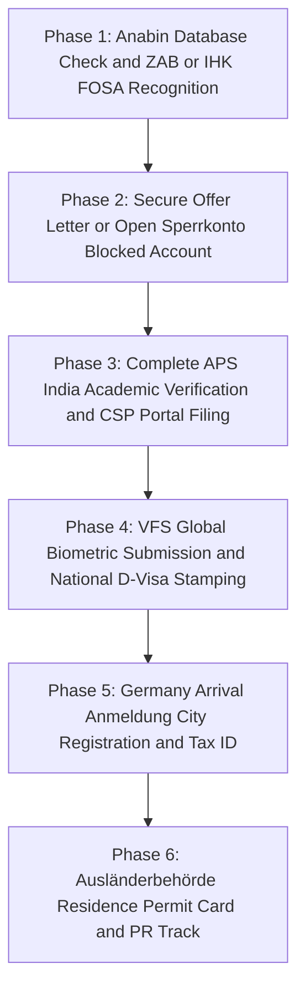

# Germany Work Visa & Opportunity Card (Chancenkarte) Complete Guide 2026: EU Blue Card €50,700 Threshold, 6-Point System, Sperrkonto (€1,091/mo), ZAB Recognition & VFS India

Germany—Europe's largest industrial economy and engineering powerhouse—is experiencing a structural demographic shortage exceeding 1.8 million vacant roles across manufacturing, IT, civil engineering, healthcare, logistics, and skilled vocational trades. Under the **Modernized Skilled Immigration Act (*Fachkräfteeinwanderungsgesetz*)** and the historic India-Germany Migration and Mobility Partnership Agreement, Indian professionals and certified trade workers now benefit from streamlined digital processing via the **Consular Services Portal (CSP)** and expanded annual national visa allocations.

In 2026, Germany's work immigration ecosystem centers around four primary legal pillars: the **Opportunity Card (*Chancenkarte* § 20a)** for jobseekers traveling without a prior contract, the **EU Blue Card (§ 18g)** with updated 2026 gross salary thresholds (**€50,700 standard / €45,934.20 shortage**), the **Vocational Skilled Worker Visa (§ 18a)** for ITI/diploma tradesmen, and the groundbreaking **Experience-Based Recognition Route (§ 19c Abs. 2)** that allows experienced professionals to deploy without prior formal German degree recognition.

This definitive 2026 master guide provides an exhaustive, authoritative breakdown of the **6-point *Chancenkarte* calculator**, **2026 EU Blue Card salary floors**, **Sperrkonto (€1,091/mo)** financial requirements, **Anabin & ZAB (*Anerkennung*) equivalence protocols**, **APS India verification**, 10 high-demand occupation net salary breakdowns in EUR and INR, and the fast-track 21-month pathway to German **Permanent Residency (*Niederlassungserlaubnis*)**.

---

## 1. Germany's Four Primary Work Immigration Pathways in 2026

Understanding the legal distinction between Germany's four work residence permits ensures candidates apply under the fastest, lowest-barrier statutory category matching their academic and work background:

| Immigration Pathway | Statutory Section | Initial Job Offer Required? | 2026 Minimum Salary / Funds Requirement | Key Eligibility & Advantage |
| :--- | :--- | :--- | :--- | :--- |
| **Opportunity Card (*Chancenkarte*)** | **§ 20a AufenthG** | **No** (12-Month Job Seeker Visa) | **€1,091/mo** Blocked Account (*Sperrkonto*) = **€13,092/yr** | Allows 20 hrs/week part-time work + 2-week trial jobs while interviewing across Germany |
| **EU Blue Card (Standard)** | **§ 18g Abs. 1 AufenthG** | **Yes** (Minimum 6-Month Contract) | **€50,700 gross/yr** (€4,225/mo) | Fast-track PR in **21 months** (with B1 German) or **27 months** (with A1 German) |
| **EU Blue Card (Shortage / STEM / IT)** | **§ 18g Abs. 1 S. 2 AufenthG** | **Yes** (IT, Engineers, Doctors, Teachers) | **€45,934.20 gross/yr** (€3,827.85/mo) | Non-degree IT specialists with 3+ years recent experience qualify! |
| **Vocational Skilled Worker** | **§ 18a AufenthG** | **Yes** (Qualified Non-Academic Trade) | Standard German Collective Wage (Tariflohn) | Requires formal recognition (*Anerkennung*) via IHK FOSA or HWK |
| **Experience-Based Practical Route** | **§ 19c Abs. 2 + § 6 BeschV** | **Yes** (2+ Years Work Experience) | **€43,470+ gross/yr** (or Collective Agreement) | **Bypasses formal German Anerkennung!** Valid with state-recognized degree/diploma from India |

> 📌 **2026 Game Changer for Indians:** Under **Section 19c(2)**, Indian engineers, technicians, and IT specialists with an Indian university degree or 2-year state-recognized vocational qualification and at least 2 years of documented relevant experience no longer have to wait 6–12 months for formal German equivalence (*Anerkennung*), provided their salary satisfies the statutory threshold or collective bargaining (*Tarifvertrag*) rate.

---

## 2. The Opportunity Card (*Chancenkarte*): Complete 6-Point System Breakdown

If you do not yet hold a binding German job offer from an employer in Berlin, Munich, Frankfurt, or Stuttgart, the **Opportunity Card (*Chancenkarte*)** grants you a 1-year residence visa to enter Germany, interview in person, work part-time up to 20 hours per week, and transition seamlessly into a full work permit inside Germany.

### Step 1: Foundational Prerequisite (Compulsory)
Before counting points, you must fulfill **BOTH** baseline requirements:
1. **Qualification:** Completed university degree OR at least 2-year vocational training recognized as state-accredited in India (verified via ZAB Digital Check / Anabin).
2. **Language Baseline:** Minimum **German A1** (Goethe-Zertifikat A1) **OR** **English B2** (IELTS 5.5–6.0 / TOEFL iBT 72+ / Cambridge).

*(Note: Candidates who obtain full official German equivalence—**Volle Anerkennung**—receive the Opportunity Card automatically WITHOUT needing to collect 6 points!)*

### Step 2: The 6-Point Scoring Matrix (For Partial/Unrecognized Qualifications)

| Evaluation Criterion | Qualification Threshold | Points Awarded | Strategic Notes for Indian Applicants |
| :--- | :--- | :--- | :--- |
| **Partial Recognition (*Teilanerkennung*)** | Official German agency notice confirming partial equivalence or missing practical modules | **4 Points** | Ideal for nurses, electricians, and mechanics undergoing *Anerkennung* |
| **Shortage Occupation (*Engpassberuf*)** | Qualification falls in STEM, engineering, IT, construction, logistics, or healthcare | **1 Point** | Covers almost all engineering, medical, and technical trades |
| **Work Experience (Tier 1)** | Minimum **5 years** of relevant professional experience within the last 7 years | **3 Points** | Supported by employer reference letters and tax/EPFO records |
| **Work Experience (Tier 2)** | Minimum **2 years** of relevant professional experience within the last 5 years | **2 Points** | Easy to verify via pay slips and experience letters |
| **German Language Proficiency** | **B2 Level** (**3 pts**) / **B1 Level** (**2 pts**) / **A2 Level** (**1 pt**) | **1 – 3 Points** | Goethe-Institut / ÖSD / telc certificate required |
| **English Language Proficiency** | **C1 Level** (IELTS 7.0+ or equivalent native/degree proof) | **1 Point** | Extra bonus point on top of basic B2 entry requirement |
| **Applicant Age** | Age **35 years or under** (**2 Points**) / Age **36 to 40 years** (**1 Point**) | **1 – 2 Points** | Evaluated on exact date of visa application submission |
| **Prior Legal Stay in Germany** | At least 6 consecutive months prior lawful stay (study/work, excluding tourism) | **1 Point** | Must hold previous German residence stamps/Anmeldung |
| **Spouse / Partner Qualification** | Spouse also qualifies for Opportunity Card and applies simultaneously | **1 Point** | Boosts dual-income household immigration scores |

**Typical High-Score Profile Example for an Indian Engineer/Technician:**
- 3+ Years Experience (**2 pts**) + Age 29 (**2 pts**) + Shortage STEM/Tech Field (**1 pt**) + English C1 (**1 pt**) = **6 Points (Instant Pass without needing German B1!)**

---

## 3. Financial Requirements: *Sperrkonto* (€1,091/mo) & Part-Time Work Math

For the **Opportunity Card (*Chancenkarte*)**, applicants must prove they can sustain their living costs in Germany for up to 12 months without relying on German social welfare (*Bürgergeld*):

### 1. The Blocked Account (*Sperrkonto*)
- **2026 Monthly Statutory Rate:** **€1,091 per month** (updated from €1,027 to reflect cost-of-living indexation).
- **12-Month Full Block Requirement:**
$$	ext{Total Blocked Funds} = 12 	imes €1,091 = €13,092 approx 	ext{₹12,05,000 INR}$$
- Approved digital blocked account providers accepted by the German Embassy in New Delhi and Consulates in Mumbai, Bengaluru, Chennai, and Kolkata include **Expatrio**, **Coracle**, and **Fintiba**.
- Every month after arrival in Germany, €1,091 is automatically released to your German current account (*Girokonto*).

### 2. Reducing *Sperrkonto* via a Part-Time Job Offer
Under 2026 rules, if you already hold a signed part-time job offer in Germany (up to 20 hours/week) paying €1,091 net/month—or if a relative/friend residing in Germany signs a formal **Declaration of Commitment (*Verpflichtungserklärung*)** at their local *Ausländerbehörde*—your €13,092 *Sperrkonto* requirement can be **reduced or completely waived**.

Comparing European job-seeker and work pathways? Read our detailed guides on the [France Work Visa VLS-TS Salarié Master Guide](/blogs/france-work-visa-for-indian-workers-2026-vls-ts-salarie-dreets-smic-salary-vfs), the [Croatia 3-Year MUP Work Permit Guide](/blogs/croatia-work-visa-for-indian-workers-2026-mup-permit-vfs-jobs-salary), and the [Poland Voivodeship Work Permit Guide](/blogs/poland-work-visa-for-indian-workers-2026-voivodeship-permit-vfs-jobs-salary).

---

## 4. Official Step-by-Step Germany Work Visa Deployment Pipeline

Germany has fully digitized initial visa screening across India through the **Federal Foreign Office Consular Services Portal (*Auslandsportal*)**. The roadmap below maps the exact end-to-end sequence:

---

## 5. In-Depth Phase Breakdown: From India to Germany

### Phase 1: Anabin Database Verification & ZAB / IHK Recognition
Before filing any German visa, verify your academic or trade credentials:
1. **University Degrees (Blue Card / § 18b):** Search the official **[Anabin Database](https://anabin.kmk.org)**.
   - Your Indian university must hold an **"H+"** status.
   - Your specific degree title (e.g., B.Tech Computer Science, B.E. Mechanical) must match **"Entspricht"** (Equivalent).
   - If your university is H+ but your exact degree title is unlisted, apply online to the **Central Office for Foreign Education (ZAB)** for a **Statement of Comparability (*Zeugnisbewertung*)** (Fee: €208, processing: 2 weeks for Blue Card applicants).
2. **Vocational Trades (§ 18a):** Electricians, plumbers, welders, and mechanics apply for formal equivalency (*Anerkennung*) through **[IHK FOSA](https://www.ihk-fosa.de)** (Chambers of Commerce) or the local Crafts Chamber (*Handwerkskammer - HWK*).

### Phase 2: Securing Employment Contract OR Blocked Account (*Sperrkonto*)
- **Employer Contract (*Arbeitsvertrag*):** For Blue Card / § 18a / § 19c(2), the German employer completes the **Declaration of Employment (*Erklärung zum Beschäftigungsverhältnis*)**, specifying gross annual salary, job duties, and weekly hours (typically 38–40 hours).
- **Pre-Approval (*Vorabzustimmung*):** For fastest processing, the German employer requests an accelerated pre-approval from the **Federal Employment Agency (*Bundesagentur für Arbeit - BA*)** inside Germany before you even book a VFS appointment in India.

### Phase 3: APS India Academic Verification & Consular Services Portal (CSP)
- **APS India Certificate:** Wait—who needs APS? While APS is strictly mandatory for Indian students, certain skilled worker visa filings and Opportunity Card applications with Indian university degrees may utilize APS India verification or ZAB Statements to certify Indian degree authenticity. Check the latest checklist on the [German Missions in India Portal](https://india.diplo.de).
- **CSP Online Filing:** Upload your passport, ZAB/Anabin printouts, employment declaration (or *Sperrkonto* confirmation), health insurance (Incoming Travel Insurance), and Police Clearance Certificate directly on the official **[Consular Services Portal (digital.diplo.de)](https://digital.diplo.de)**. Case officers pre-check your PDF documents digitally, eliminating paper rejections at the embassy!

### Phase 4: VFS Global Biometrics & National D-Visa Stamping
- Once the Consular Services Portal confirms your documents are complete, you book an in-person biometric appointment at your assigned **VFS Global Germany Visa Center** (New Delhi, Mumbai, Bengaluru, Chennai, Hyderabad, or Kolkata).
- You submit original fingerprints and your Indian passport. Standard processing takes **2 to 6 weeks** (or **1 to 3 weeks** with Fast-Track § 81a Employer Pre-Approval).
- Your passport is stamped with a **National Category D Visa** (typically valid 6 to 12 months).

### Phase 5: Arrival in Germany, *Anmeldung* & Health Insurance
Within **14 days** of landing in Frankfurt, Munich, or Berlin:
- **City Registration (*Anmeldung*):** Visit the local *Bürgeramt* with your landlord's confirmation (*Wohnungsgeberbestätigung*) to register your residential address.
- **Tax ID (*Steuer-ID*) & Pension Number:** Automatically mailed to your registered address within 2 weeks, enabling payroll activation (Tax Class I for singles, Tax Class III/V for married couples).
- **Statutory Health Insurance (*Krankenkasse*):** Transition from travel insurance to German public health insurance (**TK - Techniker Krankenkasse**, **AOK**, or **Barmer**), split 50/50 between employer and employee.

### Phase 6: *Ausländerbehörde* Residence Card & PR Track
- Before your initial D-Visa expires, visit your city's **Foreigners' Authority (*Ausländerbehörde*)** to collect your chip-enabled **Electronic Residence Permit (*eAT - Elektronischer Aufenthaltstitel*)** valid for up to **4 years** (Blue Card / § 18a) or the duration of your contract.

---

## 6. 2026 German Occupation Salary Benchmarks (Gross EUR, Net EUR & Net INR)

Germany utilizes progressive income taxation (14% to 42%) plus mandatory social security contributions (health, pension, nursing care, unemployment—approx. 20% employee share). The table below outlines real-world 2026 compensation under **Tax Class I (Single Taxpayer)** alongside net Indian Rupee conversion:

| Occupation / Technical Role | Visa Category | Gross Annual Salary (EUR) | Gross Monthly (EUR) | Net Monthly Take-Home (EUR) | Net Monthly Take-Home (INR) |
| :--- | :--- | :--- | :--- | :--- | :--- |
| **Senior Software / AI Engineer** | EU Blue Card (Shortage) | **€64,000 – €85,000** | €5,333 – €7,083 | **€3,310 – €4,220 / mo** | **₹304,500 – ₹388,000** |
| **Mechanical / Robotics Engineer** | EU Blue Card (Shortage) | **€54,000 – €72,000** | €4,500 – €6,000 | **€2,880 – €3,650 / mo** | **₹265,000 – ₹335,800** |
| **Registered Nurse (*Pflegefachkraft*)** | § 18a Skilled Trade | **€38,000 – €46,000** | €3,166 – €3,833 | **€2,180 – €2,520 / mo** | **₹200,500 – ₹231,800** |
| **Industrial Electrician / Mechatronics** | § 18a / § 19c(2) | **€40,000 – €50,000** | €3,333 – €4,166 | **€2,270 – €2,700 / mo** | **₹208,800 – ₹248,400** |
| **CNC Machinist & Toolmaker** | § 18a / § 19c(2) | **€39,000 – €48,000** | €3,250 – €4,000 | **€2,220 – €2,610 / mo** | **₹204,200 – ₹240,100** |
| **6G / TIG Structural Welder** | § 18a Skilled Trade | **€38,000 – €46,000** | €3,166 – €3,833 | **€2,180 – €2,520 / mo** | **₹200,500 – ₹231,800** |
| **Heavy Commercial Truck Driver (CE)** | § 19c + § 24a BeschV | **€36,000 – €44,000** | €3,000 – €3,666 | **€2,080 – €2,440 / mo** | **₹191,300 – ₹224,500** |
| **HVAC / Heat Pump Technician** | § 18a Skilled Trade | **€40,000 – €49,000** | €3,333 – €4,083 | **€2,270 – €2,650 / mo** | **₹208,800 – ₹243,800** |
| **Civil Site Engineer / Architect** | EU Blue Card (Shortage) | **€50,000 – €65,000** | €4,166 – €5,416 | **€2,700 – €3,350 / mo** | **₹248,400 – ₹308,200** |
| **Automotive Diagnostic Specialist** | § 18a / § 19c(2) | **€39,000 – €47,000** | €3,250 – €3,916 | **€2,220 – €2,560 / mo** | **₹204,200 – ₹235,500** |

*Note: Calculations based on 1 EUR ≈ ₹92 INR. Married employees transitioning to Tax Class III after bringing their spouse receive an additional €350 to €550 net per month due to German spousal tax splitting (*Ehegattensplitting*).*

For comparison across high-demand English-speaking or Gulf destinations, review our [UK Skilled Worker Visa 70-Point Master Guide](/blogs/uk-skilled-worker-visa-complete-guide-2026-70-points-defined-cos-salary-list-ilr), our [Australia Skills in Demand Subclass 482 Guide](/blogs/australia-skills-in-demand-visa-subclass-482-complete-guide-2026-jobs-salary-tra-pr), and our [PCC & MEA Apostille Master Guide](/blogs/police-clearance-certificate-pcc-gulf-european-visas-psk-apostille-guide-2026).

---

## 7. Accelerated Path to Permanent Residency & German Citizenship

Germany offers one of the fastest statutory pathways to permanent residency (*Niederlassungserlaubnis*) and dual citizenship in Europe:

1. **EU Blue Card Fast-Track PR:**
   - **21 Months** of qualified employment + German Language **Level B1**!
   - **27 Months** of qualified employment + Basic German Language **Level A1**!
2. **Skilled Worker (§ 18a / § 18b) PR:**
   - **36 Months (3 Years)** of holding a skilled work residence permit + 36 months of pension contributions + German **Level B1**.
3. **Dual Citizenship (*Staatsangehörigkeit*) Reform:**
   - Under Germany's modernized Nationality Law, residents can apply for German Citizenship after **5 years** of lawful residence (or **3 years** with C1 German & exceptional integration)—without being forced to renounce their previous nationality where permitted (Note: India currently requires surrender of Indian passport upon acquiring foreign citizenship, with eligibility for an **OCI Card**).

---

## 8. Frequently Asked Questions (FAQs)

### Q1: Can I apply for a Germany Work Visa or Opportunity Card without knowing the German language?

**Answer:** Yes, for two major categories: First, under the **EU Blue Card (§ 18g)**, there is legally zero German language requirement to obtain your visa—fluent English used in your engineering, IT, or corporate role is sufficient. Second, for the **Opportunity Card (*Chancenkarte*)**, you can qualify solely with **English B2** (or C1) proficiency instead of German, provided you achieve at least 6 points through your academic degree, experience, age, and shortage occupation status. However, for vocational trade visas (§ 18a), most employers require German **A2 or B1** for workplace safety.

### Q2: How long does it take to get a German Work Visa appointment at VFS Global India in 2026?

**Answer:** Due to the digital rollout of the **Consular Services Portal (CSP - digital.diplo.de)**, initial PDF verification occurs online within 2 to 4 weeks, eliminating months of physical waitlist delays. Once pre-checked online, VFS Global biometric appointments in New Delhi, Mumbai, Bengaluru, Chennai, and Hyderabad are typically available within **1 to 3 weeks**, and final visa stamping after biometrics takes **10 to 21 working days** (or 5 to 10 days with § 81a Fast-Track).

### Q3: What happens if I do not find a job in Germany within the 12 months of my Opportunity Card?

**Answer:** If you secure a part-time contract or formal job offer near the end of your 12 months that meets partial skilled requirements, you can apply inside Germany to extend your *Chancenkarte* for up to **an additional 2 years (Follow-up Opportunity Card)**, provided you hold a firm qualified employment offer and continue supporting your living expenses without social welfare. If no job offer is secured after 12 months, you must exit Germany before visa expiration.

### Q4: Can I bring my spouse and children to Germany from Day 1, and can my spouse work?

**Answer:** Yes. Holders of an **EU Blue Card**, **§ 18a**, **§ 18b**, or **§ 19c(2)** work visa are legally entitled to bring their spouse and minor children under **Family Reunification (*Familiennachzug*)**. Crucially, spouses of EU Blue Card holders receive **immediate, unrestricted full-time work rights** across Germany and are **100% exempt from the A1 German language test requirement** prior to travel!

### Q5: Is the Blocked Account (*Sperrkonto*) money (€13,092) taken by the German government as a fee?

**Answer:** No! The €13,092 deposited into a *Sperrkonto* (via Expatrio, Coracle, or Fintiba) remains **100% your own personal money**. It is simply locked in a German bank account to prove financial self-sufficiency. Once you land in Germany and complete your city registration (*Anmeldung*), the bank automatically transfers **€1,091 every month** directly into your personal German checking account to pay for your rent, groceries, and transport.

### Q6: Can IT engineers without a university degree get an EU Blue Card in Germany?

**Answer:** Yes. Under the updated **EU Blue Card (§ 18g Abs. 2)** provisions, Information and Communications Technology (ICT) specialists—including software developers, cloud architects, DevOps engineers, and cybersecurity analysts—do **not** require a university degree if they can prove at least **3 years of comparable high-level IT work experience within the last 7 years** and hold a signed German job offer meeting the shortage salary threshold of **€45,934.20 gross per year**.

### Q7: What is the difference between Anabin H+ status and a ZAB Statement of Comparability?

**Answer:** **Anabin** is the free public database maintained by the German Standing Conference of Ministers of Education. If both your Indian university is listed as **H+** and your exact degree name is marked **Entspricht** (Equivalent), printing both Anabin PDF pages costs €0 and satisfies embassy verification. If your university is H+ but your specific degree branch name isn't listed on Anabin, you must apply online to **ZAB (Central Office for Foreign Education)** for an official individual **Statement of Comparability (*Zeugnisbewertung*)**, which costs €208 and is accepted universally.

### Q8: Can I switch employers in Germany after arriving on an EU Blue Card or Work Visa?

**Answer:** Yes, with very flexible 2026 rules. During the **first 12 months** of holding an EU Blue Card, you do not need pre-approval to change jobs, though you must notify your local *Ausländerbehörde*, which verifies that the new job still meets the EU Blue Card salary floor (€50,700 or €45,934.20). After completing **12 months** on an EU Blue Card, you can switch to any qualified employer seamlessly without notifying immigration authorities for permission.

---

## 9. Conclusion: Strategic Checklist for Germany Work Immigration in 2026

Germany provides an unmatched combination of **high net European salaries, statutory worker protections, universal healthcare, free public education for children, and rapid permanent residency**. Whether entering immediately via an **EU Blue Card**, deploying as a skilled tradesman via **§ 18a / § 19c(2)**, or arriving independently on the **Opportunity Card (*Chancenkarte*)**, following official protocols guarantees high approval velocity.

Before lodging your German visa application in India:
1. Verify your institution and degree on **[Anabin](https://anabin.kmk.org)** or secure a **ZAB Statement of Comparability**.
2. Confirm your gross salary contract matches the 2026 thresholds (**€50,700 standard / €45,934.20 shortage**) or fund your **€13,092 *Sperrkonto*** for the *Chancenkarte*.
3. Register your digital profile on the official **[Consular Services Portal (digital.diplo.de)](https://digital.diplo.de)** to eliminate paper errors before your VFS Global biometrics date.

For verified European job opportunities, CV conversion to *Lebenslauf* German formatting, and guided *Anerkennung* support, explore the [WorkWise Visa Job Demand Directory](/jobs) and consult our European mobility advisors today.
