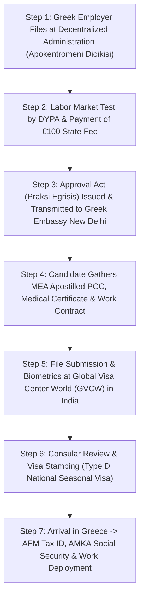

# Greece Seasonal Work Visa (Metaklisi) Complete Guide 2026: Agriculture Jobs, Hotel Staff, Salaries & Consular Process

The European Union's agricultural and tourism powerhouse—**Greece (The Hellenic Republic)**—has emerged as one of the most dynamic destinations for Indian workers seeking legal, seasonal employment abroad. Faced with severe structural labor shortages across its vast agricultural heartlands (Crete, Peloponnese, Thessaly, Macedonia) and world-renowned island tourist resorts (Santorini, Mykonos, Rhodes, Corfu, Kos), the Greek government has overhauled its legal migration channels.

Through the landmark **Greek Immigration Code ([Law 5038/2023](https://migration.gov.gr/en/))** and Article 18 of Law 4251/2014 administered by the **[Ministry of Migration and Asylum](https://migration.gov.gr/en/)**, Greece operates an expedited statutory recruitment mechanism known as **Metaklisi (Μετάκληση)**. This system allows Greek agricultural enterprises, fruit packaging factories, greenhouse complexes, and hotel resorts to legally sponsor third-country nationals (including candidates from India) on a dedicated **[National Long-Stay Visa (Type D) for Seasonal Employment](https://www.mfa.gr/en/visas/visas-for-foreigners-traveling-to-greece/national-visas.html)**.

Crucially, in recent bilateral diplomatic summits, India and Greece reinforced their historic **Migration and Mobility Partnership Agreement**, establishing transparent, government-backed labor mobility corridors designed specifically to eradicate illegal human trafficking, bogus job rackets, and unauthorized intermediaries under the oversight of the **[Ministry of External Affairs (MEA)](https://www.mea.gov.in)** and the **[Embassy of Greece in New Delhi](https://www.mfa.gr/missions-india/en/)**.

This authoritative master manual provides an exhaustive breakdown of the **Greece Seasonal Work Visa for 2026/2027**: eligible trade sectors, statutory minimum wages, the step-by-step Metaklisi approval pipeline, mandatory consular document requirements at **[Global Visa Center World (GVCW)](https://in-gr.gvcworld.eu/)** in India, official government portals, and post-arrival legal registrations.

---

## 1. Statutory Framework: What is the Greece Seasonal Work Visa (Metaklisi)?

A **Greece Seasonal Work Visa** is a specialized National Long-Stay Category D Visa issued to non-EU citizens who enter Greece to perform temporary, seasonal work under a direct, legally binding contract with an authorized Greek employer.

| Regulatory Parameter | Statutory Rule (Immigration Code Law 5038/2023 & Law 4251/2014) | Official Verification Source |
| :--- | :--- | :--- |
| **Official Visa Category** | National Long-Stay Visa (Type D) - Seasonal Employment (*Epohiaki Ergasia*) | [Hellenic MFA National Visas](https://www.mfa.gr/en/visas/visas-for-foreigners-traveling-to-greece/national-visas.html) |
| **Maximum Permitted Stay** | Up to **9 months** within any continuous 12-month period | [Ministry of Migration and Asylum](https://migration.gov.gr/en/) |
| **Multi-Year Seasonal Permit Option** | Up to **5 years** (worker returns annually for up to 9 months per year under the same employer authorization) | [Greek Immigration Code 5038/2023](https://migration.gov.gr/en/) |
| **Governing Greek Authorities** | Ministry of Migration and Asylum, Decentralized Administrations (*Apokentromeni Dioikisi*), DYPA (Public Employment Service) | [DYPA Official Portal](https://www.dypa.gov.gr/) |
| **Application Center in India** | **Global Visa Center World (GVCW)** / Embassy of Greece in New Delhi | [GVCW India Greece Visa](https://in-gr.gvcworld.eu/) |
| **Statutory Minimum Salary (2026)** | **€830.00 – €880.00 per month** (or statutory daily agricultural wage / *Merokamato* ~€38.00–€42.00/day) | [Ministry of Labour & Social Security](https://ypergasias.gov.gr/) |
| **Social Insurance System** | **e-EFKA / OGA** (Statutory health, accident, and pension insurance through *Ergosimo* or payroll) | [e-EFKA Social Security Fund](https://www.efka.gov.gr/) |
| **Tax Registration Authority** | **AADE (Independent Authority for Public Revenue)** for AFM tax number | [AADE Official Portal](https://www.aade.gr/) |
| **Path to Permanent Residency** | **Non-convertible** directly into open permanent residency; worker must depart upon permit expiry or renew seasonally | [EU Directive 2014/36/EU](https://eur-lex.europa.eu/legal-content/EN/TXT/?uri=CELEX%3A32014L0036) |

> [!IMPORTANT]
> **Understanding the 9-Month Cap:** Under European Union Directive 2014/36/EU and Greek domestic law, a seasonal worker is permitted to reside and work in Greece for a maximum cumulative period of **9 months within any rolling 12-month window**. Once the 9 months expire, the worker must return to their country of origin before they can be re-sponsored for the subsequent season.

---

## 2. Eligible Sectors & High-Demand Seasonal Job Roles

The Greek government determines annual seasonal worker quotas (*Kthorismos Ogkou Adeion Diamonis*) allocated across regional Decentralized Administrations based on verified domestic labor market shortages evaluated by the Public Employment Service (**[DYPA - dypa.gov.gr](https://www.dypa.gov.gr/)**).

### A. Agricultural & Agro-Industrial Sector (Highest Volume)
Agriculture represents over 70% of all seasonal permits issued under the Metaklisi system. Major work belts include **Crete (Heraklion, Chania)**, **Peloponnese (Ilia, Laconia, Corinth)**, and **Central Greece (Thessaly, Larissa)**.

* **Olive Harvesting & Pruning:** Greece is the world's third-largest olive oil producer. Peak hiring runs from **October through February**, involving grove maintenance, manual beating/shaking nets, crate transportation, and cold-press mill operations.
* **Citrus & Fruit Picking:** Oranges, lemons, mandolines, peaches, and nectarines across Peloponnese and Arta. Peak periods run through winter and spring.
* **Strawberry & Berry Farming:** Heavy seasonal demands across Western Greece (Manolada and Ilia), running from **November through May**.
* **Greenhouse Cultivation:** Year-round automated and semi-automated vegetable production (tomatoes, cucumbers, peppers) requiring planting, trellising, harvesting, and pest monitoring.
* **Fruit Packaging & Cold Storage Plants:** Sorting, grading, weighing, boxing, palletizing, and forklift loading in agro-processing factories.

### B. Tourism, Hospitality & Food Services (Peak Summer Season)
Greece welcomes over 33 million international tourists annually, creating acute summer labor shortages across the Aegean and Ionian islands:

* **Resort Housekeeping & Hotel Maintenance:** Cleaning guest rooms, linen management, pool maintenance, groundskeeping, and basic facility repair.
* **Kitchen Stewards & Dishwashers:** Commercial kitchen hygiene, pot washing, vegetable preparation, and waste management in high-volume resort kitchens.
* **Baggage Handlers & Logistics Assistants:** Airport-to-resort luggage transfer, warehouse inventory stocking, and resort supply handling.
* **Waitstaff & Food Service Runners:** Table service and replenishment in beachfront tavernas, hotel buffets, and resort beach clubs.

### C. Aquaculture, Fisheries & Animal Husbandry
* **Fish Farm Technicians & Deckhands:** Feeding, net cleaning, monitoring, and harvesting in coastal sea bass and sea bream aquaculture facilities across the Aegean coast.
* **Dairy & Livestock Farming:** Sheep and goat milking, fodder preparation, livestock barn hygiene, and cheese production support in regional farms.

---

## 3. Wages, Working Hours, Overtime & Accommodation Rules

Workers migrating under the Greek Seasonal Work Permit benefit from full protection under Greek statutory labor legislation administered by the **[Ministry of Labour and Social Security (ypergasias.gov.gr)](https://ypergasias.gov.gr/)** and European labor standards.

### A. Statutory Minimum Wages (2026 Standards)
The Hellenic Ministry of Labour and Social Security enforces a unified national minimum wage:
* **Monthly Base Rate (Full-Time):** **€830.00 to €880.00 gross per month** for standard 40-hour workweeks.
* **Daily Agricultural Wage (*Merokamato*):** Approximately **€37.50 to €42.00 gross per legal working day**.
* **Net Take-Home Pay:** After statutory social security withholdings ([e-EFKA](https://www.efka.gov.gr/) employee contribution of ~13.87%), net cash earnings typically stand at **€715.00 to €760.00 per month**.
* **Piece-Rate / Productivity Bonuses:** In fruit harvesting (e.g., olive and citrus picking), workers often earn piece-rate pay per crate harvested, allowing motivated workers to earn **€1,100 to €1,400+ per month** during peak harvest months.

### B. Standard Working Hours & Overtime Premiums
* **Standard Working Week:** 40 hours per week (typically 5 days of 8 hours, or 6 days of 6 hours 40 minutes in agriculture).
* **Overtime Regulations:** Overtime work is strictly regulated under Greek labor law and compensated at statutory premium rates:
  - *First legal overtime tier (up to statutory weekly cap):* +20% to +40% hourly pay enhancement.
  - *Work performed on Sundays or Official Greek Public Holidays:* Mandatory **+75% wage premium**.

### C. Employer-Provided Housing & Living Conditions
Under Law 5038/2023, the Greek employer is legally mandated to provide or arrange **adequate accommodation** meeting strict municipal health and safety guidelines:
* **Living Standards:** The accommodation must provide clean running water, electricity, adequate heating/cooling, sanitary bathrooms, cooking facilities, and sufficient space (minimum square meters per occupant).
* **Rent Deductions Capped:** If the employer deducts rent from the worker's salary, the deduction is **statutorily capped at a maximum of 25% of net wages**, and must be explicitly recorded in the employment contract approved by the Decentralized Administration. In many agricultural contracts, employers provide free accommodation on or adjacent to farm properties.

---

## 4. The 2-Stage Metaklisi Application Roadmap

Securing a Greece Seasonal Work Visa involves a strict two-stage legal procedure: Stage 1 takes place in Greece through the regional government authority, and Stage 2 takes place in India at the Greek Visa Application Centre (**[GVCW](https://in-gr.gvcworld.eu/)**).

### Stage 1: The Metaklisi Clearance in Greece (Employer Responsibilities)
1. **Employer Application Filing:** The Greek farm owner or company submits an application for foreign seasonal labor to the **Decentralized Administration (*Apokentromeni Dioikisi*)** in the region where the business operates under the statutory purview of the **[Ministry of Migration and Asylum](https://migration.gov.gr/en/)**.
2. **Quota & Labor Market Verification:** The Decentralized Administration verifies that the vacancy falls within the approved regional seasonal quota (*Kthorismos Ogkou*) and coordinates with **[DYPA (dypa.gov.gr)](https://www.dypa.gov.gr/)** to confirm no local EU job seekers are registered for the vacancy.
3. **Statutory Fee & Housing Proof:** The employer pays a non-refundable state fee of **€100 per worker**, submits tax clearance certificates from **[AADE](https://www.aade.gr/)**, business registration, and an authenticated declaration specifying compliant accommodation.
4. **Issuance of the Approval Act (*Praksi Egrisis*):** Upon approval, the Decentralized Administration issues an official **Approval Act (Έγκριση Μετάκλησης)**. A certified copy is issued to the employer, while an electronic authorization is dispatched directly through official diplomatic channels to the **[Embassy of Greece in New Delhi](https://www.mfa.gr/missions-india/en/)**.

### Stage 2: Consular Processing in India (Candidate Responsibilities)
1. **Receipt of Employment Dossier:** The candidate receives the original signed employment contract and a certified copy of the *Praksi Egrisis* from the Greek employer or authorized recruitment agency.
2. **Document Preparation & Attestation:** The applicant completes mandatory police clearance from the Regional Passport Office (RPO) via **[Passport Seva (passportindia.gov.in)](https://www.passportindia.gov.in/)** with an official **[Apostille stamp from the Ministry of External Affairs (MEA)](https://mea.gov.in/apostille.htm)**, medical examinations from an accredited diagnostic center, and passport checks.
3. **Appointment Booking at GVCW:** The candidate books an appointment at an authorized **[Global Visa Center World (GVCW India)](https://in-gr.gvcworld.eu/)** center (New Delhi, Mumbai, Kolkata, Chennai, Hyderabad, Bengaluru, etc.).
4. **Biometric Enrollment & Consular Interview:** At GVCW, the applicant submits the complete physical dossier, completes 10-digit fingerprint scanning and digital photography, and may undergo a brief consular interview verifying job comprehension, language basics, and intention to return.
5. **Passport Stamping & Issuance:** Following consular verification by the **[Embassy of Greece in New Delhi](https://www.mfa.gr/missions-india/en/)** (typically taking 3 to 6 weeks), the applicant receives their passport stamped with the **National Long-Stay Type D Seasonal Visa**.

---

## 5. Mandatory Document Checklist for Indian Applicants

To prevent visa delays or consular rejection, ensure every document matches statutory guidelines:

### Candidate Document Dossier:
- [ ] **Valid National Indian Passport:** Minimum 12 months validity remaining from date of filing, with at least 2 consecutive blank visa pages.
- [ ] **Completed National Visa Application Form (Type D):** Filled accurately in English or Greek via the **[Hellenic MFA Visa Application Portal](https://www.mfa.gr/en/visas/visas-for-foreigners-traveling-to-greece/national-visas.html)**, signed matching passport signature.
- [ ] **Two Recent Passport Photographs:** 35mm x 45mm, white background, matte finish, 80% face coverage, no digital retouching.
- [ ] **Police Clearance Certificate (PCC):** Issued strictly by the **[Regional Passport Office (RPO) / Passport Seva](https://www.passportindia.gov.in/)** and bearing an official **[Apostille stamp from the Ministry of External Affairs (MEA)](https://mea.gov.in/apostille.htm)**. Local police station certificates are not accepted. Follow our comprehensive [PCC MEA Apostille & Attestation Guide](/blogs/police-clearance-certificate-pcc-gulf-european-visas-psk-apostille-guide-2026).
- [ ] **Official Medical Fitness Certificate:** Issued by an approved diagnostic laboratory within 3 months of filing, certifying that the candidate does not suffer from infectious, contagious, or parasitic diseases under International Health Regulations (specifically chest X-ray screening for Tuberculosis, Hepatitis B & C, and Syphilis).
- [ ] **Travel Medical Insurance Policy:** Valid for the initial duration of stay with minimum emergency medical and repatriation coverage of **€30,000**, compliant with Schengen consular standards.
- [ ] **Flight Reservation / Travel Itinerary:** Confirmed round-trip flight booking or return itinerary.

### Greek Employer Sponsorship Dossier:
- [ ] **Official Metaklisi Approval Act (*Praksi Egrisis*):** Certified document issued by the competent Decentralized Administration under the **[Ministry of Migration and Asylum](https://migration.gov.gr/en/)**.
- [ ] **Signed Seasonal Employment Contract:** Stating explicit job title, monthly or daily salary, working hours (40 hrs/week), duration of employment (up to 9 months), and [e-EFKA](https://www.efka.gov.gr/) social insurance enrollment.
- [ ] **Adequate Accommodation Declaration (*Ypefthyni Dilosi Stegasis*):** Official statutory declaration signed by the employer confirming compliant housing address, sanitary conditions, and rent arrangements (free or capped within 25%).
- [ ] **Employer Tax & Social Security Clearances:** Demonstrating the Greek business has no outstanding tax liabilities with **[AADE (aade.gr)](https://www.aade.gr/)** or **[e-EFKA (efka.gov.gr)](https://www.efka.gov.gr/)**.

---

## 6. Head-to-Head Comparison: Greece Seasonal Visa vs. Other European Work Permits

Understanding how Greece's seasonal visa compares to other European work permit programs helps candidates select the ideal corridor for their long-term career goals:

| Feature / Criteria | Greece Seasonal Visa (Type D) | Croatia Work Permit (MUP) | Romania Work Permit (IGI) | Poland Work Permit (Voivodeship) |
| :--- | :--- | :--- | :--- | :--- |
| **Visa Type** | Type D (Seasonal Employment) | Type D (Single Work & Residence) | Type D/AM (Employment Visa) | Type D (National Work Visa) |
| **Permitted Stay Duration** | Max **9 months** / year | **1 Year** (Renewable) | **1 Year** (Renewable) | **1 to 3 Years** (Renewable) |
| **Path to Permanent Residency** | None (Must return or renew seasonally) | Direct path to 5-year EU Permanent Residence | Direct path to 5-year EU Permanent Residence | Direct path to 5-year EU Permanent Residence |
| **Processing Time** | **4 to 8 Weeks** (Fast-track Metaklisi) | 8 to 14 Weeks | 10 to 16 Weeks | 12 to 20 Weeks |
| **Initial Upfront Government Fees** | Low (€100 employer fee + ~€75 visa fee) | Moderate (~€140) | Moderate (~€120) | Moderate (~€100) |
| **Primary Job Categories** | Farming, Fruit Harvesting, Tourism, Kitchen Staff | Civil Construction, MEP, Drivers, Hospitality | Warehousing, Logistics, Factory, Construction | Heavy Manufacturing, Automotive, CNC, Logistics |
| **Official Portal Link** | [migration.gov.gr](https://migration.gov.gr/en/) | [mup.gov.hr](https://mup.gov.hr) | [igi.mai.gov.ro](https://igi.mai.gov.ro) | [migrant.info.pl](https://www.gov.pl) |
| **Comprehensive Guide Link** | This Guide | [Croatia Country Hub](/countries/croatia) | [Europe Work Visa Guide](/blogs/europe-work-visa-for-indian-workers-poland-croatia-romania-guide-2026) | [Europe Master Guide](/blogs/europe-schengen-work-visa-complete-guide-2026-germany-poland-croatia-luxembourg-malta-czechia) |

---

## 7. Post-Arrival Legalities: What to Do Upon Reaching Greece

Arriving in Athens, Thessaloniki, or Heraklion is only the first step. To ensure full legal compliance, the employer and candidate must complete three statutory post-arrival registrations within the first 10 days:

### 1. AFM Tax Identification Number (ΑΦΜ - Arithmos Forologikou Mitroou)
Every worker must be registered with the **[Independent Authority for Public Revenue (AADE / TAXISnet - aade.gr)](https://www.aade.gr/)**. The local Greek tax office (*DOY*) issues a unique 9-digit AFM number required for lawful wage disbursement and income tax calculations.

### 2. AMKA Social Security Number (ΑΜΚΑ - Arithmos Mitroou Koinonikis Asfalisis)
The AMKA is the national social security identifier registered through the Citizens Service Center (**KEP**) or directly through the **[Unified Social Security Fund (e-EFKA - efka.gov.gr)](https://www.efka.gov.gr/)**. Your AMKA ensures access to Greek public hospital care, prescription medications, and workplace accident protection.

### 3. EFKA Enrollment & The Ergosimo Payment Voucher System
In agricultural farming, wages and social insurance contributions are often administered via **Ergosimo (Εργόσημο)**—a state-regulated payment voucher issued by Greek banks or Hellenic Post (*ELTA*). 
- When the employer purchases an Ergosimo voucher to pay the worker's wages, a fixed statutory percentage (currently 25% for OGA agricultural insurance) is automatically withheld and credited to the worker's [e-EFKA](https://www.efka.gov.gr/) social security account.
- This guarantees transparent proof of legal earnings, healthcare coverage, and valid contribution stamps (*Ensima*) throughout the 9-month contract.

---

## 8. Anti-Fraud & Scam Protection: Spotting Bogus Greece Work Permits

Because European work permits are in exceptionally high demand across India, unscrupulous agents and fraudulent operators exploit uninformed applicants with counterfeit promises.

> [!CAUTION]
> **Red Flags of Greece Visa Scams:**
> 1. **"Guaranteed PR / Shengen Tourist to Work Visa Conversion":** Anyone claiming you can travel to Greece on a 15-day Schengen tourist visa and "convert" it to a legal work permit inside Greece is lying. Under Law 5038/2023, seasonal work permits must originate via an authorized consular Type D visa issued in India before arrival through **[GVCW](https://in-gr.gvcworld.eu/)**.
> 2. **Unverifiable "Work Permit Approval" Papers:** Authentic Metaklisi approvals are issued on official Hellenic Republic letterhead with verified administrative barcode tracking from the Decentralized Administration under the **[Ministry of Migration and Asylum](https://migration.gov.gr/en/)**. Always insist on verifying the authorization number through official channels.
> 3. **Cash-Only Demands Without Recruiter Licensing:** Authorized Indian recruitment consultants must operate under a valid license registered with the **[Ministry of External Affairs (MEA) eMigrate Portal](https://emigrate.gov.in/)**. Never pay cash to unauthorized intermediaries or village sub-agents.
> 4. **Illegal Maritime or Transit Rackets:** Never participate in unapproved overland or maritime transit routes via Turkey or North Africa. Greece enforces automated biometric tracking under the **[European Entry/Exit System (EES)](https://travel-europe.europa.eu/ees_en)** and strict coastal surveillance. Illegal entry results in immediate arrest, detention, deportation, and a 5 to 10-year Schengen entry ban.

Learn more about verifying authentic overseas agency credentials in our [Bihar & UP Gulf and European Recruitment Scam Protection Guide](/blogs/bihar-up-gulf-work-visa-guide-process-scam-protection-2026).

---

## 9. Official Government Portals & Statutory Directory

For transparent verification, Indian candidates and employers should consult these official government resources:

| Entity / Organization | Official Jurisdiction | Direct Official Web Portal | Primary Regulatory Function |
| :--- | :--- | :--- | :--- |
| **Ministry of Migration & Asylum** | Hellenic Republic (Greece) | [migration.gov.gr](https://migration.gov.gr/en/) | Greek Immigration Code, Metaklisi legislation & quotas |
| **Public Employment Service (DYPA)** | Hellenic Republic (Greece) | [dypa.gov.gr](https://www.dypa.gov.gr/) | Domestic labor market shortage tests & employer approvals |
| **Ministry of Foreign Affairs (MFA)** | Hellenic Republic (Greece) | [mfa.gr](https://www.mfa.gr/en/visas/visas-for-foreigners-traveling-to-greece/national-visas.html) | National Type D visa statutory guidelines & fees |
| **Embassy of Greece in New Delhi** | India (Diplomatic Mission) | [mfa.gr/missions-india](https://www.mfa.gr/missions-india/en/) | Consular visa adjudication & India-Greece mobility pact |
| **Global Visa Center World (GVCW)** | Authorized Visa Center | [in-gr.gvcworld.eu](https://in-gr.gvcworld.eu/) | Biometric collection & consular appointment booking |
| **Unified Social Security Fund (e-EFKA)** | Hellenic Republic (Greece) | [efka.gov.gr](https://www.efka.gov.gr/) | Agricultural social insurance & Ergosimo vouchers |
| **Tax Authority (AADE / TAXISnet)** | Hellenic Republic (Greece) | [aade.gr](https://www.aade.gr/) | AFM Greek Tax Identification Number registration |
| **Ministry of Labour & Social Security** | Hellenic Republic (Greece) | [ypergasias.gov.gr](https://ypergasias.gov.gr/) | Statutory national minimum wage & labor inspections |
| **Passport Seva (Govt of India)** | India (CPV Division) | [passportindia.gov.in](https://www.passportindia.gov.in/) | Police Clearance Certificate (PCC) issuance |
| **Ministry of External Affairs (MEA)** | Government of India | [mea.gov.in/apostille](https://mea.gov.in/apostille.htm) | Hague Convention document Apostille authentication |
| **eMigrate Project (MEA)** | Government of India | [emigrate.gov.in](https://emigrate.gov.in/) | Verification of licensed Indian overseas recruiting agencies |

---

## 10. Frequently Asked Questions (10 Detailed Technical FAQs)

### Q1: Can I extend my Greece seasonal work visa beyond 9 months while in Greece?
**Answer:** No. Under Article 18 of the Greek Immigration Code, the seasonal work permit is strictly capped at a maximum of **9 months within any 12-month period**. You must depart Greek territory upon or before the expiration of your 9-month permit. However, if your employer sponsors you for a **multi-year seasonal permit**, you can return to Greece every year for up to 5 consecutive seasons.

### Q2: Can a seasonal agricultural work permit be converted to a general permanent residence permit?
**Answer:** Directly, no. Seasonal work permits are temporary statutory instruments intended to satisfy seasonal agricultural or tourism surges. Time spent on a seasonal permit does not accumulate toward the 5-year EU Long-Term Residence card. To obtain long-term residency, a worker must secure an employer willing to sponsor them under the standard Single Work Permit (*Metaklisi Gia Exartimeni Ergasia*) under Article 15 of Law 5038/2023 on the **[Ministry of Migration and Asylum](https://migration.gov.gr/en/)** portal.

### Q3: Can I bring my spouse and children to Greece on a seasonal work visa?
**Answer:** No. Seasonal work visa holders do not possess statutory family reunification rights under Greek law. Family sponsorship is exclusively reserved for holders of multi-year regular work permits, EU Blue Cards, or corporate executive transfers.

### Q4: How much money does a seasonal agricultural worker take home each month?
**Answer:** With the Greek national minimum gross wage at **€830 to €880 per month**, net take-home salary after [e-EFKA](https://www.efka.gov.gr/) deductions averages **€715 to €760 per month**. During peak harvest seasons (such as olive picking in November–January or strawberry picking in March–May), workers earning piece-rate bonuses frequently net between **€950 and €1,300+ per month**, especially when employer accommodation is provided free of charge.

### Q5: Is food and accommodation provided for free by the employer?
**Answer:** Accommodation must be arranged by the employer under statutory health standards. In agricultural operations, many farm owners provide on-site dormitory accommodation at no charge. If rent is charged, Greek law mandates that it cannot exceed **25% of net wages**. Food is generally self-managed by the workers, though farm employers frequently provide access to shared kitchens and bulk basic groceries.

### Q6: What language skills are required for a Greece seasonal work visa?
**Answer:** There is no statutory Greek or English language test (like IELTS or CEFR) required for agricultural or basic housekeeping roles. However, possessing basic functional conversational English or learning basic Greek work terminology (numbers, safety tools, instructions) significantly improves work safety and employer evaluations.

### Q7: Where are Greek seasonal visa applications processed in India?
**Answer:** Applications are filed at the authorized **[Global Visa Center World (GVCW)](https://in-gr.gvcworld.eu/)** visa application centres located in New Delhi, Mumbai, Kolkata, Chennai, Hyderabad, Bengaluru, and other major metropolitan hubs, with consular adjudication executed by the **[Embassy of Greece in New Delhi](https://www.mfa.gr/missions-india/en/)**.

### Q8: What medical tests are required for the Greece Type D visa?
**Answer:** Consular guidelines require an authorized medical clearance certificate confirming that the applicant is free from communicable diseases dangerous to public health under International Health Regulations. This includes a chest X-ray screening for active Pulmonary Tuberculosis (TB), serological tests for Hepatitis B and C, and Syphilis.

### Q9: What happens if I leave my employer or overstay my 9-month permit?
**Answer:** Your legal right to reside in Greece is directly tied to your authorized employer's contract. Leaving your registered employer without official labor bureau approval renders your stay unlawful. Furthermore, overstaying past your 9-month limit triggers immediate registration in the **Schengen Information System (SIS)**, automatic fines upon departure (€600 to €1,200), and a Schengen-wide re-entry ban for up to 5 years.

### Q10: How does WorkWise Visa help Indian workers secure legal seasonal employment in Greece?
**Answer:** WorkWise Visa coordinates with certified European corporate employers and agricultural associations. We conduct transparent candidate vetting, verify official Metaklisi Approval Acts from the Decentralized Administrations, assist in obtaining certified MEA Apostille PCCs and compliant medical screenings, coordinate GVCW appointment scheduling, and provide complete pre-departure orientation.

---

### Ready to Explore Legal Seasonal Work Opportunities in Greece & Europe?

Take the safe, verified, and government-compliant route to European employment. Connect with WorkWise Visa's certified overseas immigration specialists for a comprehensive profile evaluation.

* **Direct WhatsApp European Immigration Desk:** [+91 8130161603](https://wa.me/918130161603?text=Hi%20WorkWise%20Visa,%20I%20want%20to%20apply%20for%20the%20Greece%20Seasonal%20Work%20Visa%202026!)
* [**Search Active Overseas Job Openings**](/jobs)
* [**Explore European Country Immigration Hubs**](/countries)
* [**Visit Our Corporate Offices in Patna & Noida**](/locations)
* [**Track Your Visa Application Online**](/track)
