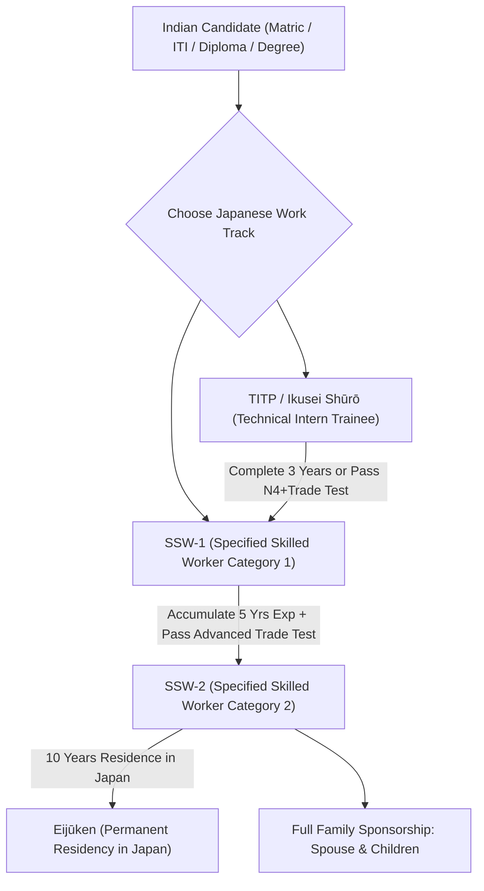
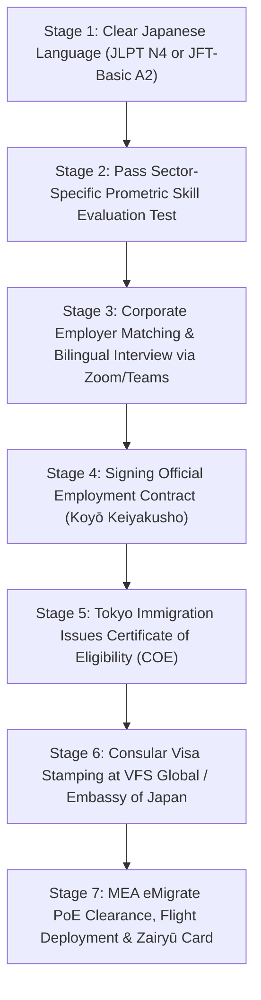

# Japan Work Visa (SSW & TITP) Complete Guide 2026: Jobs, Salaries (¥220,000+), JLPT N4, Prometric Tests, COE & Embassy Process

As the world's fourth-largest economy and a global vanguard of industrial robotics, precision manufacturing, cutting-edge healthcare, and civil infrastructure, **Japan (Nippon)** has decisively transformed its foreign employment policies. Confronted by severe demographic contractions—including a super-aged populace and a domestic shortfall projected to exceed **800,000 civilian workers** across essential industries by 2027—the Government of Japan has dismantled legacy migration barriers to welcome certified international technicians, healthcare caregivers, hospitality professionals, and engineering tradesmen.

Historically, foreign workers navigated Japan's complex labor market primarily through the **Technical Intern Training Program (TITP)**. However, following the landmark enactment of the **Specified Skilled Worker (SSW / 特定技能 - *Tokutei Ginō*) framework** under the **[Immigration Services Agency of Japan (出入国在留管理庁 - ISA)](https://www.moj.go.jp/isa/)**—and bolstered by the historic bilateral **Memorandum of Cooperation (MoC)** signed between New Delhi and Tokyo under the aegis of the **[Ministry of External Affairs (MEA India)](https://www.mea.gov.in)** and **[NSDC International](https://www.nsdcindia.org)**—Indian candidates now enjoy direct, government-protected pathways to high-paying careers in Japan.

Crucially, **2026 marks a transformative regulatory era**:
- The widespread expansion of **SSW Category 2 (特定技能2号 - *Tokutei Ginō 2-gō*)**, which grants **unlimited contract renewals, statutory family accompaniment (sponsoring spouse and dependent children), and an open trajectory to indefinite Japanese Permanent Residency (*Eijūken*)**.
- The legislative transition from traditional TITP into the revamped **Training and Employment System (*Ikusei Shūrō* - 育成就労)**, eliminating predatory intermediary fees and granting foreign trainees greater flexibility to switch employers within certified trade clusters.
- Record-high statutory minimum wage increases enacted by the **[Ministry of Health, Labour and Welfare (MHLW)](https://www.mhlw.go.jp)**, benchmarked between **¥1,050 to ¥1,165 JPY per hour** across metropolitan hubs like Tokyo, Kanagawa, and Osaka.

This authoritative, comprehensive master manual by **WorkWise Visa** details everything Indian job seekers, licensed technical institutes, and recruitment partners must master for successful deployment to Japan in 2026/2027:
- The 12 approved sovereign SSW industry sectors (from Nursing Care and Building Cleaning to Industrial Welding, Food Processing, and Construction).
- Realistic salary schedules in **Japanese Yen (¥)** and **Indian Rupees (₹)**, overtime calculations under the Japanese Labour Standards Act, and statutory social welfare protections.
- The dual testing benchmarks: **JFT-Basic / JLPT N4 Japanese language mastery** and **Prometric computer-based trade competency evaluations**.
- The step-by-step **Certificate of Eligibility (COE - 在留資格認定証明書)** processing pipeline through Tokyo Immigration.
- Consular visa submission rules via **[VFS Global Japan](https://www.vfsglobal.com/japan/india/)** and the **[Embassy of Japan in New Delhi](https://www.in.emb-japan.go.jp/)**.
- Crucial post-arrival legalities: **Zairyū Resident Cards (在留カード)**, municipal registration (*Jūminhyō*), and how to claim a **multi-lakh Rupee lump-sum pension refund (*Dattai Ichijikin*)** upon repatriation to India.

---

## Master Directory: Official Japanese Sovereign Portals & Verification Directory

To prevent exploitation by unauthorized sub-agents circulating fabricated job offers or counterfeit visa stickers, always verify statutory migration policies, employer accreditations, and visa requirements through official sovereign portals:

| Sovereign Authority / Governing Body | Jurisdiction & Statutory Mandate | Official Digital Portal | Primary Verification Function |
| :--- | :--- | :--- | :--- |
| **Immigration Services Agency of Japan (ISA - 出入国在留管理庁)** | Ministry of Justice body governing all residence statuses, COE approvals, and SSW quotas | [moj.go.jp/isa](https://www.moj.go.jp/isa/) | **[ISA Specified Skilled Worker Portal](https://www.moj.go.jp/isa/applications/ssw/index.html)** |
| **Ministry of Health, Labour and Welfare (MHLW - 厚生労働省)** | Governs national labour codes, statutory minimum wages, industrial health standards, and pension funds | [mhlw.go.jp](https://www.mhlw.go.jp/) | **[MHLW Regional Minimum Wage Matrix](https://www.mhlw.go.jp/stf/seisakunitsuite/bunya/koyou_roudou/roudoukijun/saitei/index.html)** |
| **Ministry of Foreign Affairs of Japan (MOFA - 外務省)** | Regulates consular diplomatic missions, entry visas, and bilateral labor mobility treaties | [mofa.go.jp](https://www.mofa.go.jp/) | **[MOFA Specified Skilled Worker Guidelines](https://www.mofa.go.jp/mofaj/ca/fna/ssw/us/index.html)** |
| **Embassy of Japan in India (New Delhi)** | Sovereign diplomatic chancellery processing and adjudicating consular work visas for Indian nationals | [in.emb-japan.go.jp](https://www.in.emb-japan.go.jp/) | **[Embassy Work Visa & Certificate of Eligibility (COE) Rules](https://www.in.emb-japan.go.jp/itpr_en/visa_work.html)** |
| **VFS Global Japan Visa Application Centres (India)** | Authorized outsourced commercial partner collecting biometric visa dossiers in New Delhi, Mumbai, Kolkata, Bengaluru | [vfsglobal.com/japan/india](https://www.vfsglobal.com/japan/india/) | **[VFS Japan Appointment Booking & Passport Tracking](https://www.vfsglobal.com/japan/india/)** |
| **Prometric Japan Testing Services** | Official testing administrator delivering computer-based SSW skill examinations in India | [prometric-jp.com](https://www.prometric-jp.com/en/ssw/) | **[Prometric SSW Skill Test Registration & Seat Booking](https://www.prometric-jp.com/en/ssw/)** |
| **Japan Foundation (Kokusai Kōryū Kikin)** | Sovereign cultural agency administering the **JFT-Basic (Japan Foundation Test for Basic Japanese)** | [jpf.go.jp/jft-basic](https://www.jpf.go.jp/jft-basic/e/) | **[JFT-Basic Language Schedule & Testing Protocols](https://www.jpf.go.jp/jft-basic/e/)** |
| **Organization for Technical Intern Training (OTIT - 外国人技能実習機構)** | Statutory supervisory body overseeing technical trainees, company audits, and human rights compliance | [otit.go.jp](https://www.otit.go.jp/) | **[OTIT Approved Sending Organizations Directory](https://www.otit.go.jp/)** |
| **JITCO (Japan International Trainee & Skilled Worker Org)** | Public interest incorporated foundation providing operational support for international talent deployment | [jitco.or.jp](https://www.jitco.or.jp/en/) | **[JITCO Candidate Support & Regulatory Guidance](https://www.jitco.or.jp/en/)** |
| **Ministry of External Affairs (MEA India - eMigrate)** | Governs overseas recruitment agencies, Protector of Emigrants (PoE), and PBBY insurance for Indian workers | [emigrate.gov.in](https://emigrate.gov.in) | **[eMigrate Sovereign Deployment Verification Portal](https://emigrate.gov.in)** |

---

## Explore WorkWise Visa Dedicated Portals & Overseas Career Hubs

Before preparing your documentation or scheduling technical language trials, review our regional recruitment resources and sovereign immigration directories:

- **[All Global Work Visa Destinations Directory](/countries)** — Compare employment immigration schemes across Japan, Schengen Europe, the Gulf Cooperation Council, and the UK.
- **[Live Verified Overseas Job Vacancies & Demands](/jobs)** — Browse authentic, client-interviewed job openings in mechanical engineering, construction trades, nursing, logistics, and hospitality.
- **[Track Your Visa Status Live](/track)** — Real-time tracking portal for candidate dossiers, consular visa stamping, and biometric clearances.
- **[Europe & Schengen Work Visa Master Guide 2026](/blogs/europe-schengen-work-visa-complete-guide-2026-germany-poland-croatia-luxembourg-malta-czechia)** — Detailed analysis of European single permits across Germany, Poland, Croatia, Luxembourg, and Malta.
- **[Gulf & GCC Work Visa Master Guide 2026](/blogs/gulf-work-visa-complete-guide-2026-saudi-arabia-uae-qatar-kuwait-oman-bahrain)** — Complete coverage of Saudi Arabia Qiwa, UAE MOHRE, and Wafid GAMCA medical protocols.
- **[Bihar & UP Gulf Work Visa Master Guide 2026](/blogs/bihar-up-gulf-work-visa-guide-process-scam-protection-2026)** — Authoritative manual on eMigrate PoE clearance, Takamol PVP trade tests, and combating sub-agent fraud.
- **[Police Clearance Certificate (PCC) Guide 2026](/blogs/police-clearance-certificate-pcc-gulf-european-visas-psk-apostille-guide-2026)** — Step-by-step instructions for obtaining PSK Police Clearance and MEA Hague Apostille authentication.
- **Our Regional Verification & Candidate Counseling Hubs:** Visit our authorized branch offices at **[Patna Corporate Branch](/locations/patna)**, **[Noida HQ](/locations/noida)**, **[Siwan Support Desk](/locations/siwan)**, **[Gopalganj Center](/locations/gopalganj)**, or **[Gorakhpur Desk](/locations/gorakhpur)**.

---

## 1. Comparing the 3 Official Working Pathways in Japan: TITP vs. SSW-1 vs. SSW-2

Indian citizens migrating to Japan for salaried technical or manual employment operate primarily across three statutory residence categories governed by the Japanese Immigration Control Act:

| Parameter / Feature | TITP (Technical Intern Training) | SSW-1 (Specified Skilled Worker 1) | SSW-2 (Specified Skilled Worker 2) |
| :--- | :--- | :--- | :--- |
| **Japanese Residence Status (*Zairyū Shikaku*)** | *Ginō Jisshū* (技能実習) / *Ikusei Shūrō* | *Tokutei Ginō 1-gō* (特定技能1号) | *Tokutei Ginō 2-gō* (特定技能2号) |
| **Maximum Permitted Stay** | Up to **3 to 5 Years** (Non-renewable) | Up to **5 Years** (Cumulative) | **Indefinite** (Renewable 1/3-year intervals) |
| **Family Accompaniment (Spouse & Kids)** | **Strictly Prohibited** | **Prohibited** (Except exceptional humanitarian cases) | **Fully Authorized** (Spouse & dependent children receive visas) |
| **Japanese Language Prerequisite** | Basic N5 equivalent (or pre-departure training) | **JLPT N4** or **JFT-Basic A2** (Pass score) | Evaluated through advanced technical trade performance |
| **Technical Skill Assessment** | Basic practical evaluation | **Prometric SSW Skill Test** (Pass score) | **Class 1 Advanced National Trade Test** or Foreman assessment |
| **Job / Employer Mobility** | Restricted to supervising organization cluster | **Permitted** (Worker can switch employers within same trade sector) | **Fully Permitted** across the certified industry sector |
| **Pathway to Japanese Permanent Residency** | **No** (Trainee years do not count toward 10-year PR criteria) | **No** (SSW-1 years do not count directly toward PR) | **Direct Pathway** (Counted fully toward the 10-year PR rule) |
| **Primary Target Professions** | Assembly line, agriculture, basic masonry | Nursing Care, Welding, Machinery, Hospitality | Master Welder, Construction Lead, Site Supervisor |

> [!IMPORTANT]
> **The 2026 Ikusei Shūrō Reform:** The Japanese Diet enacted historic immigration legislation transitioning the 30-year-old TITP model into the modernized **Training and Employment System (*Ikusei Shūrō* - 育成就労)**. Designed specifically to eliminate historic criticisms regarding restricted employer transfers, the new system formally positions trainees on an expedited 3-year escalator directly into **SSW-1 and SSW-2**, providing workers with lawful job mobility and long-term career permanence in Japan.

---

## 2. The 12 Approved SSW Industry Sectors & High-Demand Trades

The Government of Japan allocates dedicated national quota envelopes across **12 certified industrial sectors** suffering acute domestic labor deficits. Indian technical graduates, ITI certificate holders, nursing professionals, and skilled tradesmen can apply across the following fields:

### 1. Nursing Care (*Kaigo* - 介護) — Highest Quota Allocation
With over 29% of its population aged 65 or older, Japan faces an urgent national shortage of compassionate geriatric and medical caregivers.
- **Core Duties:** Assisting elderly residents in certified healthcare facilities with mobility, physical rehabilitation, hygiene, recreational engagement, and nutritional delivery.
- **Language Requirements:** Must pass the standard **JLPT N4 or JFT-Basic A2** PLUS the specialized **Nursing Care Japanese Language Evaluation Test (*Kaigo Nihongo Hyōka Shiken*)**.
- **Special Advantage:** Nursing caregivers who pass the rigorous Japanese National Nursing Care Worker Exam (*Kaigo Fukushishi*) can transition directly into the prestigious **\"Care Worker\" (介護) Residence Status**, enabling indefinite permanent residency and immediate family sponsorship.

### 2. Building Cleaning Management (ビルクリーニング)
- **Core Duties:** Operation of advanced commercial floor buffing machinery, sanitary chemical sterilization of medical hospitals, high-rise architectural facade cleaning, and environmental hygiene management in office high-rises and transit hubs.

### 3. Construction Sector (建設業)
- **High-Demand Trades:**
  - Structural Rebar Tying (*Tekkin-kō*) & Formwork Carpentry (*Katawaku-daiku*).
  - High-Rise Scaffolding (*Tobi*) & Structural Steel Erection.
  - Interior Drywall, Tiling, and Waterproof Coating.
  - Earthmoving Excavation & Articulated Heavy Machinery Operations.
- **SSW-2 Availability:** Construction workers who demonstrate master-level blueprint interpretation and achieve foreman certification can transition to **SSW-2**, allowing them to live permanently in Japan with their families.

### 4. Food & Beverage Manufacturing (飲食料品製造業)
- **Core Duties:** Automated factory processing, commercial meat and poultry cutting, bakery and confectionery line manufacturing, frozen food packaging, and industrial food hygiene compliant with Japanese HACCP standards.

### 5. Restaurant & Food Services (外食業)
- **Core Duties:** Commercial food preparation, professional cookery, beverage mixing, hygiene compliance, and front-of-house customer hospitality across major Japanese restaurant chains, catering corporations, and metropolitan dining facilities.

### 6. Agriculture & Livestock Farming (農業)
- **Sub-Sectors:**
  - **Crop Cultivation:** Automated greenhouse vegetable farming (tomatoes, strawberries, cucumbers), field cropping, laser-guided harvesting, and commercial sorting in regions like Hokkaido, Ibaraki, Nagano, and Kumamoto.
  - **Livestock Husbandry:** Dairy cow milking, livestock health monitoring, automated feed management, and egg processing operations.

### 7. Industrial Machinery & Manufacturing (素形材・産業機械・電気電子情報関連製造業)
- **Core Trades:**
  - Certified 6G/TIG, MIG/MAG, and Robotic Welding.
  - Computer Numerical Control (CNC) Lathe Machining & Milling.
  - Metal Press Stamping, Plastic Injection Molding, and Foundry Casting.
  - Printed Circuit Board (PCB) Assembly and Industrial Electrical Wiring.

### 8. Automobile Maintenance & Repair (自動車整備)
- **Core Duties:** Diagnostic mechanical inspection, engine overhaul, suspension repair, periodic national inspection (*Shaken* - 車検), and electrical system calibration for hybrid and electric commercial vehicles.

### 9. Aviation Ground Handling & Airport Logistics (航空業)
- **Core Duties:** Aircraft ramp handling, pushback tug operation, pallet cargo loading, automated baggage sorting, and aircraft exterior maintenance at international hubs including Haneda (HND), Narita (NRT), Kansai (KIX), and Chubu Centrair (NGO).

### 10. Accommodation & Hospitality (宿泊業)
- **Core Duties:** Front-desk reception in bilingual settings, corporate event planning, concierge services, and traditional Japanese inn (*Ryokan*) management.

---

## 3. Verified Japanese Salary Matrix & Living Cost Schedule (2026 Benchmarks)

Under **Article 3 of the Japanese Labour Standards Act (労働基準法 - *Rōdō Kijun-hō*洗)**, employers are statutorily prohibited from discriminating against foreign workers in remuneration. **A foreign national holding an SSW visa must receive equal or higher pay than a Japanese citizen performing identical duties.**

The table below presents verified basic salaries, overtime potential, statutory social insurance withholdings, and estimated take-home savings across premier industrial sectors as of **October 2026** (benchmarked at **1 Japanese Yen (JPY) ≈ ₹0.55 to ₹0.60 Indian Rupees (INR)** and **$1 USD ≈ 150 to 155 JPY**):

| Occupational Trade / Job Role | Monthly Gross Basic Salary (JPY ¥) | Equivalent in USD ($) | Monthly INR Gross (₹) | Typical Monthly Overtime (20–40 Hrs) | Est. Monthly Family Savings (INR ₹) |
| :--- | :--- | :--- | :--- | :--- | :--- |
| **Certified Nursing Caregiver (*Kaigo*)** | ¥220,000 – ¥290,000 | $1,460 – $1,930 | **₹1,25,000 – ₹1,68,000** | +¥35,000 – ¥55,000 (Night shift premiums) | **₹85,000 – ₹1,20,000 / mo** |
| **Structural Rebar / Formwork Carpenter** | ¥230,000 – ¥330,000 | $1,530 – $2,200 | **₹1,32,000 – ₹1,90,000** | +¥45,000 – ¥70,000 (Overtime 1.25x) | **₹90,000 – ₹1,35,000 / mo** |
| **TIG / MIG / Arc Pressure Welder** | ¥240,000 – ¥350,000 | $1,600 – $2,330 | **₹1,38,000 – ₹2,02,000** | +¥50,000 – ¥85,000 (Hazard & technical allowances) | **₹98,000 – ₹1,48,000 / mo** |
| **CNC Machine Operator / Turner** | ¥225,000 – ¥310,000 | $1,500 – $2,060 | **₹1,29,000 – ₹1,78,000** | +¥35,000 – ¥60,000 | **₹86,000 – ₹1,25,000 / mo** |
| **Automobile Maintenance Mechanic** | ¥235,000 – ¥320,000 | $1,560 – $2,130 | **₹1,35,000 – ₹1,84,000** | +¥40,000 – ¥65,000 | **₹92,000 – ₹1,30,000 / mo** |
| **Food Processing Factory Operative** | ¥205,000 – ¥265,000 | $1,360 – $1,760 | **₹1,18,000 – ₹1,52,000** | +¥30,000 – ¥50,000 | **₹78,000 – ₹1,10,000 / mo** |
| **Greenhouse & Agricultural Worker** | ¥200,000 – ¥260,000 | $1,330 – $1,730 | **₹1,15,000 – ₹1,49,000** | +¥25,000 – ¥45,000 (Peak seasonal harvest) | **₹75,000 – ₹1,08,000 / mo** |
| **Hotel Front Office / Restaurant Staff** | ¥210,000 – ¥280,000 | $1,400 – $1,860 | **₹1,20,000 – ₹1,61,000** | +¥30,000 – ¥50,000 | **₹80,000 – ₹1,15,000 / mo** |
| **Commercial Building Cleaning Specialist**| ¥200,000 – ¥250,000 | $1,330 – $1,660 | **₹1,15,000 – ₹1,43,000** | +¥25,000 – ¥40,000 | **₹74,000 – ₹1,02,000 / mo** |
| **Airport Ground Handler / Ramp Tech** | ¥230,000 – ¥310,000 | $1,530 – $2,060 | **₹1,32,000 – ₹1,78,000** | +¥40,000 – ¥65,000 (Shift differentials) | **₹90,000 – ₹1,28,000 / mo** |

---

### Understanding Statutory Payroll Deductions (*Shakai Hoken*) in Japan

Every legal employee in Japan is automatically enrolled in the universal **Social Insurance (*Shakai Hoken* - 社会保険)** system. While deductions reduce nominal take-home pay by approximately **18% to 22%**, they provide world-class benefits:

1. **Health Insurance (*Kenkō Hoken*):** Covers 70% of all medical treatments, hospital stays, prescription medications, and dental care across Japan. The worker pays only a 30% co-pay at clinics.
2. **Employees' Welfare Pension (*Kōsei Nenkin*):** Mandatory state retirement pension contribution. *(Crucial: Indian workers can claim this money back upon departure—see below!)*
3. **Employment Insurance (*Koyō Hoken*):** Provides unemployment stipends, injury benefits, and vocational training subsidies.
4. **Income Tax (*Shotokuzei*) & Local Inhabitant Tax (*Jūminzei*):** Progressive state and municipal taxes calculated on adjusted net earnings.
5. **Company-Arranged Accommodation (*Shataku* / *Apāto*):** Most Japanese employers provide furnished, shared or private leased studio apartments. Statutory housing deductions typically range from **¥20,000 to ¥35,000 JPY per month (₹11,000 to ₹20,000 INR)**—substantially below open-market commercial rental rates in major Japanese cities.

---

### The Massive Financial Bonus: Claiming Your Multi-Lakh Pension Refund (*Dattai Ichijikin*)

Many Indian job seekers are unaware that social pension contributions deducted in Japan are **not lost**. Under the **National Pension Act of Japan**, foreign nationals who have paid into the Employees' Pension System (*Kōsei Nenkin*) for at least 6 months and subsequently depart Japan without acquiring Japanese citizenship or permanent residency are legally entitled to receive the **Lump-Sum Withdrawal Payment (*Dattai Ichijikin* - 脱退一時金)**.

- **Maximum Claim Window:** Workers can claim up to **5 full years (60 months)** of cumulative contributions.
- **Refund Value:** For a worker completing a 3- to 5-year SSW deployment, this statutory refund typically totals between **¥800,000 to ¥1,400,000+ JPY (approximately ₹4.5 Lakhs to ₹8.0 Lakhs INR)**!
- **Filing Deadline:** The application must be submitted to the **[Japan Pension Service (Nihon Nenkin Kikō)](https://www.nenkin.go.jp/)** within **2 years** of relinquishing Japanese residency. WorkWise Visa provides complete post-return documentation assistance to ensure candidates recover 100% of their refund into their Indian bank accounts.

---

## 4. The 7-Stage End-to-End Application Lifecycle (From India to Tokyo)

Securing an official Japanese SSW work permit follows a rigorous, government-coordinated statutory progression:

### Stage 1: Japanese Language Mastery (JLPT N4 or JFT-Basic A2)
Unlike English-speaking or Gulf destinations where work language can be picked up informally, Japan mandates verified pre-departure linguistic capability:
- **Testing Track 1: JFT-Basic (Japan Foundation Test for Basic Japanese):** Administered on computers at Prometric testing centers across major Indian cities throughout the year. Consists of 60 questions covering Script and Vocabulary, Conversation and Expression, Listening Comprehension, and Reading (Target score: 200 out of 250 points, CEFR A2 level).
- **Testing Track 2: JLPT N4 (Japanese-Language Proficiency Test):** Conducted twice annually (July and December). Validates ability to comprehend basic daily conversations, read approximately 300 *Kanji* characters, and master 1,500 core Japanese vocabulary items.
- *Timeline:* Average candidate requires **3 to 5 months** of dedicated classroom and audio-visual coaching.

### Stage 2: Sector-Specific Prometric Skill Evaluation Test
Candidates schedule their technical trade assessment through **[Prometric Japan](https://www.prometric-jp.com/en/ssw/)** at authorized computer testing facilities in **New Delhi, Mumbai, Bengaluru, Hyderabad, Chennai, Kolkata, or Pune**:
- **Format:** Computer-Based Test (CBT) available in English and Japanese.
- **Content:** Practical bench simulations, safety equipment identification, blueprint reading, sanitary standards, and job-specific methodology. For Nursing Care, testing includes both the general skill test and the specialized Medical Terminology test.
- **Pass Validity:** Passing certificates issued by the competent Japanese ministries have **permanent validity** across the candidate's professional lifetime.

### Stage 3: Employer Matching & Practical Video Interview
With language and skill credentials authenticated, the candidate is matched with licensed Japanese host enterprises:
- **Interview Setting:** Conducted via high-definition video conference (Zoom, Teams) or through in-person delegation visits to WorkWise Visa regional testing hubs in Patna and Noida.
- **Focus:** Punctuality, structural trade comprehension, safety discipline, and professional enthusiasm (*Yaruki*).

### Stage 4: Execution of the Employment Agreement (*Koyō Keiyakusho*)
The Japanese enterprise issues the formal **Bilingual Employment Contract (*Koyō Keiyakusho* - 雇用契約書)** and statutory **Employment Conditions Statement (*Koyō Jōkensho*)**. The contract explicitly details:
- Exact hourly basic pay (exceeding regional minimum wage benchmarks).
- Overtime multiplier (+25% standard, +35% holiday).
- Subsidized company housing location and municipal rental rate.
- Employer-funded return flight ticket upon contract conclusion.

### Stage 5: Application for the Certificate of Eligibility (COE - 在留資格認定証明書)
The sponsoring Japanese enterprise submits the complete candidate dossier directly to the **[Immigration Services Agency of Japan (出入国在留管理庁 - ISA)](https://www.moj.go.jp/isa/)** regional bureau (such as the Tokyo Regional Immigration Bureau in Shinagawa):
- **Immigration Verification:** ISA audits the sponsoring enterprise’s tax filings, workplace safety record, and quota authorizations, while cross-verifying the candidate's authentic language and skill certificates.
- **The COE Issuance:** Immigration issues the official **Certificate of Eligibility (COE)**—now generated primarily as an authenticated digital certificate containing an official cryptographic 2D barcode.
- *Turnaround:* Typically **4 to 8 weeks** from institutional filing to digital issuance.

### Stage 6: Consular Visa Stamping at VFS Global / Embassy of Japan
With the official digital COE in hand, the candidate submits their physical passport for consular stamping:
- **Submission Centers:** Processed through **VFS Global Japan Application Centres** across India with consular adjudication executed by the **[Embassy of Japan in New Delhi](https://www.in.emb-japan.go.jp/)** or regional Consulates-General (Mumbai, Chennai, Kolkata, Bengaluru).
- **Consular Processing:** Because the COE represents prior sovereign authorization from Tokyo, consular visa stamping is typically completed within **5 to 8 business days**.
- **The Stamped Sticker:** The Embassy affixes the official Japanese visa sticker displaying status as **\"DESIGNATED ACTIVITIES / SPECIFIED SKILLED WORKER (i)\"**.

### Stage 7: MEA eMigrate PoE Clearance & Port-of-Entry Arrival
- **eMigrate Emigration Clearance (For ECR Passports):** For candidates holding ECR passports, the deployment is registered on the **[emigrate.gov.in](https://emigrate.gov.in)** platform, and mandatory **Pravasi Bharatiya Bima Yojana (PBBY)** insurance (₹10 Lakh coverage) is secured.
- **Landing in Japan:** At international border immigration (Haneda, Narita, or Kansai Airport), the automated biometric kiosk immediately prints and dispenses the physical plastic **Zairyū Resident Card (在留カード)**.
- **Municipal Registration (*Jūminhyō*):** Within 14 days of moving into their apartment, the worker visits the local city hall (*Shiyakusho*), registers their residential address, and receives their permanent **My Number (Individual Number Card)** for taxation and banking.

---

## 5. Comprehensive Document Checklist for Indian Applicants

Ensure every document strictly satisfies consular and Tokyo Immigration criteria:

### Candidate Personal Dossier:
- [ ] **Valid National Indian Passport:** Minimum 18 months validity remaining from date of filing, with at least 2 consecutive blank facing pages.
- [ ] **Original JFT-Basic A2 Score Report** OR **JLPT N4 (or higher) Certificate of Result and Scores**.
- [ ] **Prometric SSW Sector Skill Assessment Passing Certificate** (with verifiable score report barcode).
- [ ] **Two Recent Passport Photographs:** 45mm x 35mm, pure white background, matte finish, sharp facial focus, taken within the last 3 months without digital manipulation.
- [ ] **Completed Consular Visa Application Form:** Filled accurately in English with applicant signature matching passport.
- [ ] **Police Clearance Certificate (PCC):** Issued by the **[Regional Passport Office (RPO) / Passport Seva](https://www.passportindia.gov.in/)**.
- [ ] **Certified Pre-Departure Medical Examination Certificate:** Issued by an accredited diagnostic laboratory confirming absence of communicable diseases, active pulmonary tuberculosis, and serological fitness.
- [ ] **Educational Certificates & Marksheets:** 10th Standard Matriculation, 12th Intermediate, ITI Trade Diploma, or Polytechnic marksheets.

### Sponsoring Japanese Employer Dossier:
- [ ] **Official Digital Certificate of Eligibility (COE):** Issued by the Immigration Services Agency of Japan (ISA).
- [ ] **Bilingual Japanese-English Employment Contract (*Koyō Keiyakusho*):** Duly executed and signed by the corporate director.
- [ ] **Statutory Employment Conditions Statement (*Koyō Jōkensho*):** Explicitly stating hourly wage, duty schedules, and break times.
- [ ] **Registered Support Plan (*Ichigō Tokutei Ginō Gaikokujin Shien Keikaku*):** Approved plan coordinated by a certified Registered Support Organization (RSO / 登録支援機関) guaranteeing post-arrival housing, Japanese language support, and orientation.

---

## 6. Government Fees, Typical Costs & Timeline Breakdown (2026)

Understanding legitimate processing expenses prevents extortion by unscrupulous rural agents:

| Milestone / Cost Component | Statutory Recipient / Provider | Fee in JPY (¥) | Approx. Equivalent in INR (₹) | Payer Responsibility |
| :--- | :--- | :--- | :--- | :--- |
| **JFT-Basic / JLPT N4 Exam Fee** | Japan Foundation / Prometric | ¥3,000 – ¥4,500 | ₹1,800 – ₹2,600 | Candidate |
| **Prometric SSW Skill Test Fee** | Prometric Japan Testing Body | ¥4,000 – ¥8,000 | ₹2,400 – ₹4,800 | Candidate |
| **Tokyo Immigration COE Issuance**| Immigration Services Agency (ISA) | **¥0 (Free)** | **₹0** | State Sovereign Service |
| **Japanese Consular Visa Fee** | Embassy of Japan in New Delhi | Approx. ¥600 | ₹500 (Single Entry) | Candidate / Employer |
| **VFS Global Logistics Fee** | VFS Global Application Centre | — | ₹650 – ₹850 | Candidate |
| **MEA eMigrate PoE Clearance & PBBY** | Ministry of External Affairs India | — | ₹375 (2-Year Policy) | Statutory Employer / Candidate |
| **International Airfare (India to Japan)**| Commercial Airline | ¥45,000 – ¥75,000 | ₹25,000 – ₹42,000 | **Covered by Employer / Package** |

### Expected Timeline from Start to Flight Departure:
* **Japanese Language Coaching (0 to N4):** 3 to 4 Months
* **Prometric Skill Test & Matching:** 2 to 3 Weeks
* **ISA Tokyo COE Adjudication:** 4 to 8 Weeks
* **VFS Global Visa Stamping:** 1 to 2 Weeks
* **Total End-to-End Duration:** **5 to 7 Months** of structured preparation.

---

## 7. CRITICAL ANTI-SCAM ADVISORY: Protecting Yourself from Fraudulent Japan Job Rackets

Because salaries and living standards in Japan are exceptionally high, fraudulent travel agents and social media syndicates across India routinely target aspiring candidates with deceptive rackets.

> [!CAUTION]
> **The Top 4 Warning Signs of Japan Visa Fraud:**
> 
> **1. The \"Tourist Visa / Short-Stay Visa Conversion\" Scam:**  
> Sub-agents often tell applicants: *\"Fly to Tokyo on a 15-day tourist visa; our Japanese partner will convert it into an SSW work visa once you land.\"*  
> **THIS IS 100% FRAUDULENT.** Under Article 20 of the Japanese Immigration Control Act, it is **statutorily illegal** to change from a Temporary Visitor (Tourist) status to an SSW work visa inside Japan. Persons attempting this are arrested, detained in ISA immigration detention facilities (such as Ushiku or Higashi-Nihon), and issued a **Mandatory 5-Year Deportation Ban**. Legitimate work permits must ALWAYS originate via a formal **Certificate of Eligibility (COE)** issued in Japan prior to consular stamping in India.
> 
> **2. Extortionate Demands for ₹8 to ₹15 Lakhs:**  
> Rogue agents routinely demand astronomical sums from rural families under the guise of \"buying a Japanese work permit quota.\" Under the bilateral India-Japan Memorandum of Cooperation (MoC), sovereign COE processing is completely free of government fees. Authorized overseas placement consultants operate with transparent, government-regulated service charges.
> 
> **3. Deceptive Language Promises: \"No Japanese Language Needed\":**  
> Any intermediary claiming you can secure an official SSW work visa without passing either the **JLPT N4 or JFT-Basic A2** is circulating forged papers. Japanese immigration officers systematically cross-check test identification numbers directly with the digital database of the Japan Foundation. If a fake score report is discovered, the candidate faces an automatic lifetime immigration ban to Japan.
> 
> **4. Counterfeit COE PDF Letters:**  
> Fraudsters produce graphic Canva-made certificates bearing fabricated Japanese imperial crests and fake ministerial signatures. Genuine digital COEs contain secure 2D cryptographic barcodes that can be validated instantaneously at official consular chancelleries.

---

## 8. Frequently Asked Questions (FAQs): Japan Work Visas (2026 Master Directory)

### Q1: Can I legally switch employers inside Japan if I am unhappy with my company?
**Answer:** **Yes!** This is one of the single greatest advantages of the **Specified Skilled Worker (SSW)** visa over the old TITP intern program. Under SSW regulations, you possess the statutory legal right to change employers, provided your new employer operates within the same certified industrial trade sector (or you pass the Prometric skill test for a new sector). You do not need your previous sponsor's \"release letter\" or consent to transition.

### Q2: Is there a vegetarian or Halal food lifestyle feasible in Japan for Indian workers?
**Answer:** Absolutely. While traditional Japanese cuisine uses fish broth (*dashi*), major supermarket chains across Japan (such as Gyōmu Super, Aeon, and Ito-Yokado) stock extensive selections of lentils (*daal*), basmati rice, chickpeas, fresh vegetables, tofu, and certified Halal poultry. Furthermore, every major metropolitan area features active Indian grocery distribution networks and authentic Indian restaurants. Most candidates quickly adapt to cooking healthy, familiar Indian meals in their apartment kitchens.

### Q3: What is the age limit for applying for an SSW work visa in Japan?
**Answer:** Under Japanese immigration law, any candidate aged **18 years or older** is legally eligible to apply for an SSW visa. There is no statutory upper age limit; however, corporate Japanese employers in construction, manufacturing, and healthcare typically seek candidates between **19 and 38 years of age** to ensure long-term physical vitality and trade adaptability.

### Q4: Does time spent in Japan under an SSW-1 visa count toward Japanese Permanent Residency (PR)?
**Answer:** Directly, no. Years accumulated under **SSW-1 (up to 5 years)** do not satisfy the 10-year residency prerequisite for Japanese Permanent Residency (*Eijūken*). However, once a worker upgrades to **SSW-2 (Tokutei Ginō 2-gō)**, all subsequent years count 100% toward the permanent residency requirement. Alternatively, healthcare workers who attain the national *Kaigo Fukushishi* license can apply for PR after demonstrating continuous domestic service.

### Q5: Can I bring my wife and children to Japan on an SSW visa?
**Answer:** Under **SSW-1**, dependent family sponsorship is not authorized under standard guidelines. However, workers who transition to **SSW-2** are legally authorized under the Immigration Act to sponsor their legal spouse and dependent children for **Dependent Visas (家族滞在 - *Kazoku Taizai*)**. Spouses holding dependent status are also authorized to work part-time up to **28 hours per week** under a formal Permission to Engage in Activity Other Than That Permitted (*Shikakugai Katsudō Kyoka*).

### Q6: What happens if I fall sick or suffer a workplace accident in Japan?
**Answer:** Under the mandatory **Social Health Insurance (*Kenkō Hoken*)**, 70% of all medical, hospital, surgical, and pharmaceutical expenses are paid by the national healthcare fund. Furthermore, workplace accidents are covered 100% under **Industrial Accident Compensation Insurance (*Rōsai Hoken*)**, which guarantees full paid medical treatment, disability compensation, and statutory salary continuity without any out-of-pocket costs to the employee.

### Q7: Where are the Prometric SSW Skill Test centers located in India?
**Answer:** Prometric operates modern, biometric computer testing centers in **New Delhi (Connaught Place & Nehru Place), Gurugram, Mumbai, Bengaluru, Hyderabad, Chennai, Kolkata, and Ahmedabad**. Testing sessions for Nursing Care, Building Cleaning, Food Service, and Agriculture are scheduled multiple times each month.

### Q8: What is the minimum educational qualification required for a Japan SSW Work Visa?
**Answer:** Japanese immigration does not mandate a university degree for the SSW category. Candidates who have completed **Class 10 (Matriculation), Class 12, ITI trade diplomas, or polytechnic certifications** are 100% eligible, provided they successfully clear the two mandatory examinations: the Japanese language test (JLPT N4 or JFT-Basic A2) and the sector-specific Prometric technical skill assessment.

### Q9: How does the Japanese overtime system operate under the Labour Standards Act?
**Answer:** The statutory Japanese workweek is fixed at **40 hours (8 hours per day, 5 days per week)**. Any duty performed exceeding 8 hours per day or on scheduled rest days must be compensated at a mandatory statutory premium:
- Standard Overtime: **+25% of the base hourly wage**.
- Late-Night Overtime (between 10:00 PM and 5:00 AM): **+50% of the base hourly wage**.
- Work on Statutory Public Holidays: **+35% of the base hourly wage**.

### Q10: How does WorkWise Visa support Indian candidates aspiring to work in Japan?
**Answer:** WorkWise Visa provides an end-to-end, transparent overseas deployment pipeline:
1. **Intensive Japanese Language Coaching:** Tailored training programs preparing candidates to pass the JLPT N4 / JFT-Basic A2 exam on their very first attempt.
2. **Prometric Trade Preparation:** Hands-on technical orientation for nursing terminology, construction safety, and manufacturing bench trials.
3. **Direct Corporate Matching:** Direct interview coordination with licensed Japanese host enterprises and certified Registered Support Organizations (RSO).
4. **COE & Consular Visa Management:** Vetting and filing documentation with the Immigration Services Agency of Japan and VFS Global India.
5. **Pre-Departure Briefing & Post-Arrival Welfare:** Cultural orientation, accommodation vetting, airport reception coordination, and assistance in claiming the **Multi-Lakh Pension Refund (*Dattai Ichijikin*)** when returning to India.

---

### Ready to Launch Your Global Career in Japan?

Step onto the verified, high-paying, and government-backed path to overseas employment. Connect with WorkWise Visa's licensed Asia-Pacific career advisors today for an individual profile evaluation and Japanese language training assessment.

* **Direct WhatsApp Japan Desk:** [+91 8130161603](https://wa.me/918130161603?text=Hi%20WorkWise%20Visa,%20I%20want%20to%20apply%20for%20the%20Japan%20SSW%20Work%20Visa%202026!)\n* [**Explore Active Overseas Job Openings**](/jobs)
* [**Track Your Visa Application Online**](/track)
* [**Compare Global Work Visa Destinations**](/countries)
* [**Visit Our Corporate Offices in Patna, Siwan & Noida**](/locations)
