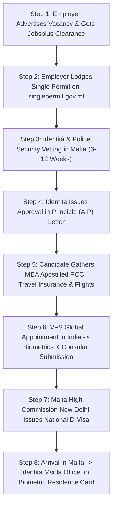

# Malta Work Visa (Single Permit) Complete Guide 2026: Jobs, Salaries, Identità AIP, Skills Pass & VFS India Process

As an English-speaking, high-growth Mediterranean economy in the heart of the European Union and the Schengen Area, the **Republic of Malta** has become one of the premier employment destinations for Indian professionals, skilled tradesmen, drivers, and hospitality personnel. With its booming tourism industry, expanding logistics hubs, modern construction projects, and thriving tech sector, Malta faces structural shortages across essential economic sectors.

To manage non-EU labor mobility transparently, the Maltese government administers the **Single Work Permit (Single Permit)** under **[Subsidiary Legislation 217.17](https://legislation.mt/eli/sl/217.17/eng)**. This streamlined, co-ordinated immigration channel is governed by **[Identità Malta Agency (identita.gov.mt)](https://identita.gov.mt)** (formerly Identity Malta) in close partnership with **[Jobsplus (jobsplus.gov.mt)](https://jobsplus.gov.mt)**, the national public employment service.

Crucially, **2026 brings landmark regulatory enhancements**: the formal implementation of the mandatory **Malta Skills Pass** for hospitality workers, stricter **Housing Authority lease registration rules**, and accelerated processing for specialized professionals under the **Key Employee Initiative (KEI)** and **Specialist Employee Initiative (SEI)**.

This definitive statutory guide breaks down everything Indian applicants and employers must know about the **Malta Work Visa for 2026/2027**: high-demand vacancies, statutory minimum wages, the step-by-step Identità Approval in Principle (AIP) roadmap, VFS Global New Delhi and regional consular filing, document checklists, and anti-fraud protections.

---

## 1. Executive Summary: What is the Malta Single Work Permit?

A **Malta Single Permit** is a combined work and residence authorization granted under European Union Directive 2011/98/EU. It allows third-country nationals (including Indian citizens) to legally reside and work in Malta for a specific employer in a designated job role.

| Regulatory Parameter | Statutory Framework (Subsidiary Legislation 217.17 & Identità Guidelines) | Official Verification Source |
| :--- | :--- | :--- |
| **Official Permit Title** | Single Permit (Employment Licence & Residence Authorization) | [Identità Expatriates Unit](https://identita.gov.mt) |
| **Initial Validity Period** | **1 Year** (Renewable annually upon ongoing employment) | [Single Permit Online Portal](https://singlepermit.gov.mt) |
| **Long-Term Settlement** | Path to 5-Year EU Long-Term Resident Status (*Status ta' Resident fit-Tul*) | [EU Directive 2003/109/EC](https://eur-lex.europa.eu) |
| **Primary Competent Authorities** | **Identità Malta Agency** & **Jobsplus Public Employment Service** | [jobsplus.gov.mt](https://jobsplus.gov.mt) |
| **Application Center in India** | **VFS Global Malta Application Centres** (Delhi, Mumbai, Kolkata, Chennai, etc.) | [VFS Global Malta India](https://visa.vfsglobal.com/ind/en/mlt) |
| **Consular Adjudication** | **High Commission of the Republic of Malta in New Delhi** | [High Commission of Malta](https://foreignandeu.gov.mt/en/Embassies/Hc_New_Delhi/Pages/HC_New_Delhi.aspx) |
| **Statutory Minimum Wage (2026)** | **€213.54 per week** (Approx. **€925.34 gross per month** for 40 hours) | [Department of Industrial & Employment Relations (DIER)](https://dier.gov.mt) |
| **Accelerated Programs** | **Key Employee Initiative (KEI - €35,000+)** & **Specialist Employee (SEI - €25,000+)** | [Identità Fast-Track Schemes](https://identita.gov.mt) |
| **New 2026 Requirement** | Mandatory **Malta Skills Pass** for Tourism & Hospitality occupations | [Malta Tourism Authority (MTA)](https://www.mta.com.mt) |

> [!IMPORTANT]
> **Approval in Principle (AIP) Milestone:** Unlike some European countries where workers file directly at the embassy first, Malta's process starts inside Malta. The employer applies online through the **[Single Permit Portal (singlepermit.gov.mt)](https://singlepermit.gov.mt)** while the candidate is still in India. Only after Identità conducts background checks and issues an official **Approval in Principle (AIP) Letter** does the candidate apply for their National Type D visa at VFS Global in India.

---

## 2. High-Demand Sectors, Job Roles & Salary Benchmarks (2026)

Because English is an official national language of Malta alongside Maltese, international workers adapt rapidly to corporate and service environments. Major hiring sectors include:

### A. Transportation, Logistics & Delivery (High Volume)
Malta's ride-hailing and e-commerce ecosystems rely heavily on foreign drivers:
* **Cab & Private Hire Drivers (Bolt, Uber, eCabs):** Operating passenger sedans and vans across Malta and Gozo. Typical earnings range between **€1,400 to €2,200 gross per month** (depending on hours and platform commissions). Requires converting or acquiring a Maltese Transport Authority (TM) driver tag.
* **Food Delivery Couriers & Dispatchers:** Motorcycle and scooter couriers earning **€1,100 to €1,600 gross per month**.
* **Heavy Vehicle, Bus & Truck Drivers:** Operating Malta Public Transport buses, construction concrete mixers, and distribution container trucks. Earns **€1,600 to €2,400 gross per month**.

### B. Hospitality, Culinary Arts & Tourism
With over 3 million tourists visiting Valletta, St. Julian's, Sliema, and Bugibba each year, hospitality remains an economic engine:
* **Chefs (Commis, Demi Chef, Sous Chef, Indian Specialty Cooks):** Monthly earnings range from **€1,300 to €2,500 gross**.
* **Waiters, Bartenders & Food Runners:** Earning **€1,000 to €1,400 gross per month** plus customer gratuities.
* **Hotel Room Attendants & Housekeeping Supervisors:** Earning **€950 to €1,300 gross per month**.
* *Note on Skills Pass:* All candidates applying in tourism roles must clear the online Malta Skills Pass verification before visa submission.

### C. Construction, Engineering & MEP Trades
Major civil infrastructure, real estate, and coastal restoration projects drive steady demand:
* **Masons, Shuttering Carpenters & Steel Fixers:** **€1,200 to €1,700 gross per month**.
* **Certified 6G & TIG/MIG Welders:** **€1,400 to €2,200 gross per month**.
* **HVAC Technicians, Plumbers & Electricians:** **€1,300 to €1,900 gross per month**.
* **Heavy Equipment Mechanics & Crane Operators:** **€1,600 to €2,400 gross per month**.

### D. Healthcare & Elderly Caregiving
To support state facilities like [Mater Dei Hospital](https://deputyprimeminister.gov.mt) and private residential care homes:
* **Care Assistants & Senior Caregivers:** **€1,100 to €1,500 gross per month**.
* **Registered Staff Nurses:** **€1,800 to €2,800 gross per month** (requires Council for Nurses and Midwives licensing).

### E. IT, iGaming, Financial Compliance & Engineering
Malta is Europe's premier gaming and fintech regulatory center:
* **Software Developers, QA Engineers & DevOps Specialists:** **€2,800 to €5,500 gross per month**.
* **Anti-Money Laundering (AML) & Compliance Officers:** **€2,500 to €4,500 gross per month**.

---

## 3. The 2026 Game-Changers: Skills Pass & Lease Registration Rules

To protect worker welfare and uphold high industry standards, the Government of Malta introduced two critical regulatory measures in 2026:

### 1. The Mandatory Malta Skills Pass (Phase-Wise Rollout)
Managed collaboratively by the **Institute of Tourism Studies (ITS)** and the **Malta Tourism Authority (MTA)**, the **Skills Pass** is a mandatory certification required for non-EU workers entering the tourism and hospitality sector.
* **Online Component (Pre-Arrival):** The applicant completes online modules covering Basic English communication, Maltese hospitality standards, and customer service fundamentals, followed by an online interview.
* **Verification:** The electronic Skills Pass certificate must be attached to the Identità Single Permit application; without it, Jobsplus will not approve the vacancy clearance.

### 2. Strict Housing Authority Lease Registration
To eliminate substandard living quarters and overcrowding:
* Every rental agreement in Malta must be registered by the landlord on the official **[Housing Authority Portal (rentregistration.mt)](https://rentregistration.mt)**.
* Identità cross-references the candidate's residence address against the municipal occupancy limit (maximum 2 occupants per bedroom). Submitting an unverified or overcrowded address leads to immediate permit revocation.

---

## 4. Step-by-Step Single Permit Application Roadmap

Securing a Malta Work Visa follows an orderly, multi-stage administrative process:

### Stage 1: Jobsplus Labor Market Clearance & Employer Portal Filing
1. **Labor Market Test:** The Maltese employer posts the job vacancy on **[Jobsplus (jobsplus.gov.mt)](https://jobsplus.gov.mt)**. If no suitable Maltese or EU citizen is available, Jobsplus grants authorization to hire a non-EU candidate.
2. **Online Single Permit Submission:** The employer uploads the candidate's passport, curriculum vitae (CV), signed employment contract, position description, lease agreement, and qualifications to the **[Single Permit Online Portal (singlepermit.gov.mt)](https://singlepermit.gov.mt)**, paying the non-refundable government fee of **€300**.

### Stage 2: Security Vetting & Issuance of the Approval in Principle (AIP)
1. **Inter-Agency Screening:** Identità Malta, the Police Immigration Section, and internal security directorates vet the application.
2. **Issuance of the AIP Letter:** Upon successful clearance (typically taking 8 to 12 weeks), Identità issues the **Approval in Principle (AIP) Letter**. This official document confirms that the work permit has been granted subject to entry visa issuance.

### Stage 3: Consular Processing in India (VFS Global)
1. **Dossier Preparation:** The candidate receives the original AIP letter and compiles their passport, MEA Apostilled PCC, medical fitness report, flight reservations, and proof of accommodation.
2. **VFS Global Appointment:** The candidate books an appointment at the nearest **[VFS Global Malta Centre](https://visa.vfsglobal.com/ind/en/mlt)** in New Delhi, Mumbai, Kolkata, Chennai, Hyderabad, Bengaluru, Cochin, Jalandhar, or Ahmedabad.
3. **Biometrics & Submission:** The candidate submits the physical dossier and completes biometric capture.
4. **Visa Stamping:** The **[High Commission of the Republic of Malta in New Delhi](https://foreignandeu.gov.mt/en/Embassies/Hc_New_Delhi/Pages/HC_New_Delhi.aspx)** adjudicates the application, stamping a **National Long-Stay Category D Visa** (valid for 90 to 180 days) into the candidate's passport.

### Stage 4: Post-Arrival Formalities in Malta
1. **Entry:** The worker lands at Malta International Airport (Luqa - MLA) and presents their passport, National D visa, and AIP letter to border control officers.
2. **Biometric Card Appointment:** Within days of arrival, the worker visits the **Identità Expatriates Unit** (Valley Road, Msida) for live biometric capture (fingerprints and photo).
3. **Collection of Residence Card:** Within 2 to 4 weeks, Identità issues the physical biometric **e-Residence Card (Single Permit)** authorizing work and residency for 1 full year.

---

## 5. Mandatory Document Checklist for Indian Candidates

Ensure every document strictly satisfies consular and Identità statutory criteria:

### Candidate Document Dossier:
- [ ] **Valid National Indian Passport:** Minimum 12 months validity remaining, issued within the last 10 years, with at least 2 consecutive blank visa pages.
- [ ] **Official Approval in Principle (AIP) Letter:** Issued by Identità Malta Agency.
- [ ] **National Long-Stay Visa Application Form (Type D):** Fully completed and signed matching passport signature.
- [ ] **Two Recent Passport Photographs:** 35mm x 45mm, plain white background, 80% face coverage, compliant with ICAO biometric standards.
- [ ] **Police Clearance Certificate (PCC):** Issued strictly by the **[Regional Passport Office (RPO)](https://www.passportindia.gov.in/)** and authenticated with an official **[Hague Apostille Stamp from the Ministry of External Affairs (MEA)](https://mea.gov.in/apostille.htm)**. Valid for 6 months from issue date. See our [PCC MEA Apostille Complete Guide](/blogs/police-clearance-certificate-pcc-gulf-european-visas-psk-apostille-guide-2026).
- [ ] **Travel Medical Insurance:** Minimum emergency hospitalization and repatriation coverage of **€30,000**, valid across all Schengen member states for the full visa validity.
- [ ] **Proof of Accommodation:** Official lease contract registered on the **[Housing Authority Portal (rentregistration.mt)](https://rentregistration.mt)** along with the Landlord's Declaration Form.
- [ ] **Confirmed Flight Reservation:** Round-trip flight itinerary indicating travel dates.
- [ ] **Skills Pass Certificate (If Applicable):** Required for all hospitality and food & beverage service job categories.
- [ ] **Educational Credentials & Experience Letters:** Notarized diplomas, trade certificates, and employer appointment letters proving relevant vocational capability.

### Employer Document Dossier:
- [ ] **Signed Employment Contract:** Stating explicit weekly hours (40 hrs), job title, gross monthly/annual salary, and compliance with statutory Maltese labor law.
- [ ] **Position Description (Job Schedule):** Detailed breakdown of duties and organizational hierarchy.
- [ ] **Jobsplus Declaration of Suitability & Vacancy Clearance:** Proof that the position was advertised locally without finding an EU worker.
- [ ] **Proof of Fee Payment:** Receipt for the €300 Identità processing fee.

---

## 6. Government Fees, Costs & Processing Timelines (2026)

| Fee Component | Statutory Beneficiary | Fee in EUR (€) | Approx. INR (₹) | Payer Responsibility |
| :--- | :--- | :--- | :--- | :--- |
| **Identità Single Permit Application Fee** | Identità Malta Agency | **€300.00** | ₹27,000 | Employer or Applicant |
| **National D-Visa Processing Fee** | Malta High Commission | **€100.00** | ₹9,000 | Applicant |
| **VFS Global Logistics & Biometric Fee** | VFS Global India | **€30.00 – €40.00** | ₹2,700 – ₹3,600 | Applicant |
| **MEA Hague Apostille Attestation** | Passport Seva / MEA | Approx. ₹2,500 – ₹4,000 | Applicant |
| **Malta Skills Pass (Tourism Roles Only)** | Institute of Tourism Studies | **€475.00** | ₹42,750 | Applicant or Employer |
| **Travel Medical Insurance (1 Year)** | Approved Insurance Underwriter | **€80.00 – €140.00** | ₹7,200 – ₹12,600 | Applicant |

### Official Processing Timelines:
* **Jobsplus Labor Market Test:** 2 to 3 weeks
* **Identità Security Vetting & AIP Issuance:** 6 to 10 weeks
* **VFS Global India & High Commission Visa Stamping:** 3 to 5 weeks
* **Total Estimated Turnaround:** **12 to 18 Weeks** from initial filing to flight departure.

---

## 7. Post-Arrival Formalities in Malta: Your First 14 Days

To maintain lawful status after landing in Malta, complete these mandatory legal registrations:

### 1. Identità Biometric Enrollment
Within your first week, attend your scheduled appointment at the **Identità Expatriates Unit** (Valley Road, Msida). Your fingerprints, signature, and facial biometrics will be captured for the physical Single Permit card.

### 2. Social Security & National Insurance (NI) Number
Register with the **Department of Social Security** to obtain your 9-digit Social Security Number. A statutory 10% employee contribution is deducted from weekly wages, providing access to free healthcare at state hospitals ([Mater Dei Hospital](https://deputyprimeminister.gov.mt)), maternity/paternity support, and injury benefits.

### 3. CFR Income Tax Registration (Tax Identification Number)
Register with the **[Commissioner for Revenue (CFR - cfr.gov.mt)](https://cfr.gov.mt)**. Malta operates a progressive tax structure (0% to 35%), with generous single and married tax calculation brackets.

### 4. Opening a High-Street Bank Account
Open a checking account with recognized commercial banks like **[Bank of Valletta (BOV)](https://www.bov.com)**, **[HSBC Bank Malta](https://www.hsbc.com.mt)**, or **APS Bank**. Provide your passport, work contract, registered lease agreement, and Identità temporary receipt.

---

## 8. Anti-Fraud & Scam Warning: Spotting Fake Malta Work Permits

Because Malta is an English-speaking Schengen state, fake job offers and forged Approval in Principle (AIP) documents are prevalent across India.

> [!CAUTION]
> **Warning Signs of Malta Work Visa Fraud:**
> 1. **"Instant AIP in 15 Days":** Legitimate security vetting through Identità and the Malta Police takes a minimum of 6 to 10 weeks. Any agent promising an approval letter within 10 to 15 days is selling a counterfeit document.
> 2. **Unverifiable Approval Letters:** Genuine Identità AIP letters feature official government crests, detailed applicant passport numbers, specific employer registration numbers, and can be verified directly via email with `singlepermit.identita@gov.mt`.
> 3. **Guaranteed Schengen Tourist-to-Work Conversion:** You cannot travel to Malta on a 15-day tourist visa and "convert" it to a legal work permit inside Malta. Applications submitted by third-country nationals physically residing unlawfully or on short-stay tourist visas are rejected automatically by Identità.
> 4. **Cash Demands by Unregistered Intermediaries:** Only engage with agencies licensed by the **[Ministry of External Affairs (MEA) eMigrate Portal](https://emigrate.gov.in/)**. Never transfer funds to personal savings accounts.

Learn more about identifying counterfeit overseas offers in our [Bihar & UP Gulf and European Recruitment Scam Protection Guide](/blogs/bihar-up-gulf-work-visa-guide-process-scam-protection-2026).

---

## 9. Official Government Portals & Directory

| Organization / Authority | Jurisdiction | Official Website | Primary Function |
| :--- | :--- | :--- | :--- |
| **Identità Malta Agency** | Government of Malta | [identita.gov.mt](https://identita.gov.mt) | Citizenship, residence & Single Permit administration |
| **Single Permit Portal** | Government of Malta | [singlepermit.gov.mt](https://singlepermit.gov.mt) | Online employer application & status tracking system |
| **Jobsplus Employment Service** | Government of Malta | [jobsplus.gov.mt](https://jobsplus.gov.mt) | National labor market clearance & vacancy registry |
| **High Commission of Malta** | Diplomatic Mission (India) | [foreignandeu.gov.mt](https://foreignandeu.gov.mt/en/Embassies/Hc_New_Delhi/Pages/HC_New_Delhi.aspx) | Consular visa adjudication & passport stamping |
| **VFS Global Malta India** | Official Visa Partner | [visa.vfsglobal.com/ind/en/mlt](https://visa.vfsglobal.com/ind/en/mlt) | Biometric collection & visa application submission |
| **Housing Authority Malta** | Government of Malta | [rentregistration.mt](https://rentregistration.mt) | Mandatory residential lease agreement verification |
| **Malta Tourism Authority (MTA)** | Government of Malta | [mta.com.mt](https://www.mta.com.mt) | Tourism regulatory standards & hospitality oversight |
| **Institute of Tourism Studies (ITS)** | Government of Malta | [its.edu.mt](https://its.edu.mt) | Administration of the mandatory Malta Skills Pass |
| **Commissioner for Revenue (CFR)** | Government of Malta | [cfr.gov.mt](https://cfr.gov.mt) | Income tax registration & tax brackets |
| **Passport Seva (Govt of India)** | Ministry of External Affairs | [passportindia.gov.in](https://www.passportindia.gov.in/) | Police Clearance Certificate (PCC) issuance |
| **MEA Apostille Portal** | Government of India | [mea.gov.in/apostille](https://mea.gov.in/apostille.htm) | Hague Apostille authentication on Indian certificates |
| **eMigrate Project (MEA)** | Government of India | [emigrate.gov.in](https://emigrate.gov.in/) | Verification of licensed Indian overseas recruiting agencies |

---

## 10. Frequently Asked Questions (10 Detailed Technical FAQs)

### Q1: Can I switch employers once I arrive in Malta on a Single Permit?
**Answer:** Yes, but you cannot simply quit and start working elsewhere immediately. Under Identità regulations, if you wish to change employers, your new employer must submit a fresh Single Permit application (Change of Employer) through the online portal and obtain labor clearance from Jobsplus. You must continue working for your original sponsor or maintain lawful status until the new authorization is granted.

### Q2: Does Malta offer a pathway to Permanent Residency (PR)?
**Answer:** Yes. After 5 years of continuous, legal residence in Malta under a Single Permit (without spending more than 6 consecutive months or a total of 10 months outside Malta during those 5 years), you can apply for **EU Long-Term Resident Status (*Status ta' Resident fit-Tul*)**. This grants permanent settlement rights, open labor market access, and freedom to work across European member states.

### Q3: What is the minimum salary required for the Malta Single Permit?
**Answer:** The statutory baseline is the Maltese National Minimum Wage, which stands at approximately **€925.34 gross per month** (€213.54 weekly). However, market salaries for drivers, skilled tradesmen, and hospitality staff typically range from **€1,100 to €1,800+ gross per month**, while specialized professionals qualify under the Specialist Employee Initiative (minimum €25,000/year) or Key Employee Initiative (minimum €35,000/year).

### Q4: Can I bring my wife and children to Malta on a work permit?
**Answer:** After completing 1 year of lawful employment in Malta and demonstrating adequate accommodation (Housing Authority approved) and stable financial resources, you can sponsor your spouse and minor children under the **Family Reunification Regulations (Subsidiary Legislation 217.06)**.

### Q5: Is English language proficiency mandatory for a Malta Work Visa?
**Answer:** While formal tests like IELTS are not strictly mandated by the High Commission for blue-collar or trade roles, candidates must demonstrate functional English comprehension during employer interviews and VFS consular interactions. For hospitality roles, passing the online **Malta Skills Pass** English assessment is now mandatory.

### Q6: Can I travel to other European countries with a Malta Work Visa?
**Answer:** Yes! Malta is a full member of the **Schengen Area**. Once you possess your National D visa or your physical biometric e-Residence Card, you can travel visa-free to all 29 Schengen member countries (such as France, Germany, Italy, Switzerland, and Spain) for up to 90 days within any 180-day period for tourism or business visits.

### Q7: What happens if my Single Permit application is rejected by Identità?
**Answer:** Identità issues a formal Refusal Letter detailing the specific grounds (e.g., failed security background checks, insufficient qualifications, employer tax non-compliance, or failed Jobsplus labor market clearance). Applicants have the legal right to lodge an appeal with the **Immigration Appeals Board (IAB)** within 15 working days of notification.

### Q8: What medical tests are required for the Malta D-Visa in India?
**Answer:** Candidates must provide a medical fitness certificate from an accredited pathology clinic confirming that they are free from infectious diseases dangerous to public health, specifically active Pulmonary Tuberculosis (demonstrated via a recent chest X-ray), Hepatitis B and C, and HIV.

### Q9: Can an Indian driver license be converted directly into a Maltese driver license?
**Answer:** No. India and Malta do not have a mutual driving license exchange treaty. Indian drivers can drive legally in Malta for up to 12 months using their valid Indian license accompanied by an official International Driving Permit (IDP). Within that first year, commercial and cab drivers must undergo local theory and practical driving examinations through **Transport Malta (TM)** to acquire a full Maltese EU driving license.

### Q10: How does WorkWise Visa help Indian workers secure legal employment in Malta?
**Answer:** WorkWise Visa partners directly with licensed Maltese hospitality groups, logistics fleet operators, and engineering firms. We manage the complete lifecycle: employer matching, Jobsplus clearance, Identità online filing, AIP document verification, MEA Apostilled PCC authentication, VFS India appointment scheduling, and pre-departure accommodation coordination with 100% legal transparency under the Ministry of External Affairs.

---

### Ready to Build Your Career in Malta & the European Union?

Take the verified, government-compliant pathway to European employment. Connect directly with WorkWise Visa's licensed overseas career counselors to evaluate your profile for active vacancies in Malta, Greece, Croatia, and across the Schengen zone.

* **Direct WhatsApp European Career Desk:** [+91 8130161603](https://wa.me/918130161603?text=Hi%20WorkWise%20Visa,%20I%20want%20to%20apply%20for%20Malta%20Work%20Visa%202026!)
* [**Browse Verified Overseas Job Demands**](/jobs)
* [**Explore European Country Immigration Hubs**](/countries)
* [**Read our Greece Seasonal Work Visa Guide**](/blogs/greece-seasonal-work-visa-complete-guide-2026-jobs-salary-metaklisi-process)
* [**Read our Croatia Country & Visa Guide**](/countries/croatia)
* [**Visit Our Corporate Offices in Patna & Noida**](/locations)
* [**Track Your Visa Dossier Online**](/track)
