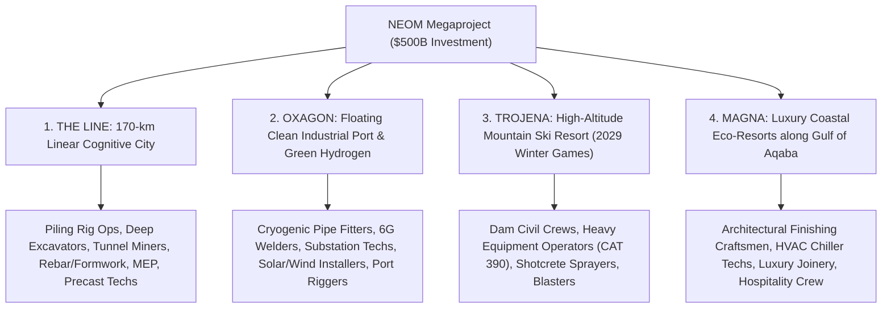
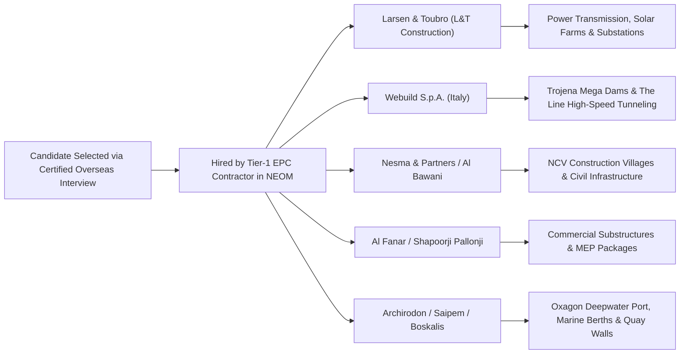
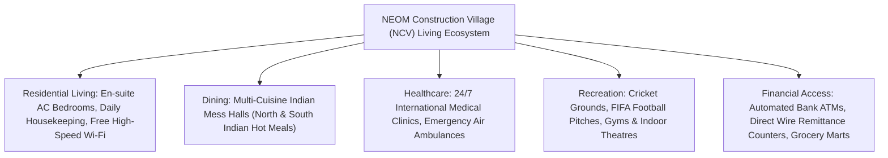
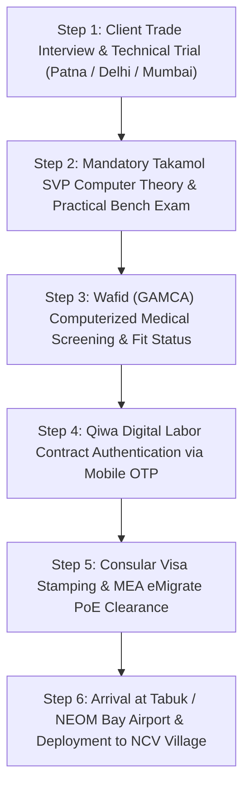

# NEOM Project Latest Updates & Mega Recruitment 2026/2027: The Line, Oxagon, Trojena Jobs, High Salaries (SAR 3,000–8,500+), Qiwa Contracts, Takamol Tests & Direct EPC Hiring Guide

As the crowning jewel of the **Kingdom of Saudi Arabia’s Vision 2030** transformation, **NEOM (نيوم)** represents the most audaciously ambitious, capital-intensive engineering undertaking in human history. Backed by the sovereign **Public Investment Fund (PIF)** with an investment allocation exceeding **$500 Billion USD**, this futuristic 26,500-square-kilometer giga-region located along the Red Sea coast in Tabuk Province has transitioned decisively from architectural blueprints into an intense, round-the-clock physical construction mobilization.

With more than **140,000 active construction personnel, civil engineers, project managers, and technical tradesmen** already deployed on site across massive developments—and total on-site workforce projections scaling past **300,000 personnel** toward 2027—NEOM has emerged as the premier overseas employment corridor for Indian and South Asian professionals.

Crucially, **late 2026 marks unprecedented technical milestones and structural recruitment acceleration**:

- **The Line Foundations & Tunneling Breakthroughs:** Piling operations across the initial 2.4-kilometer Marina sector of **The Line** have completed record-breaking deep foundation excavation, moving over 1 million cubic meters of earth weekly. Underground high-speed rail tunneling (the "Spine") and modular precast substructures are advancing under mega-contracts awarded to premier international consortia.
- **Oxagon & Green Hydrogen Gigafactory:** Industrial installation is in full swing at **Oxagon**, the world's largest floating industrial port complex. The **NEOM Green Hydrogen Company (NGHC)**—an $8.4 Billion joint venture between ACWA Power, Air Products, and NEOM—is erecting thousands of specialized solar and wind power arrays, high-voltage substations, and 2.2 Gigawatts of advanced thyssenkrupp Nucera electrolyzers, triggering huge recruitment demand for electrical, instrumentation, and cryogenic piping specialists.
- **Trojena Winter Games Infrastructure Rush:** Preparing to host the **2029 Asian Winter Games**, the mountain mega-resort of **Trojena** is executing complex dam engineering for its freshwater artificial lake, subterranean tunneling for "The Vault", and high-altitude road cutting, requiring heavy earthmoving machinery operators, blast-hole drillers, and structural civil contractors.
- **Strengthened Saudi Labor Protections:** Workers deployed to NEOM enjoy strict statutory oversight under the **Saudi Ministry of Human Resources and Social Development (MHRSD)** through the **[Qiwa Digital Platform (qiwa.sa)](https://www.qiwa.sa/)**. Direct electronic contracts, transparent probationary terms, automated monthly wage protection (WPS), and mandatory **Takamol Skill Verification Program (SVP)** certifications protect candidates against historic Gulf recruitment vulnerabilities.
- **Unrivaled Living Standards in NEOM Construction Villages (NCV):** Unlike conventional industrial camps, workers at NEOM are accommodated in state-of-the-art **NEOM Construction Villages (NCV 1 to NCV 8)**—featuring individual air-conditioned en-suite bedrooms, high-speed fiber-optic Wi-Fi, multicuisine Indian dining facilities, athletic stadiums, recreational cinema centers, and accredited on-site medical clinics.

This comprehensive, authoritative master guide by **WorkWise Visa** details the active mega-regions, top hiring EPC contractors, authentic salary schedules in Saudi Riyals (SAR) and Indian Rupees (INR), the Takamol testing process, Qiwa contract verification, and verified recruitment pathways for 2026/2027.

---

## Master Directory: Official Saudi & NEOM Sovereign Portals & Verification Directory

To protect yourself against deceptive middlemen circulating counterfeit "NEOM Authority Direct Employment Offers", always cross-reference recruitment mandates, trade test credentials, and visa issuance through official sovereign and corporate portals:

| Governing Body / Sovereign Portal                                  | Jurisdiction & Statutory Mandate                                                                                   | Official Digital Portal                                                                              | Primary Verification Function                                                                           |
| :----------------------------------------------------------------- | :----------------------------------------------------------------------------------------------------------------- | :--------------------------------------------------------------------------------------------------- | :------------------------------------------------------------------------------------------------------ |
| **NEOM Official Sovereign Portal**                                 | Executive authority managing the planning, commercial partnerships, and development of NEOM                        | [neom.com](https://www.neom.com/)                                                                    | **[NEOM Global Megaproject Hub](https://www.neom.com/en-us)**                                           |
| **NEOM Careers & Talent Portal**                                   | Official corporate hiring gateway for direct engineering, corporate, and operational positions                     | [careers.neom.com](https://careers.neom.com/)                                                        | **[Official NEOM Job Listings & Applications](https://careers.neom.com/)**                              |
| **Qiwa Platform (MHRSD - قوى)**                                    | Ministry of Human Resources and Social Development portal governing all digital work contracts and Iqama approvals | [qiwa.sa](https://www.qiwa.sa/)                                                                      | **[Qiwa Electronic Contract Authentication](https://www.qiwa.sa/en/services/work-contracts)**           |
| **Takamol Skill Verification Program (SVP - برنامج الفحص المهني)** | Sovereign testing body evaluating trade competency and certifying blue-collar artisans before visa issuance        | [svp.qiwa.sa](https://svp.qiwa.sa/)                                                                  | **[Takamol Candidate Verification & Test Booking](https://svp.qiwa.sa/en)**                             |
| **Wafid (GAMCA) Medical Portal**                                   | Gulf Health Council accredited medical network executing computerized pre-departure health clearances              | [wafid.com](https://wafid.com/)                                                                      | **[Wafid Online Appointment & Fit Slip Verification](https://wafid.com/)**                              |
| **Ministry of Foreign Affairs (MOFA KSA - منصة التأشيرات)**        | Sovereign diplomatic gateway issuing Visa Authorization Slips (Wakala) and adjudicating work visas                 | [visa.mofa.gov.sa](https://visa.mofa.gov.sa/)                                                        | **[KSA Visa Verification & Stamping Status](https://visa.mofa.gov.sa/)**                                |
| **Royal Embassy of Saudi Arabia (New Delhi)**                      | Sovereign diplomatic mission processing work visa endorsements for Northern & Eastern Indian candidates            | [saudiembassy.net](https://www.saudiembassy.net/)                                                    | **[Consular Work Visa Guidelines](https://www.saudiembassy.net/)**                                      |
| **Royal Consulate General of Saudi Arabia (Mumbai)**               | Diplomatic mission processing consular visa stamping for Western & Southern Indian applicants                      | [embassies.mofa.gov.sa/sites/India](https://embassies.mofa.gov.sa/sites/India/EN/Pages/default.aspx) | **[Consulate Services & Attestation](https://embassies.mofa.gov.sa/sites/India/EN/Pages/default.aspx)** |
| **Ministry of External Affairs (MEA India - eMigrate)**            | Sovereign Indian platform governing licensed recruitment agencies, PoE clearances, and PBBY insurance              | [emigrate.gov.in](https://emigrate.gov.in)                                                           | **[eMigrate Emigration Clearance Portal](https://emigrate.gov.in)**                                     |

---

## Explore WorkWise Visa Dedicated Portals & Gulf Career Hubs

Before attending technical client interviews or booking your Takamol skill evaluation, explore our sovereign migration directories and dedicated regional centers:

- **[All Global Work Visa Destinations Directory](/countries)** — Compare overseas career pathways across Saudi Arabia, UAE, Qatar, Singapore, Japan, South Korea, and Schengen Europe.
- **[Saudi Arabia Work Visa & NEOM Comprehensive Guide 2026](/countries/saudi-arabia)** — Complete country guide covering living costs, Iqama rules, and salary benchmarks.
- **[Live Verified Overseas Job Vacancies & Demands](/jobs)** — Discover authenticated, employer-vetted openings for NEOM piping fabricators, heavy equipment mechanics, MEP technicians, and safety officers.
- **[Track Your Visa Status Live](/track)** — Real-time tracking portal for candidate dossiers, Takamol test bookings, and Saudi visa stamping.
- **[Takamol SVP Trade Test Complete Master Guide 2026](/blogs/takamol-svp-skill-verification-program-saudi-arabia-trade-test-guide-2026)** — Syllabus, practical bench marking, Indian center directory (Patna, Gorakhpur, Delhi, Mumbai), and pass rules.
- **[Wafid (GAMCA) Medical Examination 2026 Complete Guide](/blogs/wafid-gamca-medical-examination-2026-online-appointment-rules-fit-unfit-criteria)** — Complete manual on online slip booking, TB scarring re-tests, fit/unfit criteria, and GCC guidelines.
- **[Bihar & UP Gulf Work Visa Guide 2026: Scam Protection & Sahi Process](/blogs/bihar-up-gulf-work-visa-guide-process-scam-protection-2026)** — Ground reality guidance for candidates from Eastern UP and Bihar to ensure zero-fraud deployment.
- **[Singapore Work Permit & S Pass Complete Master Guide 2026](/blogs/singapore-work-permit-s-pass-complete-guide-2026-jobs-salary-mom-ipa)** — Explore alternative high-paying trade pathways in Singapore's BCA construction and shipyard sectors.
- **[B2B Overseas Recruitment Agency & Employer Partnership](/b2b-partner)** — Direct recruitment collaboration channels for Saudi EPC contractors, electromechanical conglomerates, and manpower logistics operators.
- **Our Regional Support & Document Verification Branches:**
  - **[Patna Head Office (Bihar)](/locations/patna)** | **[Noida Regional Desk](/locations/noida)** | **[Delhi / NCR Branch](/locations/delhi)**
  - **[Siwan Branch Office](/locations/siwan)** | **[Gopalganj Regional Branch](/locations/gopalganj)** | **[Gorakhpur Branch (UP)](/locations/gorakhpur)**

---

## 1. NEOM’s 4 Core Mega-Regions: Construction Progress & Active Job Demands

NEOM is not a conventional standalone city; it is a sprawling industrial and urban ecosystem divided into four interconnected macro-regions, each requiring distinct engineering disciplines:

### 1. THE LINE: Deep Piling, The Spine Rail & Modular Framing

**The Line** is a revolutionary 170-kilometer-long, 500-meter-tall, and 200-meter-wide cognitive linear city designed to run entirely on 100% renewable energy without roads, cars, or carbon emissions.

- **Current Construction Status:** Mega piling and foundational excavation are underway across the premier coastal section ("Hidden Marina"). More than 20,000 deep structural foundation piles have already been driven into bedrock by international specialized contractors like Trevi, Bauer, and Keller.
- **Active Technical Trade Demands:**
  - Hydraulic Piling & Rotary Drilling Rig Operators (Casagrande, Soilmec, Bauer BG series).
  - Heavy Earthmoving Operators: CAT 349/390 excavators, Komatsu articulated dump trucks, D9 bulldozers.
  - Underground Tunnel Miners & TBM (Tunnel Boring Machine) crew for "The Spine" high-speed rail corridor.
  - Rebar Steel Fixers & Heavy Structural Formwork Carpenters for massive reinforced concrete subterranean rafts.
  - Industrial Surveyors & Geotechnical Soil Testing Technicians operating advanced GPS/LiDAR stations.

### 2. OXAGON: The World’s Largest Floating Industrial City & Green Energy Hub

Located on the Red Sea coast near the Suez Canal maritime route, **Oxagon** integrates an advanced automated port, global logistics parks, and next-generation manufacturing clusters.

- **Current Construction Status:**
  - **NEOM Green Hydrogen Plant (NGHC):** Over 60% completed on structural mechanical packages. Installing 4,000+ Megawatts of dedicated solar and wind power in the high-desert plains, massive 380kV high-voltage switchyards, and cryogenic ammonia production storage spheres.
  - **Duba Port Expansion (Port of NEOM):** Deepwater dredging, new container quay wall fabrication, and automated crane rail civil works by marine EPC giants Archirodon and Boskalis.
- **Active Technical Trade Demands:**
  - 6G SMAW, GTAW (TIG), and FCAW Pipe Welders certified on cryogenic stainless steel and duplex alloys.
  - Pipe Fabricators & Spool Riggers experienced in high-pressure steam and hydrogen distribution loops.
  - High-Voltage (HV/EHV) Substation Cable Jointers, Industrial Electricians, and Relay Technicians.
  - Solar PV Panel Mounting Technicians and Wind Turbine Mechanical Assemblers.
  - Instrumentation & Control (I&C) Technicians for SCADA, distributed control systems (DCS), and pneumatic loop checks.

### 3. TROJENA: Mountain Engineering for the 2029 Asian Winter Games

Perched in the Sarawat Mountains of Tabuk Province with elevations exceeding 2,600 meters above sea level, **Trojena** is designed as a year-round mountain resort featuring outdoor ski slopes, mountain biking trails, luxury wellness chalets, and an enormous artificial freshwater lake.

- **Current Construction Status:** Consortiums led by Italian engineering titan Webuild and Saudi partners are constructing three massive dams to retain the central artificial lake. Heavy blasting, rock anchoring, and underground cavern excavation for "The Vault" (a vertical subterranean village) are accelerating rapidly.
- **Active Technical Trade Demands:**
  - Certified Blast Hole Drillers, Rock Anchoring Mechanics, and Grouting Technicians.
  - Shotcrete & Gunite Concrete Sprayers for steep mountain slope stabilization.
  - Dam Construction Civil Technicians, Heavy Vibratory Roller Drivers, and Batching Plant Operators.
  - Rough-Terrain Mobile Crane Operators and Heavy Riggers handling precast modules on mountain roads.
  - Specialized Cold-Climate MEP Technicians and Structural Steel Erectors.

### 4. MAGNA: Ultra-Luxury Coastal Destinations on the Gulf of Aqaba

Spanning 12 distinct destinations along the pristine Gulf of Aqaba coastline—including Leyja, Epicon, Siranna, Utamo, Norlana, Aquellum, Zardun, Xaynor, Elanan, Gidori, Treyam, and Jaumur.

- **Current Construction Status:** Luxury boutique eco-residences, marina yacht berths, and cliffside architectural chalets are in active civil execution.
- **Active Technical Trade Demands:**
  - Architectural Finishers: Marble masons, luxury gypsum ceiling installers, decorative plasterers.
  - Central HVAC Chiller Technicians, BMS (Building Management System) Operators, and Firefighting Technicians.
  - Master Joinery Carpenters, Architectural Glass Glaziers, and Landscape Horticulture Supervisors.

---

## 2. Top EPC Contractors Actively Hiring for NEOM

The vast majority of workforce recruitment for NEOM is executed not directly by the sovereign NEOM authority, but by **Tier-1 International Engineering, Procurement, and Construction (EPC) Contractors** and their specialized sub-contractors:

| EPC Contractor                         | Origin         | Major Project Packages in NEOM                                                                     | Primary Trades Actively Recruited                                                                   |
| :------------------------------------- | :------------- | :------------------------------------------------------------------------------------------------- | :-------------------------------------------------------------------------------------------------- |
| **Larsen & Toubro (L&T Construction)** | India / Global | NEOM Green Hydrogen 4 GW Solar & Wind Generation, 380kV EHV Substations, Power Transmission Grids  | Industrial Electricians, Cable Jointers, Substation Fitters, Steel Tower Riggers, Civil Supervisors |
| **Webuild S.p.A.**                     | Italy          | Trojena 3 Mega Dams, Artificial Lake Excavation, The Line High-Speed Rail "Spine" Tunneling        | TBM Miners, Tunnel Excavator Drivers, Shotcrete Technicians, Heavy Mechanics, Dam Civil Foremen     |
| **Nesma & Partners**                   | Saudi Arabia   | Pioneer Camp Housing, NEOM Construction Villages (NCV), Bulk Earthworks, Highway Arteries          | Heavy Dump Truck Drivers, Grader Operators, Asphalt Mechanics, Batching Plant Technicians           |
| **Al Bawani Contracting**              | Saudi Arabia   | The Line Subterranean Modules, Hospital Facilities, Administrative Headquarters, Security Stations | Rebar Steel Fixers, Formwork Carpenters, Plasterers, MEP Plumbing & Firefighting Technicians        |
| **Al Fanar Company**                   | Saudi Arabia   | Electrical Infrastructure, Renewable Power Sub-stations, Underground Cabling Networks              | MV/HV Cable Pullers, Transformer Assembly Technicians, Relay & Instrumentation Engineers            |
| **Archirodon Construction**            | Greece / KSA   | Port of NEOM (Oxagon) Quay Wall Construction, Marine Basin Dredging, Coastal Breakwaters           | Marine Riggers, Structural Marine Welders, Tugboat Mechanics, Crane Operators                       |
| **FCC Construction / Trevi**           | Spain / Italy  | The Line Deep Piling Foundations, Diaphragm Wall Construction, Jet Grouting                        | Hydraulic Piling Rig Mechanics, Mud Circulation Technicians, Bentonite Plant Operators              |

---

## 3. Verified Salary Matrix, Overtime & Savings (SAR vs. INR Benchmarks 2026/2027)

Salaries in Saudi Arabia are **100% tax-free**. Under standard corporate EPC packages at NEOM, employers provide **free accommodation, free food, free site transport, medical insurance, and paid annual flight tickets**, enabling workers to remit nearly their entire paycheck.

_Benchmark Exchange Rate: **1 Saudi Riyal (SAR) ≈ ₹22.50 to ₹23.00 Indian Rupees (INR)**._

| Occupational Trade / Job Role                 | Monthly Basic Salary (SAR) | Fixed Site / OT Allowance (SAR) | Total Gross Monthly Salary (SAR) | Total Monthly In-Hand (INR ₹)  |
| :-------------------------------------------- | :------------------------- | :------------------------------ | :------------------------------- | :----------------------------- |
| **Shuttering Carpenter / Rebar Steel Fixer**  | SAR 1,600 – 2,200          | SAR 400 – 700                   | **SAR 2,000 – 2,900**            | **₹46,000 – ₹66,000 INR**      |
| **Mason (Block / Plaster / Tile)**            | SAR 1,600 – 2,100          | SAR 400 – 650                   | **SAR 2,000 – 2,750**            | **₹46,000 – ₹63,000 INR**      |
| **Structural / Pipe Fabricator**              | SAR 2,000 – 2,800          | SAR 600 – 1,000                 | **SAR 2,600 – 3,800**            | **₹60,000 – ₹87,000 INR**      |
| **6G TIG / SMAW / Arc Welder**                | SAR 2,400 – 3,500          | SAR 800 – 1,400                 | **SAR 3,200 – 4,900**            | **₹73,000 – ₹1,12,000 INR**    |
| **Industrial / Substation Electrician**       | SAR 2,000 – 2,800          | SAR 600 – 950                   | **SAR 2,600 – 3,750**            | **₹60,000 – ₹86,000 INR**      |
| **Instrumentation & Control (I&C) Tech**      | SAR 2,500 – 3,600          | SAR 700 – 1,200                 | **SAR 3,200 – 4,800**            | **₹73,000 – ₹1,10,000 INR**    |
| **Excavator / Bulldozer / Grader Operator**   | SAR 2,500 – 3,400          | SAR 700 – 1,100                 | **SAR 3,200 – 4,500**            | **₹73,000 – ₹1,03,000 INR**    |
| **Mobile Crane / Tower Crane Operator**       | SAR 3,000 – 4,500          | SAR 800 – 1,500                 | **SAR 3,800 – 6,000**            | **₹87,000 – ₹1,38,000 INR**    |
| **Land Surveyor / GPS Instrument Tech**       | SAR 3,200 – 4,800          | SAR 800 – 1,400                 | **SAR 4,000 – 6,200**            | **₹92,000 – ₹1,42,000 INR**    |
| **HSE Safety Officer (NEBOSH IGC Certified)** | SAR 3,800 – 6,000          | SAR 1,000 – 1,800               | **SAR 4,800 – 7,800**            | **₹1,10,000 – ₹1,79,000 INR**  |
| **QA/QC Civil / Mechanical Inspector**        | SAR 4,500 – 7,500          | SAR 1,200 – 2,000               | **SAR 5,700 – 9,500**            | **₹1,31,000 – ₹2,18,000 INR**  |
| **Site Engineer (Civil / Electrical / Mech)** | SAR 6,000 – 11,000         | SAR 1,500 – 3,000               | **SAR 7,500 – 14,000+**          | **₹1,72,000 – ₹3,22,000+ INR** |

### Working Hours, Overtime & Statutory Benefits:

- **Standard Work Schedule:** 8 hours per day, 6 days per week (48 hours/week) under the Saudi Labour Law.
- **Overtime Calculation (Article 107 of Saudi Labour Law):** Overtime hours are compensated at **150% of the basic hourly wage (1.5x)**. Because of intensive schedule milestones at NEOM, workers commonly complete 2 to 3 hours of daily overtime, significantly boosting in-hand monthly remuneration.
- **End-of-Service Gratuity (ESB):** Upon contract completion, workers receive statutory severance pay equal to **half a month's wage for each of the first 5 years**, and **one full month's wage for each subsequent year**.

### Net Monthly Savings Comparison: India vs. Standard Gulf vs. NEOM Megaproject

| Financial Metric / Head              | Domestic Indian Metro Sites | Standard Gulf Subcontractor (Dubai / Riyadh) | NEOM Tier-1 EPC Mega Project (Tabuk)            |
| :----------------------------------- | :-------------------------- | :------------------------------------------- | :---------------------------------------------- |
| **Gross Monthly Remuneration**       | ₹20,000 – ₹32,000 INR       | SAR 1,400 – 1,800 (~₹32,000 – ₹41,000)       | **SAR 2,800 – 4,800+ (~₹64,000 – ₹1,10,000+)**  |
| **Accommodation Cost**               | Self-paid (₹4,000 – ₹8,000) | Cramped shared suburban camp                 | **100% Free Air-Conditioned En-suite NCV Unit** |
| **Food & Mess Cost**                 | Self-paid (₹4,000 – ₹6,000) | Deducted or self-cooked (SAR 300)            | **100% Free 3 Hot Indian Buffet Meals Daily**   |
| **Daily Site Commute**               | Self-paid local transport   | Standard crowded labor bus                   | **Free Modern Air-Conditioned Shuttle Fleet**   |
| **Overtime Earnings**                | Irregular or unpaid         | 1 hr/day depending on site budget            | **Guaranteed 2–3 hrs/day at 1.5x basic pay**    |
| **Statutory Healthcare**             | Minimal out-of-pocket       | Basic clinic network                         | **Full 24/7 NCV On-site Medical Hospital**      |
| **NET Monthly Remittance to Family** | **₹10,000 – ₹18,000 INR**   | **₹24,000 – ₹32,000 INR**                    | **₹58,000 – ₹98,000+ INR Clean Remittance**     |

---

## 4. Life at Site: Inside the NEOM Construction Villages (NCV)

One of the most defining aspects of working at NEOM is the unprecedented standard of worker welfare. To prevent the substandard camp conditions historically associated with remote desert sites, NEOM designed and constructed purpose-built **Construction Villages (NCV 1 through NCV 8)**:

- **Living Quarters:** High-spec modular accommodations with individual climate-controlled air conditioning, private or shared en-suite bathrooms, ergonomic bedding, storage lockers, and daily laundry service.
- **Nutrition & Catering:** Dedicated central dining halls operated by international catering conglomerates (e.g., Sodexo, Tamimi Global, Nesma). Serves authentic hot North Indian and South Indian meals (fresh chapatis, daal, rice, curries, chicken/mutton dishes, and vegetarian alternatives).
- **Sports & Recreation:** Full-sized floodlit cricket grounds, FIFA-grade artificial turf football stadiums, basketball courts, fully equipped fitness gymnasiums, and recreation lounges with pool tables and satellite televisions.
- **Healthcare & Safety:** Advanced on-site health complexes staffed with multilingual physicians, nursing teams, diagnostic X-ray units, and dedicated emergency medical evacuation protocols.

---

## 5. The 6-Stage Recruitment, Testing & Deployment Pipeline

Securing an authentic job at NEOM follows an established, digitally verifiable regulatory sequence:

### Stage 1: Client Selection & Technical Trade Trial

Interviews are conducted by visiting technical delegations from L&T, Webuild, Nesma, or Al Bawani at accredited overseas trade testing facilities in India (such as WorkWise Visa testing centers in Patna, Siwan, Gorakhpur, or Noida). Candidates must demonstrate practical mastery—such as 6G welding radiography coupons, pipe spool alignment, rebar cage tying, or heavy excavator trenching.

### Stage 2: The Mandatory Takamol Skill Verification Program (SVP)

Under Saudi Arabian federal regulations, any candidate traveling under a technical profession code (such as _Electrician_, _Welder_, _Plumber_, _Mason_, _Carpenter_, _Auto Mechanic_) must clear the **[Takamol Professional Verification Program (SVP)](https://svp.qiwa.sa/)**:

- **Exam Format:** Divided into a **Computer-Based Theory Exam (CBT)** with translated multiple-choice questions in Hindi/Urdu/English covering safety symbols and tools, followed by a **Practical Bench Examination** supervised by certified Takamol evaluators.
- **Center Locations in India:** Centers operate in **New Delhi, Mumbai, Patna, Gorakhpur, Lucknow, Hyderabad, Bengaluru, Chennai, and Kochi**.
- **Practical Trade Benchmarks:**
  - _Welder (6G TIG/SMAW):_ Root penetration, hot pass, capping on carbon/stainless steel coupon evaluated via visual & X-ray radiographic inspection.
  - _Electrician:_ Reading Single Line Diagrams (SLD), wiring 3-phase star-delta starter control circuits, and multimeter circuit testing.
  - _Plumber & Pipe Fitter:_ Isometric blueprint reading, pipe beveling, thread cutting, cold bending, and hydrostatic pressure testing.
  - _HVAC Technician:_ Compressor motor circuit wiring, vacuum holding leak tests, refrigerant charging, and manifold diagnostics.
- _Crucial:_ Without a passed Takamol certificate linked directly to your passport number on the Qiwa platform, **the Saudi Embassy will strictly refuse to stamp your work visa.**

### Stage 3: Wafid (GAMCA) Computerized Medical Screening

Candidates register on **[wafid.com](https://wafid.com/)** and pay the standard $10 USD booking fee to receive an automatically assigned medical slip at an accredited GCC diagnostic hospital in India:

- Screened for active pulmonary tuberculosis (digital chest X-ray), HIV 1/2, Hepatitis B & C, syphilis, and physical mobility.
- Upon passing, the clinic uploads the **"FIT" status** directly into the Saudi MOFA central immigration database.

### Stage 4: Authentication of the Electronic Qiwa Work Contract

This is the ultimate legal protection against contract substitution:

1. The sponsoring EPC company creates the digital employment contract on **[qiwa.sa](https://www.qiwa.sa/)**.
2. The contract explicitly registers your **basic monthly salary, overtime rate, job designation, working hours, and medical coverage**.
3. You receive an official SMS notification with an authentication link.
4. You review the contract online in English or Arabic and accept it via digital OTP verification.
5. Once accepted, the contract is locked into the sovereign Ministry of Human Resources system and cannot be altered or substituted upon your arrival in Saudi Arabia.

### Stage 5: Consular Visa Stamping & MEA eMigrate Clearance

- The candidate's original passport, Takamol certificate, Wafid Fit report, and authenticated Police Clearance Certificate (PCC) issued by the **Passport Seva Kendra (PSK)** are submitted to the **Royal Embassy of Saudi Arabia in New Delhi** or the **Consulate in Mumbai** via authorized VFS Tasheel centers.
- For ECR passport holders, deployment is registered on the **[eMigrate (emigrate.gov.in)](https://emigrate.gov.in)** portal with mandatory **Pravasi Bharatiya Bima Yojana (PBBY)** insurance (₹10 Lakh death/disability coverage).

### Stage 6: Deployment & Port-of-Entry Arrival

Workers fly on commercial flights to **Tabuk Regional Airport (TUU)** (approx. 2 hours coach transfer to site) or directly into **NEOM Bay Commercial Airport (NUM)**. Company liaison officers receive workers at the terminal, arrange transport directly to assigned Construction Villages (NCV), issue local Saudi SIM cards, and coordinate biometric fingerprinting for physical **Iqama (Muqeem Residence Permit)** issuance within 14 days.

---

## 6. CRITICAL ANTI-SCAM ADVISORY: Protecting Yourself from Fake NEOM Offers

Because of the enormous global fame of the NEOM project, international syndicates and unscrupulous local agents routinely fabricate fraudulent paperwork to extort lakhs of Rupees from job seekers.

> [!CAUTION]
> **Top 4 Signs of a Fraudulent NEOM Job Offer:**
>
> **1. The "Direct NEOM Authority HR Hiring Letter":**  
> Fraudsters issue multi-page PDF offer letters bearing high-resolution NEOM logos, signed by fictitious executives such as "Director of Human Resources, NEOM Project". **THIS IS 99% A SCAM.** The direct entity _NEOM Company_ recruits corporate executives, planners, and specialized directors directly through `careers.neom.com`. Blue-collar artisans, technicians, and site engineers are **almost exclusively recruited and hired by accredited EPC contractors (such as L&T, Webuild, Nesma, Al Bawani)**. If an agent claims you are being hired "directly by the Prince of Saudi Arabia or NEOM Authority" for a helper or welder role, it is fraudulent.
>
> **2. Demands to Deposit Money into Private Indian Bank Accounts:**  
> Scammers often send fake appointment letters and demand ₹30,000 to ₹1,50,000 for "NEOM Security Clearance", "Camp Reservation", or "Aramco Badge Insurance". Sovereign Saudi visa processing has fixed, transparent statutory fees. Legitimate EPC contractors do not ask candidates to transfer money to personal Google Pay or PhonePe accounts.
>
> **3. Absence of a Qiwa Digital Verification Record:**  
> If an agent provides you with a paper contract but cannot generate an authenticated contract link on the official sovereign **[qiwa.sa](https://www.qiwa.sa/)** platform, the job offer is 100% illegitimate. Always insist on seeing your active Qiwa electronic contract prior to handing over your passport for final visa stamping.
>
> **4. Skipping the Takamol Trade Test:**  
> Any sub-agent who claims: _"You don't need to take the Takamol test; I have direct setting in the embassy to stamp your welder/electrician visa without an exam"_ is lying. Saudi consular systems are digitally interlocked with Takamol's database. A visa with a technical trade code physically cannot be generated without an authenticated Takamol pass record.

### Official Saudi Labor Helpline & Grievance Mechanism:

If you encounter any illegal demands or employment irregularities:

- **MHRSD Sovereign Toll-Free Labor Hotline:** Call **19911** from inside Saudi Arabia (press 2 for Hindi/Urdu assistance, available 24/7).
- **Online Grievance Registration:** File formal complaints via the Ministry portal at **[labor.hrsd.gov.sa](https://labor.hrsd.gov.sa)** or through your **Qiwa** individual dashboard.

---

## 7. Frequently Asked Questions (FAQs) — NEOM Megaproject Recruitment

### Q1. Where is NEOM located and how does a worker travel there?

**Ans:** NEOM is located in the northwestern Tabuk Province of Saudi Arabia, bordering the Red Sea and the Gulf of Aqaba. Workers arrive via international commercial flights landing at **Tabuk Regional Airport (TUU)** (approx. 2 hours drive to site) or the specialized **NEOM Bay Airport (NUM)**. EPC companies provide air-conditioned luxury coach transport directly from the airport terminal to your designated Construction Village.

### Q2. Is food and accommodation really free at NEOM?

**Ans:** Yes. Under standard Tier-1 EPC employment contracts operating in NEOM, furnished air-conditioned accommodation in a licensed NEOM Construction Village (NCV) and three hot meals daily in the central Indian mess are provided **100% free of charge**. Your gross salary in Saudi Riyals is paid without unauthorized deductions for rent or food.

### Q3. What is the Takamol SVP test and is it compulsory for NEOM?

**Ans:** Yes. The **Takamol Skill Verification Program (SVP)** is a mandatory sovereign requirement established by the Saudi Ministry of Human Resources. If your visa profession code is a skilled trade (electrician, welder, plumber, carpenter, mason, refrigeration technician, auto mechanic), you must pass both the computer theory test and the practical bench test at an accredited Indian test center before the Saudi Embassy will issue your work visa.

### Q4. Can a worker change companies while working in NEOM?

**Ans:** Yes. Under the Saudi Labor Reform Initiative (LRI) active on the **Qiwa platform**, foreign workers can transfer their sponsorship (_Naqal Kafala_) to another employer upon completion of their contract period without requiring the previous employer's consent (NOC). If an employer fails to pay wages for 3 consecutive months or fails to renew your Iqama within statutory timelines, you are legally entitled to an immediate sponsor transfer through Qiwa.

### Q5. How much money can an Indian worker save each month at NEOM?

**Ans:** Because accommodation, meals, laundry, and medical insurance are provided free by the EPC contractor, workers spend very little on site (typically SAR 200 to SAR 400 for personal phone data and toiletries). A skilled artisan earning SAR 2,800 to SAR 3,800 gross (basic + OT) saves between **SAR 2,500 and SAR 3,400 monthly**, allowing them to remit **₹58,000 to ₹78,000 INR clean to India every month**. Specialized operators and supervisors earning SAR 5,000 to SAR 8,000 remit between **₹1,15,000 and ₹1,80,000 INR per month**.

### Q6. Are women allowed to work in the NEOM project?

**Ans:** Yes, absolutely. Under Saudi Arabia’s Vision 2030, tens of thousands of women are actively employed across NEOM in architectural engineering, project planning, quality control inspection, administrative operations, nursing, hospitality, and safety supervision. NEOM Construction Villages maintain dedicated female residential complexes with full security and modern amenities.

### Q7. What medical tests are required for a Saudi work visa for NEOM?

**Ans:** Candidates must undergo the standardized computerized **Wafid (GAMCA)** medical screening in India. Key tests include a digital chest X-ray (confirming clear lungs free of active pulmonary TB), serology blood tests for HIV, Hepatitis B (HBsAg), Hepatitis C (Anti-HCV), VDRL (Syphilis), and general liver/kidney function tests.

### Q8. What is the minimum educational requirement for NEOM jobs?

**Ans:** Requirements vary by trade:

- **General Helpers / Civil Labor:** 10th Standard Matriculation or literate with basic communication skills.
- **Skilled Craftsmen (Carpenters, Masons, Welders):** ITI trade certificate or minimum 2 to 3 years verifiable site experience + Takamol passing slip.
- **Heavy Machinery Operators:** Valid GCC or Indian Heavy Transport Vehicle (HTV) driving license with minimum 3 years proven commercial operation.
- **Safety Officers:** College Degree or Diploma + certified **NEBOSH IGC** (International General Certificate) qualification.
- **Engineers / Surveyors:** Polytechnic Diploma or B.Tech / B.E. in Civil, Mechanical, or Electrical Engineering.

### Q9. What happens during extreme summer heat in NEOM?

**Ans:** Saudi Arabia enforces a strict statutory **Summer Midday Work Ban** between June 15 and September 15 under MHRSD regulations, prohibiting outdoor physical labor under direct sunlight from **12:00 PM to 3:00 PM**. Construction sites operate on split morning and twilight shifts, equipped with air-conditioned mobile respite cabins, chilled water dispensers, and electrolyte hydration stations.

### Q10. How can Indian candidates apply safely through WorkWise Visa?

**Ans:** Candidates can visit WorkWise Visa verification branches in **Patna, Siwan, Gopalganj, Gorakhpur, and Noida/Delhi** for preliminary skill pre-assessment and document vetting. We connect qualified artisans directly with visiting technical interview delegations from Tier-1 EPC contractors (L&T, Nesma, Webuild), coach candidates for the Takamol SVP examination, verify electronic Qiwa contracts, and process eMigrate PoE clearance under the Ministry of External Affairs.

---

## Conclusion: Build Your Future on the World’s Grandest Megaproject with WorkWise Visa

The NEOM project is not merely an overseas job; it is a once-in-a-generation career accelerator. Working on projects of this technological scale—from cryogenic green hydrogen electrolyzers to linear cognitive civil engineering—imparts world-class technical credentials that elevate a professional's international earning power for decades to come.

At **WorkWise Visa**, we ensure your journey to NEOM is 100% legal, transparent, and direct:

- Regular client interview delegations from Tier-1 EPC contractors (Larsen & Toubro, Nesma, Webuild, Al Bawani).
- Hands-on technical trade test orientation and computer CBT coaching for the Takamol SVP examination.
- Transparent Qiwa electronic contract verification, Wafid medical guidance, and eMigrate PoE clearance under the Ministry of External Affairs.

Visit our specialized recruitment branches in **[Patna](/locations/patna)**, **[Siwan](/locations/siwan)**, **[Gopalganj](/locations/gopalganj)**, **[Gorakhpur](/locations/gorakhpur)**, and **[Noida / Delhi NCR](/locations/noida)**, explore live vacancies on our **[Jobs Portal](/jobs)**, or contact our Gulf Career Desk today to register for upcoming NEOM interview drives.
