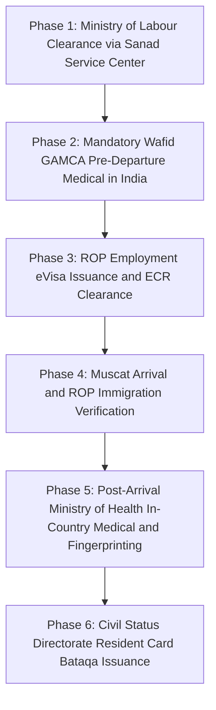

# Oman 2-Year Employment Visa & Royal Oman Police (ROP) Work Permit Complete Guide 2026: MoL Sanad Clearance, Royal Decree 53/2023, Wafid Medical, Resident Card (Bataqa) & Minimum Salaries

The Sultanate of Oman stands out across the Gulf Cooperation Council (GCC) as one of the most stable, secure, and legally transparent destinations for international skilled workers and vocational tradesmen. Driven by the ambitious **Oman Vision 2040** economic diversification blueprint, massive industrial developments in the **Special Economic Zone at Duqm (SEZAD)**, the expansion of the **Sohar Port and Freezone**, and mega-scale green hydrogen projects, Oman continues to attract tens of thousands of certified Indian professionals, engineers, technicians, and specialized tradespeople every year.

However, Oman's foreign recruitment framework has undergone a major modernization with the enforcement of the **New Oman Labour Law (promulgated under Royal Decree No. 53/2023)**. The government has streamlined administrative touchpoints through the **Ministry of Labour (MoL) Sanad electronic services**, strengthened the **Royal Oman Police (ROP) Directorate General of Passports and Civil Status** digital eVisa portal, and implemented strict enforcement of worker rights, statutory working hour caps, and the mandatory **Wage Protection System (WPS)**.

This definitive 2026 master guide provides an exhaustive, step-by-step breakdown of securing an **Oman 2-Year Employment Visa**, passing the **Wafid (formerly GAMCA)** pre-departure medical, clearing MoL labor quota sanctions, obtaining your **Civil Status Resident Card (Bataqa)**, analyzing the high-value **Omani Rial (OMR) currency economics**, and comparing real-world 2026 monthly trade salaries in Indian Rupees (INR).

---

## 1. Oman Labour Law Reforms (Royal Decree 53/2023): What Workers Must Know

The promulgation of **Royal Decree 53/2023** marked the most comprehensive update to Oman's employment regulations in over two decades. The law recalibrates the relationship between foreign expatriates and sponsoring enterprises (*Arbab*), enshrining powerful statutory safeguards:

| Regulatory Parameter | Previous Oman Labour Law (RD 35/2003) | Modernized Law (Royal Decree 53/2023) | Impact on Indian Expatriates |
| :--- | :--- | :--- | :--- |
| **Standard Weekly Hours** | 45 Hours / Week (9 hours/day) | **40 Hours / Week (8 hours/day)** | 5 hours less weekly work before overtime kicks in |
| **Daily Break Period** | 30 minutes rest | **At least 1 hour continuous rest** | Rest cannot exceed continuous 6 hours of work |
| **Paid Annual Leave** | 30 calendar days (after 6 mos) | **30 working days fully paid per year** | Equivalent to approx. 36 calendar days of leave |
| **Sick Leave Allotment** | Max 10 weeks graduated pay | **Up to 182 days continuous or intermittent** | First 14 days at 100% pay, days 15-28 at 75% pay |
| **End of Service Gratuity** | 15 days basic for first 3 yrs, 30 days thereafter | **Full 1 month basic salary per completed year** | Substantially higher end-of-contract payout |
| **Employer Document Retention** | Widespread grey-market withholding | **Strictly Illegal (Article 6)** | Fines up to 500 OMR and immediate commercial suspension |
| **Wage Protection System (WPS)** | Partial corporate compliance | **100% Mandatory Bank Transfer via CBO** | Salaries electronically tracked by Ministry of Labour |

> 📌 **Strategic Takeaway:** Under Article 6 of Royal Decree 53/2023, it is an explicit criminal offense for any employer, manager, or recruiter to retain an employee's passport, personal travel documents, or national identity cards without written judicial authorization. Workers retain sovereign possession of their original passport throughout their tenure in Oman.

---

## 2. MoL Sanad Labour Clearance vs. Royal Oman Police (ROP) eVisa

A common point of confusion among overseas jobseekers is the division of authority between Oman's labor and immigration bodies. Securing an Oman employment permit requires clearance through two separate sovereign entities:

### Stage A: The Ministry of Labour (MoL) & Sanad Service Centers
Before any visa can be issued to a candidate in India, the sponsoring company in Oman must obtain a **Labour Clearance (Tashira / No-Objection Labour Quota)**:
- **Commercial Feasibility & Omanisation Audit:** The employer submits their corporate file through an authorized **Sanad Service Center** (Oman's nationwide network of digital government service hubs) or directly via the [Ministry of Labour Portal](https://www.mol.gov.om). The ministry verifies that the company has maintained its mandatory statutory **Omanisation quota** (the percentage of Omani nationals employed in that commercial tier) and has no pending Wage Protection System violations.
- **Electronic Employment Approval:** Once approved, the MoL issues an electronic labor permit allocation specifying the authorized occupational title, basic monthly wage, and nationality (India).

### Stage B: Royal Oman Police (ROP) Directorate General of Passports & Civil Status
With the MoL labor approval in hand, the employer applies to the **Royal Oman Police (ROP)** for the physical immigration visa:
- **ROP Employment eVisa Application:** Filed via the [ROP eVisa Portal](https://evisa.rop.gov.om). The employer uploads the candidate's passport copy, attested educational certificates, and biometric data.
- **ROP Electronic Visa Issuance:** The ROP issues a digital **Work Visa Entry Permit**. This document allows the candidate to legally board a flight to Muscat International Airport (MCT) or Salalah Airport (SLL) within **90 days** from the date of issue.
- **Two-Year Multi-Entry Validity:** Once converted into a Resident Card post-arrival, the employment visa is valid for **2 continuous years** and permits unlimited exits and re-entries to Oman.

To verify your employment visa or check its authenticity directly on official government servers, review our in-depth [Work Visa Check Online by Passport Number Master Guide 2026](/blogs/work-visa-check-online-by-passport-number-2026-saudi-dubai-qatar-kuwait-europe).

---

## 3. Omani Rial (OMR) Remittance Economics: The Power of $2.60 USD

One of the greatest financial attractions of working in the Sultanate of Oman is the exceptional monetary strength of the **Omani Rial (OMR)**. 

The Central Bank of Oman (CBO) pegs the Omani Rial directly to the United States Dollar at an official fixed rate of **1 OMR = 2.6008 USD**. Because the US Dollar is historically strong against Asian currencies, 1 OMR consistently trades between **₹216 and ₹219 Indian Rupees (INR)**.

### Monthly Purchasing Power & Remittance Value Table (2026 Rates)

| Monthly Salary in OMR | USD Equivalent ($) | Direct INR Value (1 OMR ≈ ₹217) | Free Employer Benefits Value | Est. Monthly Remittance to India |
| :--- | :--- | :--- | :--- | :--- |
| **140 OMR** (Entry Helper/Loader) | $364 USD | ₹30,380 INR | Free Camp Room + Free Mess Meals | ₹24,000 – ₹26,000 INR |
| **180 OMR** (Mason / Carpenter) | $468 USD | ₹39,060 INR | Free AC Housing + Site Transport | ₹32,000 – ₹34,000 INR |
| **230 OMR** (6G Pipe Welder / Electrician) | $598 USD | ₹49,910 INR | Free Housing + Utilities + Medical | ₹40,000 – ₹43,000 INR |
| **320 OMR** (Heavy Trailer Driver / Crane) | $832 USD | ₹69,440 INR | Free Company Housing + Food Allowance | ₹56,000 – ₹60,000 INR |
| **450 OMR** (Civil/Mechanical Foreman) | $1,170 USD | ₹97,650 INR | Single Room Housing + Transport | ₹78,000 – ₹83,000 INR |
| **750 OMR** (Project Site Engineer) | $1,950 USD | ₹162,750 INR | Family Housing / Allowance + Car | ₹130,000 – ₹140,000 INR |

> 💡 **Remittance Advantage:** In Oman, commercial tier-1 contracting, petrochemical, and EPC infrastructure employers provide **free company-provided air-conditioned bachelor housing, free transportation to job sites, and subsidized or 100% free mess food**. Because daily overhead expenses are near zero, Indian trade workers typically remit over **80% to 85% of their total gross earnings** directly home each month.

If you are evaluating other tax-free Gulf currencies, explore our comparative guides on the [UAE 2-Year Employment Visa Guide](/blogs/uae-2-year-employment-visa-mohre-work-permit-guide-2026-offer-letter-labor-card-emirates-id), the [Bahrain LMRA Work Permit Guide](/blogs/bahrain-work-visa-lmra-permit-complete-guide-2026-wafid-cpr-salary-stamping), and the [Qatar Work Visa and QID Guide](/blogs/qatar-work-visa-qid-complete-guide-2026-mol-contract-qvc-medical-metrash2).

---

## 4. Official Step-by-Step Oman Employment Deployment Pipeline

Securing an Oman work visa requires strict adherence to sovereign medical, verification, and civil status milestones. The roadmap below outlines the exact sequential process:

---

## 5. In-Depth Phase Breakdown: From India to Muscat

### Phase 1: MoL Clearance & Electronic Offer Verification
- **Employer Filing:** The sponsoring company verifies its Omanisation percentage through the [Ministry of Labour Portal](https://www.mol.gov.om) and registers an open quota for the desired trade.
- **Dual-Language Offer Letter:** The employer generates an official MoL bilingual contract in English and Arabic (often accompanied by Hindi translation). This document outlines your exact basic salary, food allowance, housing arrangement, and working hours.
- **Digital Consent:** The candidate reviews and signs this offer letter before immigration processing can proceed.

### Phase 2: Mandatory Wafid (GAMCA) Pre-Departure Medical
The Sultanate of Oman requires all prospective expatriate employees traveling from India to pass a centralized medical examination administered under the **Wafid Medical Program** (formerly GAMCA):
- **Online Booking:** The candidate books an appointment online via the [Official Wafid Portal](https://wafid.com). The system automatically assigns an accredited medical diagnostics center across Indian cities including Mumbai, Delhi, Hyderabad, Chennai, Kolkata, Kochi, Lucknow, Ahmedabad, and Calicut.
- **Screening Parameters:**
  1. **Blood Serology:** Complete ELISA screening for HIV 1 and 2, Hepatitis B (HBsAg), and Hepatitis C antibodies (Anti-HCV).
  2. **Digital Chest Radiography (X-Ray):** Screening for active Pulmonary Tuberculosis (TB), calcified apical granulomas, or extensive pleural scarring.
  3. **Biochemical Panel:** Fasting blood sugar (Diabetes), liver function enzymes (SGOT/SGPT), renal profile (Creatinine), and blood pressure.
  4. **Physical Fitness:** Visual acuity, hearing, physical mobility, and hernia check.
- **Fit Certificate Upload:** Once verified Fit, the clinic uploads the digital medical fitness record directly to the Wafid GCC central database, making it instantly visible to the Oman Ministry of Health (MoH) and ROP immigration. For a complete review of medical fitness standards and test preparation, consult our [Wafid GAMCA Medical Examination Master Guide 2026](/blogs/wafid-gamca-medical-examination-2026-online-appointment-rules-fit-unfit-criteria).

### Phase 3: ROP Employment eVisa Issuance & ECR Clearance
- **eVisa Stamping:** The employer uploads the Wafid Fit certificate, candidate passport scan, and photograph to the [Royal Oman Police eVisa Portal](https://evisa.rop.gov.om). The ROP issues the **Employment Visa** within 3 to 7 working days.
- **Police Clearance Certificate (PCC):** Candidates in managerial, supervisory, or technical roles must obtain an apostilled PCC from their Regional Passport Office (RPO) in India. Learn the step-by-step booking procedure in our [PCC & MEA Apostille Master Guide 2026](/blogs/police-clearance-certificate-pcc-gulf-european-visas-psk-apostille-guide-2026).
- **Government of India eMigrate Clearance:** Candidates holding an **ECR (Emigration Check Required)** passport traveling on blue-collar labor visas must have their employment contract processed through the Government of India’s [eMigrate Portal](https://emigrate.gov.in) by an MEA-registered recruiting agency. This provides mandatory **Pravasi Bharatiya Bima Yojana (PBBY)** insurance with ₹10 Lakh accidental death and disability coverage.

### Phase 4: Arrival in Oman & Border Immigration Verification
- **Muscat / Salalah Entry:** The candidate boards their flight to Oman. At the ROP immigration counter at Muscat International Airport (MCT), the officer scans the candidate's passport and matches the electronic entry permit in the ROP border control database.
- **Status Conversion:** The 90-day entry permit is activated. The sponsoring company's public relations officer (*Mandoob*) receives the candidate at the airport and coordinates transfer to company accommodations.

### Phase 5: Post-Arrival Ministry of Health Medical & Biometrics
- **Confirmatory In-Country Medical:** Under Oman Ministry of Health regulations, newly arrived expatriates must complete a secondary local health check at an authorized government health center (such as the Darsait Medical Fitness Center in Muscat). This includes a repeat blood draw and confirmation of the absence of communicable pathogens.
- **Digital Fingerprinting:** The worker reports to the ROP Criminal Investigations Department (CID) or Civil Status Center for electronic 10-digit fingerprinting, digital photo capture, and signature recording.

### Phase 6: Civil Status Directorate Resident Card (Bataqa) Issuance
- **Smart Card Production:** Upon clearance of the in-country medical and biometrics, the ROP Directorate General of Civil Status issues the **Resident Card** (locally known in Arabic as the **Bataqa - بطاقة مقيم**).
- **Card Specifications:** The Bataqa is an advanced chip-embedded smart card containing your Civil Number (a unique 8-digit national identification number), employer name, profession, card expiration date, and blood group.
- **Daily Utility:** The Bataqa is your primary legal identity in Oman. It is required to open a local bank account under the Wage Protection System (WPS), purchase mobile SIM cards, register residential leases, and access healthcare clinics.

---

## 6. In-Demand Trades & 2026 Monthly Salary Benchmarks (OMR & INR)

Oman's industrial corridor—spanning the industrial hubs of Rusayl, Sohar, Duqm, and Salalah—maintains sustained demand for certified trade specialists. The table below outlines real-world 2026 salary scales for Indian workers across core vocational specializations:

| Trade / Specialization | Minimum Experience | Monthly Basic (OMR) | Overtime & Food (OMR) | Total Gross (OMR) | Net Monthly Remittance (INR) |
| :--- | :--- | :--- | :--- | :--- | :--- |
| **6G / TIG-MIG Pipe Welder** | 3+ Years (ASME Sec IX) | 190 – 250 OMR | 40 – 70 OMR | **230 – 320 OMR** | ₹50,000 – ₹69,500 INR |
| **Industrial / Building Electrician** | 2+ Years ITI | 150 – 200 OMR | 35 – 55 OMR | **185 – 255 OMR** | ₹40,000 – ₹55,000 INR |
| **Pipe Fabricator & Fitter** | 3+ Years Petrochem | 170 – 220 OMR | 40 – 60 OMR | **210 – 280 OMR** | ₹45,500 – ₹60,500 INR |
| **Heavy Trailer / Tanker Driver** | Valid GCC/Oman License | 220 – 300 OMR | 50 – 80 OMR | **270 – 380 OMR** | ₹58,500 – ₹82,500 INR |
| **Mason / Tile & Marble Fixer** | 2+ Years Commercial | 130 – 170 OMR | 30 – 45 OMR | **160 – 215 OMR** | ₹34,500 – ₹46,500 INR |
| **HVAC Chiller & Duct Technician** | 3+ Years Central AC | 180 – 240 OMR | 40 – 65 OMR | **220 – 305 OMR** | ₹47,500 – ₹66,000 INR |
| **Tubular Scaffolder (CITB/CISRS)** | 2+ Years Offshore/Plant | 140 – 180 OMR | 35 – 50 OMR | **175 – 230 OMR** | ₹38,000 – ₹50,000 INR |
| **Auto / Heavy Diesel Mechanic** | 3+ Years CAT/Komatsu | 190 – 260 OMR | 40 – 70 OMR | **230 – 330 OMR** | ₹50,000 – ₹71,500 INR |
| **Commercial Cook / Caterer** | 2+ Years Mess/Hotel | 140 – 190 OMR | 30 – 45 OMR | **170 – 235 OMR** | ₹37,000 – ₹51,000 INR |
| **Civil / Piping Site Foreman** | 5+ Years Diploma | 300 – 450 OMR | 60 – 100 OMR | **360 – 550 OMR** | ₹78,000 – ₹119,000 INR |

*Note: Calculations based on 1 OMR = ₹217 INR. Actual compensation varies based on technical certification, project complexity, and employer tier.*

---

## 7. Legal Rights, Wage Protection System (WPS) & Job Switching

Under the modernized **Labour Law (RD 53/2023)**, Oman has enacted some of the most progressive expat protections in the Middle East:

### Wage Protection System (WPS)
- All employers must register their employees' bank accounts with the **Central Bank of Oman (CBO)** Wage Protection System.
- Wages must be transferred electronically by the **7th calendar day** of each month.
- If a company fails to pay wages within 10 days of the due date, the Ministry of Labour automatically suspends all commercial transactions, blocking the company from obtaining new visas or renewing existing permits.

### End of Service Gratuity (ESG) Math
Under Article 61 of RD 53/2023, employees who complete one or more continuous years of service are entitled to an End of Service Gratuity calculated as:
$$	ext{End of Service Benefit} = 	ext{Last Drawn Basic Salary} 	imes 	ext{Total Years of Service}$$
For example, if a welder completes 4 years of continuous service with a final basic salary of **220 OMR**, their mandatory end-of-service payout is:
$$	ext{Gratuity} = 220 	ext{ OMR} 	imes 4 = 880 	ext{ OMR} approx 	ext{₹190,960 INR}$$

### Transferring Sponsorship (Switching Jobs in Oman)
- The historic "No Objection Certificate (NOC)" requirement was abolished under Royal Decree 53/2023.
- An expatriate worker who completes their 2-year fixed employment contract, or whose contract is terminated by mutual written agreement with proper notice (minimum 30 calendar days), has the sovereign right to transfer to a new employer within Oman without exiting the country or facing a re-entry ban.
- The new sponsoring company applies for a transfer of services (*Naql Kafala*) through the Ministry of Labour Sanad electronic portal.

---

## 8. Frequently Asked Questions (FAQs)

### Q1: What is the validity of an Oman employment visa and Resident Card?

**Answer:** An Oman employment visa and the corresponding Civil Status Resident Card (*Bataqa*) are issued with a validity of **2 continuous years**. Both the visa and card can be renewed indefinitely by the sponsoring employer through the Ministry of Labour and Royal Oman Police (ROP), provided the company maintains compliance with its mandatory Omanisation quotas and Wage Protection System (WPS) regulations.

### Q2: What is the minimum salary for an Indian worker on an Oman employment visa?

**Answer:** While Oman's statutory minimum wage of 325 OMR per month applies strictly to Omani nationals, market minimum wages for foreign workers are governed by Ministry of Labour job classification quotas and Indian Embassy attestation rules. In 2026, entry-level general helpers receive between **120 and 150 OMR** (₹26,000 to ₹32,500 INR), certified skilled tradesmen earn between **180 and 280 OMR** (₹39,000 to ₹60,500 INR), and supervisors earn **350 OMR or more** (₹76,000+ INR), with bachelor accommodation and transport provided free of charge.

### Q3: Can an employer in Oman legally confiscate my original Indian passport?

**Answer:** Absolutely not. Under Article 6 of the New Oman Labour Law (Royal Decree 53/2023), it is strictly illegal for any employer, company representative, or recruiter to retain or confiscate an employee's original passport or travel documents without written authorization issued by a competent court of law. Sponsoring companies that violate this rule face administrative fines of up to **500 OMR** per passport and commercial file suspension.

### Q4: What happens if an applicant is declared Unfit in the Wafid GAMCA medical test for Oman?

**Answer:** If an applicant is diagnosed with an active communicable disease—such as active Pulmonary Tuberculosis (TB), HIV 1 or 2, or chronic Hepatitis B—the accredited Wafid medical center will mark the digital record as "Unfit" on the centralized Gulf GCC database. This triggers an automated 6-month to 12-month ban on applying for employment visas across all GCC states (Oman, UAE, Saudi Arabia, Qatar, Bahrain, Kuwait). Candidates with temporary ailments like non-infectious lung infections can retest after medical treatment and doctor clearance.

### Q5: How many hours can I legally work per day in Oman before overtime pay?

**Answer:** Under Royal Decree 53/2023, the standard statutory working week in Oman is capped at **40 hours per week**, distributed as 8 hours per day across 5 working days, with at least two consecutive weekly rest days. Any work performed beyond 8 hours in a single day is legally classified as overtime (*Izafi*). Daytime overtime must be compensated at basic hourly rate plus **25% premium**, while nighttime overtime (between 9:00 PM and 5:00 AM) requires a **50% premium**.

### Q6: What is a Sanad Service Center, and what role does it play in the Oman visa process?

**Answer:** Sanad Service Centers are officially licensed, privately operated digital government service kiosks across Oman that process electronic administrative transactions for the Ministry of Labour, Ministry of Commerce, and Royal Oman Police. Employers utilize Sanad centers to submit labor clearance quotas, register employment contracts, process work permit renewals, and clear sponsorship transfer applications electronically.

### Q7: Can I sponsor my family (wife and children) on an Oman employment visa?

**Answer:** Yes. Under ROP Civil Status regulations, expatriate employees in designated professional, technical, or managerial occupations who earn a verified minimum basic salary of **150 to 300 OMR per month** (depending on corporate category and housing allowance) can sponsor their legally married spouse and dependent children for an **Oman Family Joining Visa** or **Family Residence Visa**. The family visa is valid for 2 years and synchronized with the primary worker's Resident Card.

### Q8: How can I file a labor grievance or unpaid salary complaint in Oman?

**Answer:** Expatriate workers can file a confidential labor dispute directly through the [Ministry of Labour Electronic Complaints Portal](https://www.mol.gov.om) or by calling the ministry's toll-free labor helpline at **80077000**. Under Royal Decree 53/2023, labor dispute conciliation is completely free of charge for workers, and the ministry is mandated to resolve disputes within **30 days** or refer the matter directly to the competent labor court.

---

## 9. Conclusion: Strategic Checklist for Oman Employment in 2026

The Sultanate of Oman offers Indian professionals and skilled tradesmen one of the safest, most lucrative, and legally stable employment environments in the entire Middle East. By leveraging the immense currency strength of the **Omani Rial (OMR ≈ ₹217 INR)**, free corporate accommodation benefits, and the robust protections of **Royal Decree 53/2023**, foreign workers can achieve rapid financial elevation and secure long-term career growth.

Before embarking on your employment journey to Muscat or Duqm, ensure that:
1. You have verified your job offer letter on the official [Ministry of Labour Portal](https://www.mol.gov.om).
2. You book your pre-departure medical solely through the official [Wafid Platform](https://wafid.com) to avoid unauthorized clinics.
3. You verify your ROP electronic visa authenticity through the [ROP eVisa System](https://evisa.rop.gov.om).
4. You receive your physical Resident Card (*Bataqa*) within 30 days of arrival in Oman and register your bank account under the Wage Protection System.

For specialized guidance on verified Gulf vacancies, visa document attestation, and international deployment pipelines, explore our comprehensive [WorkWise Visa Job Demand Directory](/jobs) and consult our destination immigration advisors today.
