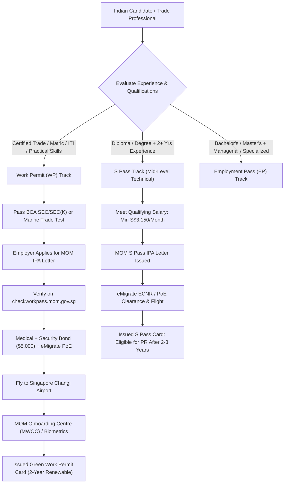
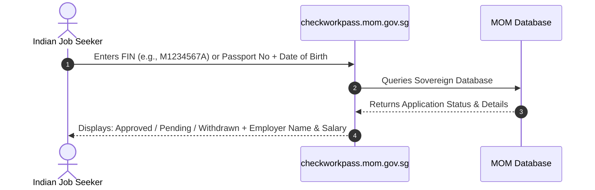
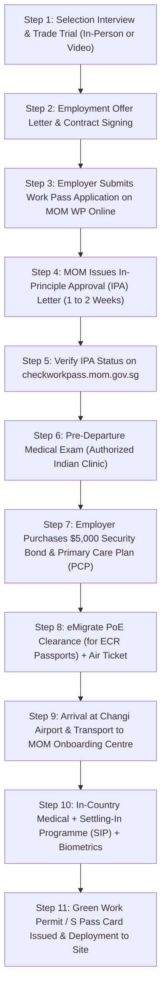

# Singapore Work Permit & S Pass Complete Master Guide 2026: Construction, Shipyard & Services Jobs, Salaries (S$1,800–S$4,000+), MOM IPA Letter, BCA Trade Test, Levy Rules & Legal Flight Process

As Southeast Asia's foremost financial capital, global maritime hub, and high-tech manufacturing nexus, the **Republic of Singapore** stands as one of the most rewarding, transparent, and legally secure employment destinations for Indian and South Asian technical trade professionals. Anchored by the world's second-busiest transshipment port, world-class civil infrastructure megaprojects (such as the Changi Airport Terminal 5 development, Tuas Mega Port expansion, and the Cross Island MRT Line), and the sprawling Jurong Island petrochemical complex, Singapore maintains a continuous, robust demand for foreign skilled artisans, technicians, and engineering specialists.

Unlike unstructured migration corridors, foreign employment in Singapore is regulated with unmatched precision by the sovereign **[Ministry of Manpower (MOM - 新加坡人力部)](https://www.mom.gov.sg/)**. Every legal foreign employee—from frontline shipyard riggers and construction steel fixers to CNC mechanics, F&B supervisors, and project engineers—operates under a digitally tracked, sovereign-approved work pass tied to transparent statutory protections under the **Singapore Employment Act**.

Crucially, **2026 marks a transformative regulatory era for international personnel entering Singapore**:
- **Strong Currency Advantage:** With 1 Singapore Dollar (SGD) trading strongly at approximately **₹63 to ₹65 Indian Rupees (INR)**, monthly earnings in Singapore yield exceptional disposable savings compared to domestic Indian markets. A standard trade artisan earning S$1,800 to S$2,800 per month commands between **₹1,15,000 and ₹1,80,000 INR**, while experienced S Pass technicians earning S$3,150 to S$4,200+ per month achieve between **₹2,00,000 and ₹2,70,000 INR**.
- **Modernized Work Permit Rules for Non-Traditional Sources (NTS):** Under MOM's revised policies, eligible employers in the services and manufacturing sectors can recruit Indian and South Asian personnel across an expanded list of technical and operational roles, while the Construction and Marine Shipyard sectors continue their high-volume intake of certified tradesmen possessing **Building and Construction Authority (BCA) Skills Evaluation Certificates (SEC / SEC(K))**.
- **Upgraded S Pass Salary Benchmarks:** In line with MOM's progressive wage calibration, the minimum qualifying salary for the **S Pass** has been reinforced at **S$3,150 SGD per month** (and **S$3,650 SGD** in the financial services sector), ensuring fair compensation and clear career progression for mid-level technicians and supervisors.
- **Sovereign Digital Verification & Anti-Scam Armor:** Through the official **[MOM Check Work Pass Portal (checkworkpass.mom.gov.sg)](https://checkworkpass.mom.gov.sg/)** and the **SGWorkPass Mobile App**, every prospective candidate can verify the authenticity of their **In-Principle Approval (IPA) Letter**, registered monthly salary, and employer Unique Entity Number (UEN) in under 30 seconds before paying any processing charges or boarding an aircraft.
- **Mandatory Primary Care Plan (PCP) & FEDRA Housing Standards:** All Work Permit holders in the Construction, Marine Shipyard, and Process (CMP) sectors are legally covered by mandatory primary healthcare plans and housed in Purpose-Built Dormitories (PBDs) licensed under the Foreign Employee Dormitories Act (FEDRA), guaranteeing clean air-conditioned accommodations, Wi-Fi, catered dining, and on-site recreation.

This comprehensive, definitive master guide by **WorkWise Visa** details every stage of securing legal employment, clearing trade assessments, verifying official sovereign documentation, and establishing a prosperous technical career in Singapore in 2026/2027.

---

## Master Directory: Official Singapore Sovereign Portals & Verification Directory

To insulate yourself against fraudulent agents, forged IPA letters, or unlicensed recruitment intermediaries, always verify your job offers, work pass status, and employer credentials through official Singapore Government portals:

| Sovereign Authority / Governing Body | Jurisdiction & Statutory Mandate | Official Digital Portal | Primary Verification Function |
| :--- | :--- | :--- | :--- |
| **Ministry of Manpower (MOM - 新加坡人力部)** | Supreme sovereign body governing labor policy, work passes, employment laws, foreign worker levies, and workplace safety | [mom.gov.sg](https://www.mom.gov.sg/) | **[MOM Work Passes & Permits Hub](https://www.mom.gov.sg/passes-and-permits)** |
| **MOM Check Work Pass / WP Online Portal** | Official real-time database to check work pass application status, validity, and IPA letter legitimacy | [checkworkpass.mom.gov.sg](https://checkworkpass.mom.gov.sg/) | **[Live Work Pass & IPA Verification Tool](https://checkworkpass.mom.gov.sg/)** |
| **Building and Construction Authority (BCA)** | Regulates the built environment, oversees SEC / SEC(K) skill test standards, and accredits overseas test centers | [bca.gov.sg](https://www1.bca.gov.sg/) | **[BCA Construction Trade Certification & ATTC Directory](https://www1.bca.gov.sg/buildsg/manpower/skills-evaluation-certificate-sec-sec-k)** |
| **Immigration & Checkpoints Authority (ICA)** | Manages Singapore borders, entry approvals, Short-Term Visit Passes (STVP), and Permanent Residence (PR) | [ica.gov.sg](https://www.ica.gov.sg/) | **[ICA SG Arrival Card & Border Entry Portal](https://eservices.ica.gov.sg/sgarrivalcard/)** |
| **High Commission of the Republic of Singapore in New Delhi** | Sovereign diplomatic mission handling bilateral relations, consular matters, and visa liaison for India | [mfa.gov.sg/newdelhi](https://www.mfa.gov.sg/newdelhi) | **[High Commission Consular & Visa Information](https://www.mfa.gov.sg/Overseas-Mission/New-Delhi)** |
| **Consulates-General of Singapore (Mumbai & Chennai)** | Regional consular representations facilitating commercial relations and documentation | [mfa.gov.sg/overseas-missions](https://www.mfa.gov.sg/Overseas-Missions) | **[Singapore Consulates in India Directory](https://www.mfa.gov.sg/Overseas-Missions)** |
| **Tripartite Alliance for Dispute Management (TADM)** | Official statutory body mediating employment disputes, unpaid wage claims, and contract breaches | [tal.sg/tadm](https://www.tal.sg/tadm) | **[TADM Dispute Lodgment & Worker Advisory](https://www.tal.sg/tadm)** |
| **Migrant Workers' Centre (MWC)** | Non-governmental bipartite welfare organization assisting distressed foreign workers with legal aid and shelter | [mwc.org.sg](https://www.mwc.org.sg/) | **[MWC 24/7 Helpline & Worker Welfare Hub](https://www.mwc.org.sg/)** |
| **Ministry of External Affairs (MEA India - eMigrate)** | Governs overseas recruiting agent licensing, Protector of Emigrants (PoE) clearance, and PBBY insurance for Indian workers | [emigrate.gov.in](https://emigrate.gov.in) | **[eMigrate Sovereign Deployment Portal](https://emigrate.gov.in)** |

---

## Explore WorkWise Visa Dedicated Portals & Global Career Hubs

Before submitting your technical credentials or scheduling a trade evaluation, explore our sovereign migration directories and certified overseas career channels:

- **[All Global Work Visa Destinations Directory](/countries)** — Compare overseas career pathways across Singapore, Japan, South Korea, Schengen Europe, the Gulf Cooperation Council, and the UK.
- **[Live Verified Overseas Job Vacancies & Demands](/jobs)** — Discover authenticated openings for shipyard welders, structural fitters, MEP technicians, CNC operators, drivers, and hospitality staff.
- **[Track Your Visa Status Live](/track)** — Real-time candidate tracking portal for trade test bookings, MOM IPA verification, and eMigrate clearances.
- **[South Korea Work Visa (E-9 EPS & E-7 Skilled) Master Guide 2026](/blogs/south-korea-work-visa-e9-eps-e7-skilled-complete-guide-2026-jobs-salary-topik)** — Comprehensive breakdown of South Korea shipbuilding welders, EPS-TOPIK exams, and ₩2,100,000+ monthly salaries.
- **[Japan Work Visa (SSW & TITP) Complete Master Guide 2026](/blogs/japan-work-visa-ssw-titp-complete-guide-2026-jobs-salary-prometric-coe)** — Detailed analysis of Japan's Specified Skilled Worker pathways, Prometric trade tests, and ¥220,000+ monthly wages.
- **[Bihar & UP Gulf Work Visa Guide 2026: Scam Protection & Sahi Process](/blogs/bihar-up-gulf-work-visa-guide-process-scam-protection-2026)** — Practical advice for candidates from Northern and Eastern India to avoid fraudulent sub-agents.
- **[Police Clearance Certificate (PCC) Master Guide 2026](/blogs/police-clearance-certificate-pcc-gulf-european-visas-psk-apostille-guide-2026)** — Step-by-step instructions for Passport Seva Kendra (PSK) PCC booking and MEA Apostille authentication.
- **[B2B Overseas Recruitment Agency & Employer Partnership](/b2b-partner)** — Direct recruitment collaboration channels for Singapore contractors, marine shipyards, and logistics fleet operators.
- **Our Regional Support & Document Verification Branches:**
  - **[Patna Head Office (Bihar)](/locations/patna)** | **[Noida Regional Desk](/locations/noida)** | **[Delhi / NCR Branch](/locations/delhi)**
  - **[Siwan Branch Office](/locations/siwan)** | **[Gopalganj Regional Branch](/locations/gopalganj)** | **[Gorakhpur Branch (UP)](/locations/gorakhpur)**

---

## 1. Comparing Singapore's 3 Primary Work Pass Categories: Work Permit (WP) vs. S Pass vs. Employment Pass (EP)

Foreign professionals working in Singapore are categorized under three distinct tiers governed by educational credentials, skill certifications, and monthly salary thresholds:

| Parameter / Feature | Work Permit (WP) — CMP Sectors | S Pass (Mid-Level Skilled Technical) | Employment Pass (EP) (Executive / Specialist) |
| :--- | :--- | :--- | :--- |
| **Target Workforce** | Semi-skilled & skilled craftsmen, construction labor, marine shipyard trades, factory machine operators | Technicians, site supervisors, engineering draftsmen, junior IT, nurses, assistant managers | Senior engineers, project managers, enterprise executives, software architects |
| **Minimum Qualifying Salary** | **No official statutory minimum** (Market rate: **S$1,800 to S$2,800+** with OT) | **S$3,150 SGD / month** (Higher for older/more experienced; S$3,650 in Finance) | **S$5,000 SGD / month** (S$5,500 in Finance) + COMPASS Points Framework |
| **Educational Prerequisite** | 10th Pass / ITI Trade Certificate / BCA SEC or SEC(K) skill card | Relevant Polytechnic Diploma or University Degree + relevant experience | Recognized University Degree + strong career track record |
| **Foreign Worker Levy Paid by Employer** | **Yes** (Tiered from **S$300 to S$950/month** depending on worker skill level: Higher vs Basic Skilled) | **Yes** (Tier 1: **S$550/month**; Tier 2: **S$650/month**) | **No Foreign Worker Levy** |
| **Dependency Ratio Ceiling (Quota)** | Strictly controlled by sector (Construction: up to 1:7; Shipyard: 1:3.5) | Capped at **10% to 15%** of company's total local workforce | No quota limit, but must score 40+ points on MOM COMPASS matrix |
| **Family Sponsorship (DP / LTVP)** | **Strictly Prohibited** (Cannot sponsor spouse, children, or parents) | **Permitted** if fixed monthly salary is **S$6,000+ SGD** (Spouse & children receive Dependant's Pass) | **Permitted** if monthly salary is **S$6,000+ SGD** (Spouse & children); S$12,000+ for parents |
| **Maximum Validity & Renewal** | **2 Years** per issuance (Renewable up to **14–26 years** depending on skill tier: R1 Higher Skilled vs R2 Basic Skilled) | **2 Years** initial, renewable for **3 years** at each renewal indefinitely | **2 to 3 Years**, renewable for 3 to 5 years |
| **Pathway to Singapore Permanent Residence (PR)** | **No direct pathway** (Work Permit holders cannot apply for PR) | **Direct Pathway** (Can apply for Singapore PR under the PTS Scheme after 2–3 years) | **Direct Pathway** (Can apply for Singapore PR under the PTS Scheme after 1–2 years) |
| **Medical Insurance & Security Bond** | Mandatory **S$5,000 Security Bond** + Primary Care Plan (PCP) + S$60,000 inpatient insurance | Mandatory S$60,000 inpatient medical insurance; No Security Bond | Employer corporate medical insurance; No Security Bond |

---

## 2. High-Demand Industries & Approved Job Roles in Singapore (2026)

Singapore's industrial economy is structured across four primary foreign workforce sectors, each governed by specific MOM quotas, safety certifications, and wage matrices:

### A. Construction & Infrastructure Sector (BCA Certified)
Driven by the Cross Island Line (CRL), Changi Airport T5, North-South Corridor (NSC), and mega public housing (HDB) developments:
- **Structural Formwork Carpenters & Timber Craftsmen:** Assembling reinforced formwork systems for high-rise towers, civil flyovers, and underground metro stations.
- **Rebar Steel Fixers & Benders:** Reading structural bar-bending schedules, fabricating heavy steel cages, and tying high-tensile reinforcement meshes.
- **Plasterers, Tile Setters & Bricklayers:** Applying precision architectural cement plastering, marble tiling, and internal partition masonry to strict BCA standards.
- **MEP Electrical Installation Technicians:** Installing industrial electrical conduits, cable trays, main distribution switchboards, and fire alarm wiring.
- **Sanitary & Plumbing Pipe Fitters:** Laying potable water lines, underground sewerage pipes, and storm-water drainage networks.
- **Tower Crane & Mobile Crane Operators:** Heavy lifting operations requiring MOM-certified crane operator licenses.

### B. Marine Shipyard & Offshore Engineering Sector (Tuas & Jurong)
Singapore is home to global offshore energy titans such as **Seatrium** (formed by the merger of Sembcorp Marine and Keppel Offshore & Marine) and specialized drydocks in Tuas, Jurong Port, and Benoi:
- **6G SMAW, GTAW (TIG) & FCAW Marine Welders:** Certified multi-process welding on cryogenic LNG fuel tanks, ship hull double-bottoms, and offshore jack-up rig legs. Must pass 100% radiographic examination (RT) and ultrasonic non-destructive testing (NDT). Earning potential reaches **S$2,500 to S$3,800+ SGD** (~₹1,60,000 to ₹2,45,000 INR).
- **Marine Hull Fitters & Fabricators:** Aligning heavy steel plates, cutting hull curves using oxy-acetylene and plasma torches, and assembling ship blocks.
- **Marine Pipe Fitters & Riggers:** Installing high-pressure hydraulic lines, ballast piping, and seawater cooling systems aboard container vessels and oil tankers.
- **Blasters & Marine Protective Coating Painters:** Operating high-pressure hydro-blasting equipment and spraying multi-layer marine epoxy paint in ballast tanks.
- **Scaffold Erectors (Marine Rigging):** Assembling complex tubular scaffolding inside ship cargo holds and around superstructures under strict MOM Shipyard Safety Assessor permits.

### C. Process & Chemical Engineering Sector (Jurong Island)
Jurong Island is an internationally renowned chemical and refining cluster hosting over 100 global energy leaders, including ExxonMobil, Shell, and Petrochemical Corporation of Singapore (PCS):
- **Plant Mechanical Technicians:** Maintaining high-speed centrifugal pumps, industrial gas turbines, reciprocating compressors, and heat exchangers.
- **Instrumentation & Control (I&C) Technicians:** Calibrating pneumatic control valves, 4-20mA pressure transmitters, DCS controllers, and programmable logic controllers (PLCs).
- **Refinery Riggers & Plant Maintenance Mechanics:** Turnaround and shutdown maintenance crews performing flange blinding, pressure vessel internal inspections, and pipe spool replacements.

### D. Manufacturing & Services Sectors (S Pass & Selected NTS Work Permits)
- **Precision CNC Lathe & Milling Operators:** Programming G-code, tooling setup, and micrometer-level precision parts production in semiconductor and aerospace equipment factories.
- **Logistics Warehouse Technicians & Forklift Drivers:** Operating reach trucks and automated storage/retrieval systems (ASRS) in mega supply chain hubs (PSA Singapore, DHL, Schenker).
- **Hospitality & F&B Services (S Pass / Eligible Work Permit):** Chefs, kitchen supervisors, hotel technical maintenance crew, and customer service leads.

---

## 3. Realistic Salary Structure, Overtime Earnings & Living Costs (SGD vs. INR)

Singapore's currency provides an enormous savings multiplier. Here is an authentic financial breakdown based on standard 2026 industrial employment terms:

| Employment Category & Trade | Monthly Basic Salary (SGD) | Guaranteed / Avg Overtime (OT 1.5x) | Total Monthly In-Hand (SGD) | Total Monthly In-Hand (INR) (1 SGD ≈ ₹64) |
| :--- | :--- | :--- | :--- | :--- |
| **Construction General Worker (R2 Basic)** | S$800 – S$1,000 | S$450 – S$700 | **S$1,350 – S$1,700** | **₹86,000 – ₹1,09,000 INR** |
| **Construction Skilled Trade (R1 SEC/SEC-K)** | S$1,100 – S$1,500 | S$650 – S$1,000 | **S$1,850 – S$2,450** | **₹1,18,000 – ₹1,57,000 INR** |
| **Marine Shipyard 6G Welder / Pipe Fitter** | S$1,200 – S$1,700 | S$800 – S$1,400 | **S$2,100 – S$3,100** | **₹1,34,000 – ₹1,98,000 INR** |
| **Process / Chemical Maintenance Technician** | S$1,400 – S$1,900 | S$700 – S$1,200 | **S$2,200 – S$3,000** | **₹1,40,000 – ₹1,92,000 INR** |
| **Heavy Machinery / Crane Operator** | S$1,600 – S$2,200 | S$800 – S$1,200 | **S$2,500 – S$3,400** | **₹1,60,000 – ₹2,18,000 INR** |
| **S Pass Technical Supervisor / Site Engineer** | S$3,150 – S$4,200 | Fixed / Project Allowance | **S$3,400 – S$4,600** | **₹2,17,000 – ₹2,94,000 INR** |

### Breakdown of Monthly Living Expenses in Singapore
Under Singapore law and standard corporate contracts in the CMP sectors:
- **Accommodation:** In 90% of Work Permit contracts, employers are legally mandated to provide approved Purpose-Built Dormitory (PBD) housing or factory-converted accommodation. When subsidized or provided free, worker deductions are capped at **S$0 to S$150/month**. For S Pass holders renting a shared room in an HDB flat, rent ranges between **S$400 and S$650/month**.
- **Food & Groceries:** Self-cooking in dormitory communal kitchens or sharing a mess plan typically costs **S$150 to S$250/month** (~₹9,500 to ₹16,000 INR).
- **Transport:** Employers generally provide dedicated bus transport between worker dormitories and construction/shipyard job sites. Independent MRT and bus travel with an EZ-Link card costs **S$60 to S$100/month**.
- **Mobile & Miscellaneous:** S$30 to S$50/month for high-speed prepaid SIM card data and personal hygiene supplies.

> [!TIP]
> **Net Monthly Remittance Potential:** A dedicated skilled trade worker (R1 welder, carpenter, or electrician) earning S$2,100 to S$2,600 SGD typically saves between **S$1,500 and S$2,000 SGD per month**, allowing them to remit **₹95,000 to ₹1,30,000 INR clean to their family in India every month**.

---

## 4. The BCA SEC & SEC(K) Skill Certification: Pathway to R1 Higher Skilled Status

To work legally in Singapore's Construction sector as an Indian national, candidates must clear a recognized trade test conducted by the **Building and Construction Authority (BCA)** at an **Approved Training and Testing Centre (ATTC)**:

### Why BCA Certification is Critical:
1. **R1 vs. R2 Classification:** Foreign workers without recognized skills are classified as **Basic Skilled (R2)**, with higher employer levies (up to S$700–S$900/month) and a maximum employment tenure capped at 14 years. Candidates with a **BCA Skills Evaluation Certificate (SEC or SEC(K))** are designated as **Higher Skilled (R1)**: the employer levy is cut in half (down to S$300–S$350/month), and the worker can remain employed in Singapore for up to **26 continuous years**.
2. **Authorized ATTC Examination Hubs in India:** BCA maintains accredited training centers primarily in **Tamil Nadu (Chennai, Tiruchirappalli/Trichy, Madurai)** and **Andhra Pradesh/Telangana (Hyderabad)**, with testing sessions regularly supervised by visiting Singapore BCA examiners.
3. **Core Tested Trades:**
   - Precast Concrete Component Installation
   - Thermal Insulation & Ducting
   - Electrical Wiring & Conduit Installation
   - Steel Reinforcement Fixing (Rebar)
   - Formwork Carpentry (Timber & System Formwork)
   - Plumbing & Sanitary Pipe Fitting
   - Tiling & Plastering

---

## 5. The Critical MOM In-Principle Approval (IPA) Letter & Verification Roadmap

The **In-Principle Approval (IPA) Letter** is the single most critical document in the Singapore employment process. Issued directly by the Ministry of Manpower, this 4 to 6-page digital document serves as your official pre-approved visa and entry authorization.

### Key Details Displayed on an Authentic MOM IPA Letter:
1. **Application Number & Work Permit/S Pass Number:** Unique sovereign tracking sequence.
2. **Foreign Identification Number (FIN):** A permanent alphanumeric identifier (e.g., `M1234567X`).
3. **Full Name & Nationality:** Exactly matching your Indian passport.
4. **Employer Name & Unique Entity Number (UEN):** The registered Singapore corporate identity of your sponsor.
5. **Occupation:** Exact approved job designation (e.g., *Marine Welder*, *Formwork Carpenter*).
6. **Detailed Monthly Salary Breakdown:**
   - Basic Monthly Salary (in SGD)
   - Monthly Fixed Allowances (e.g., housing, food)
   - Overtime Hourly Rate Calculation Formula
   - Authorized Salary Deductions (if any, strictly regulated by MOM)
7. **Official Security Barcode / QR Code:** Machine-readable code linking directly to MOM's digital database.

### How to Verify Your Singapore IPA Letter in 30 Seconds:

1. Visit the official sovereign portal: **[checkworkpass.mom.gov.sg](https://checkworkpass.mom.gov.sg/)** (or open the **SGWorkPass** mobile application).
2. Choose **Check pass status by**:
   - Option A: **FIN and Name / Date of Birth** (found on page 1 of your IPA letter).
   - Option B: **Passport Number, Date of Birth, and Country of Origin (India)**.
3. Click **Submit**.
4. **Verify the Output:**
   - **Status:** Must display **"Approved"** or **"Issued"**.
   - **Employer Name:** Must exactly match the name of the company that interviewed and recruited you.
   - **Pass Type:** Must clearly state *Work Permit* or *S Pass*.
   - **Warning Sign:** If the portal returns *\"No records found\"* or the employer name differs from your contract, **do not pay any money to the recruitment agent—the document is counterfeit.**

---

## 6. Complete Step-by-Step Deployment Pipeline: From Interview to Flight

Securing employment in Singapore follows a structured, transparent sequence under MOM and MEA eMigrate oversight:

### Detailed Breakdown of Key Steps:

#### Step 1: Pre-Departure Medical Examination in India
Before booking flights, candidates must undergo a mandatory medical screening covering:
- Chest X-Ray (to rule out active tuberculosis)
- Serological testing for HIV / AIDS, Syphilis (VDRL), and Hepatitis B
- Malaria and general physical fitness examination
- Note: Unlike Gulf countries which use the Wafid GAMCA network, Singapore accepts pre-departure medicals conducted by reputable private diagnostic hospitals in India, provided they comply with MOM medical formats.

#### Step 2: The S$5,000 Security Bond & Primary Care Plan (PCP)
- For every Non-Malaysian Work Permit holder, Singapore law requires the employer to purchase a **S$5,000 Security Bond** from an authorized insurance provider prior to the worker's arrival.
- **Important:** The cost of this bond is legally the sole responsibility of the Singapore employer. **Deducting the security bond cost from a worker's wages is a criminal offense under the Employment of Foreign Manpower Act (EFMA).**
- Employers must also enroll the worker in an MOM-designated **Primary Care Plan (PCP)**, which provides full outpatient consultation, annual health screening, and telemedicine for an affordable annual premium.

#### Step 3: eMigrate & Protector of Emigrants (PoE) Clearance
- For Indian candidates holding **ECR (Emigration Check Required)** passports, departure for Singapore requires Emigration Clearance through the **[MEA eMigrate Portal (emigrate.gov.in)](https://emigrate.gov.in)**.
- The employer or certified Indian recruiting agency uploads the authenticated MOM IPA letter and employment contract.
- Workers are covered under the **Pravasi Bharatiya Bima Yojana (PBBY)**, providing ₹10 Lakh insurance coverage against disability, accidents, and repatriation.
- Candidates with **ECNR (Non-ECR)** passports do not require PoE emigration clearance; the valid MOM IPA letter, passport, and air ticket are sufficient to pass Indian airport immigration.

#### Step 4: Arrival at Changi Airport & MOM Onboarding Centre (MWOC)
Upon landing at Singapore Changi Airport:
1. The candidate presents their original passport, printed MOM IPA letter, and completed **SG Arrival Card** to ICA border control officers.
2. The employer or company representative receives the worker and transports them directly to an **MOM Onboarding Centre (such as the Migrant Worker Onboarding Centre - MWOC at Choa Chu Kang or Tengah)**.
3. At the onboarding facility, the worker completes:
   - Verification of vaccination records.
   - Comprehensive in-country medical examination.
   - **Settling-In Programme (SIP):** A mandatory 1-day orientation covering local laws, Singapore cultural norms, road safety, fire prevention, and worker grievance channels.
   - Digital fingerprint biometrics and high-resolution photo capture.
4. Within 4 to 7 business days, MOM issues the physical **Green Work Pass Card**, equipped with an embedded RFID chip and QR code for continuous digital verification.

---

## 7. Legal Rights, Labor Protections & Anti-Scam Shield for Indian Workers

Singapore is renowned internationally for enforcing strict penalties against unethical employers and unauthorized labor exploitation. As a legal work pass holder in Singapore, you are protected by statute:

### 1. The Employment of Foreign Manpower Act (EFMA) Protections:
- **Zero Kickbacks:** It is strictly illegal under the EFMA for an employer or agency to demand or collect employment kickbacks from a foreign worker in exchange for a job offer.
- **Mandatory Electronic Salary Payment:** Employers in the Construction, Marine Shipyard, and Process sectors must pay foreign workers' salaries directly into an authorized Singapore bank account (such as POSB Payroll Account) or via the FAST interbank clearing system by the 7th day following the end of the salary period.
- **Overtime Regulations:** Any work performed in excess of 44 hours per week must be compensated at a minimum rate of **1.5 times the basic hourly rate of pay**. Work conducted on gazetted public holidays or mandatory rest days commands higher statutory multipliers (up to 2.0x).
- **Prohibition on Withholding Passports:** An employer cannot confiscate or withhold a foreign worker's passport against their will. Passports are the sovereign property of the issuing government and must remain in the worker's personal possession.

### 2. What to Do in Case of Unpaid Wages or Workplace Disputes:
If an employer delays salary payments, fails to provide safe living conditions, or violates contract clauses:
1. Contact the **Tripartite Alliance for Dispute Management (TADM)** at **[tal.sg/tadm](https://www.tal.sg/tadm)** or visit the TADM Services Centre. TADM mediators convene formal dispute conferences to recover unpaid wages and overtime arrears.
2. Contact the **Migrant Workers' Centre (MWC)** 24-hour helpline at **+65 6536 2692**. MWC officers provide immediate emergency shelter, nutritional support, and pro bono legal counsel to distressed foreign workers.
3. Lodge a confidential report directly with the **Ministry of Manpower** via the online portal or hotlines. MOM's labor enforcement inspectors conduct surprise workplace and dormitory raids to penalize non-compliant companies.

---

## 8. Frequently Asked Questions (FAQs) — Singapore Work Visas for Indians

### Q1. What is the difference between an R1 and R2 Work Permit in Singapore?
**Ans:** Under MOM regulations, foreign workers are classified into two skill tiers:
- **R2 (Basic Skilled):** Workers without recognized Singapore trade credentials. Employers pay higher monthly levies (S$700 to S$950), and the worker can only stay in Singapore for up to 14 years.
- **R1 (Higher Skilled):** Workers who have passed an approved **BCA Skills Evaluation Certificate (SEC or SEC(K))** or hold recognized technical diplomas. Employers pay a drastically reduced levy (around S$300 to S$350/month), and the worker can remain employed in Singapore for up to **26 continuous years**. Upgrading from R2 to R1 makes you significantly more attractive to Singapore employers.

### Q2. Can a Work Permit holder bring their family (wife and children) to Singapore?
**Ans:** No. Under MOM regulations, foreign Work Permit holders are not eligible to sponsor dependants. However, mid-level technical professionals on an **S Pass** earning at least **S$6,000 SGD per month** can legally sponsor their spouse and legally married children under 21 years old on **Dependant's Passes (DP)**.

### Q3. How do I verify if my Singapore IPA letter is real or fake?
**Ans:** Go to **[checkworkpass.mom.gov.sg](https://checkworkpass.mom.gov.sg/)** on any smartphone or computer. Enter your Foreign Identification Number (FIN) and Name, or your Passport Number, Date of Birth, and Nationality (India). If the system confirms \"Approved\" with the exact employer name, job title, and monthly salary stated on your document, it is 100% genuine. If no records appear, the IPA letter is fake.

### Q4. Is a GAMCA / Wafid medical examination required for Singapore?
**Ans:** No. The Wafid (GAMCA) medical system is strictly required for Gulf Cooperation Council (GCC) countries (Saudi Arabia, UAE, Qatar, Oman, Kuwait, Bahrain). For Singapore, candidates undergo a standard pre-departure medical test in India at any accredited diagnostic hospital, followed by a mandatory, legally binding in-country medical screening conducted upon arrival at the MOM Onboarding Centre (MWOC) in Singapore.

### Q5. Can a Work Permit holder change companies inside Singapore without leaving?
**Ans:** Yes, under MOM's **Change of Employer (COE) / Transfer** scheme. If your contract is concluding, or if your current employer agrees to sign a transfer consent letter, another Singapore employer in the same sector can submit a transfer work permit application on WP Online without requiring you to fly back to India. During specific grace periods (such as company insolvency), MOM also permits workers to seek new employment through designated transfer windows.

### Q6. How much money can an Indian worker save per month in Singapore?
**Ans:** A skilled trade artisan (welder, pipe fitter, carpenter, electrician) earning S$2,000 to S$2,600 SGD (including standard overtime) incurs approximately S$300 to S$450 in food, mobile, and personal expenses (as housing is provided by the employer). This leaves a monthly net surplus of **S$1,600 to S$2,200 SGD**, which equals approximately **₹1,00,000 to ₹1,40,000 INR** sent home every month.

### Q7. What is the current S Pass minimum salary in 2026?
**Ans:** The standard minimum qualifying salary for the S Pass is **S$3,150 SGD per month** (and **S$3,650 SGD** for positions in the financial services sector). For older, more experienced applicants in their late 30s and 40s, MOM's progressive salary benchmarks scale progressively higher up to S$4,650+ SGD per month to ensure wage equity.

### Q8. What happens if an employer does not pay my salary on time?
**Ans:** Under Section 21 of the Singapore Employment Act, employers must pay salaries at least once a month within 7 days after the end of the salary period, and overtime pay within 14 days. Failure to do so is an offense. You can immediately seek assistance from the **Migrant Workers' Centre (MWC)** (+65 6536 2692) or file a claim with the **Tripartite Alliance for Dispute Management (TADM)**. MOM regularly prosecutes and revokes the work pass privileges of errant employers.

---

## Conclusion: Start Your Legal Singapore Career with WorkWise Visa

Singapore remains the gold standard for international trade careers—offering rock-solid statutory legal protections, transparent salary payments, clean and secure accommodations, and the immense financial strength of the Singapore Dollar. By obtaining certified trade credentials (such as BCA SEC/SEC(K)), verifying sovereign documentation directly through official MOM digital gateways, and avoiding unlicensed agents, Indian professionals can build life-changing, multi-decade overseas careers.

At **WorkWise Visa**, our specialized overseas placement team provides transparent, end-to-end guidance:
- Trade training coordination and test registration at accredited ATTC centres in India.
- Direct sourcing connections with reputable Singapore construction contractors, marine shipyards, and engineering conglomerates.
- Authentic MOM IPA verification, eMigrate PoE clearance, and pre-departure briefings.

Visit our regional counseling centers in **[Patna](/locations/patna)**, **[Siwan](/locations/siwan)**, **[Gopalganj](/locations/gopalganj)**, **[Gorakhpur](/locations/gorakhpur)**, and **[Noida / Delhi NCR](/locations/noida)**, browse verified active job opportunities on our **[Live Vacancies Portal](/jobs)**, or submit your credentials online today.
