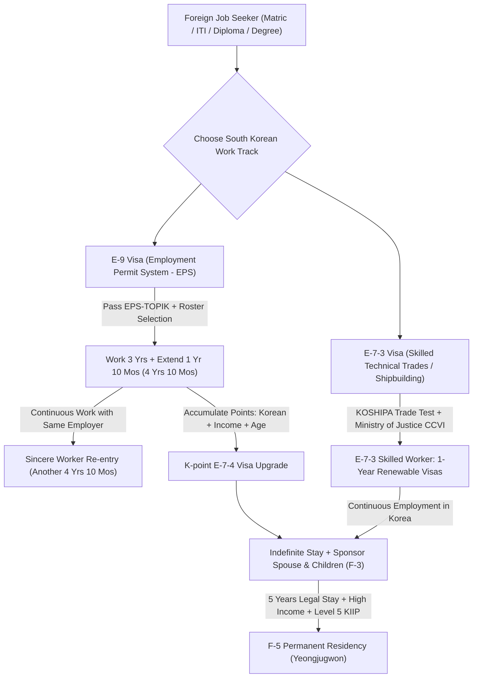
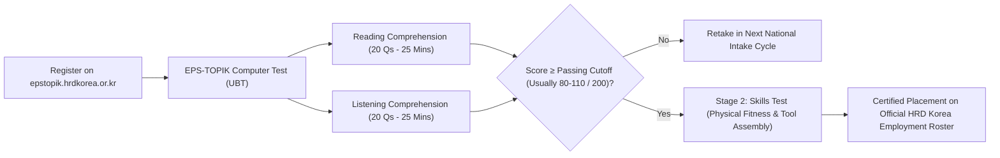

# South Korea Work Visa (E-9 EPS & E-7 Skilled) Complete Master Guide 2026: Jobs, Salaries (₩2,100,000+), EPS-TOPIK, Shipbuilding Trades, CCVI & Embassy Process

As East Asia's premier manufacturing powerhouse, the world's leading shipbuilder, and an economic vanguard across high-tech automotive, industrial robotics, precision electronics, and green petrochemicals, the **Republic of Korea (South Korea - 대한민국)** has enacted the most ambitious foreign labor quota expansion in its modern history. Confronted by acute domestic demographic contractions—including the world's lowest birth rate and severe labor shortages across industrial manufacturing complexes, coastal shipyards, rural agricultural centers, and inland construction projects—the Government of South Korea has expanded its foreign workforce targets to unprecedented heights in 2026.

Historically, foreign blue-collar workers migrated to South Korea predominantly through the **Employment Permit System (EPS / 고용허가제)** under the **E-9 Non-Professional Employment Visa**. However, in response to structural shortages in advanced engineering trades, the **[Ministry of Justice (MOJ - 법무부)](https://www.moj.go.jp/)** and the **[Ministry of Employment and Labor (MOEL - 고용노동부)](https://www.moel.go.kr/)** have dramatically upgraded the **E-7 Skilled Worker Visa framework**—specifically expanding the **E-7-3 Technical Trades quota for shipbuilding welders, hull painters, and electrical fitters**, while streamlining the **K-point E-7-4 point-based upgrade system** for experienced foreign workers already in Korea.

Crucially, **2026 brings historic regulatory milestones for international job seekers**:
- The national foreign worker intake quota under the **Employment Permit System (E-9)** has been raised to an all-time high exceeding **165,000 workers**, with newly authorized slots opened across hotel housekeeping, dining service operations, logistics parcel sorting, and forestry.
- The South Korean statutory minimum wage has been officially increased by the Minimum Wage Commission to **₩10,030 KRW per hour**, establishing a baseline monthly wage of **₩2,096,270 KRW** (~₹1,30,000 INR) for a standard 40-hour work week, while overtime and holiday allowances in manufacturing and shipbuilding regularly propel monthly earnings to **₩2,600,000 to ₩3,800,000+ KRW** (~₹1,60,000 to ₹2,40,000 INR).
- The legal operational framework provides comprehensive protections: non-discrimination under the **Korean Labour Standards Act**, mandatory enrollment in the **Four Major Social Insurances (*4-Dae Boheom*)**, and statutory guarantee of the **Departure Guarantee Insurance (*Chulguk Man-gi Boheom*)**, ensuring returning workers collect a **multi-lakh Rupee lump-sum severance payout** directly upon departure at Incheon International Airport.

This definitive, exhaustive master manual by **WorkWise Visa** covers every statutory phase required for Indian and South Asian candidates to secure legal overseas employment in South Korea in 2026/2027:
- The legal pathways: **E-9 Non-Professional Employment (EPS)** vs. **E-7-3 Skilled Technical Trades** vs. **E-7-4 Points-Based Upgrade**.
- The 5 primary employment industries: Shipbuilding & Maritime, Precision Automotive & Heavy Machinery, Agriculture & Livestock, Construction, and Food & Service Logistics.
- Realistic wage schedules in **Korean Won (₩)** and **Indian Rupees (₹)**, overtime multipliers (1.5x to 2.0x), and living expenses.
- The **EPS-TOPIK Korean Language Examination (UBT format)** syllabus, question pattern, and passing benchmarks.
- The **Certificate for Confirmation of Visa Issuance (CCVI - 사증발급인정서)** processing pipeline through **[Hi Korea (hikorea.go.kr)](https://www.hikorea.go.kr)**.
- Consular visa submission rules via the **[Korea Visa Application Center (KVAC)](https://www.visaforkorea-in.com/)** and the **[Embassy of the Republic of Korea in New Delhi](https://overseas.mofa.go.kr/in-en/index.do)**.
- Anti-scam advisories, legal job change regulations through local Job Centers (*Goyong Senteo*), and how to claim your lump-sum Departure Guarantee severance refund.

---

## Master Directory: Official South Korean Sovereign Portals & Verification Directory

To protect yourself against unregulated commercial middlemen, bogus work offers, or counterfeit visa stamps, always verify statutory migration policies, employer quotas, and visa approvals through official sovereign portals:

| Sovereign Authority / Governing Body | Jurisdiction & Statutory Mandate | Official Digital Portal | Primary Verification Function |
| :--- | :--- | :--- | :--- |
| **Ministry of Employment and Labor (MOEL - 고용노동부)** | Formulates national labor codes, sets annual foreign worker quotas, enforces statutory minimum wages and labor safety | [moel.go.kr](https://www.moel.go.kr/) | **[MOEL Foreign Workforce Policy](https://www.moel.go.kr/english/)** |
| **Human Resources Development Service of Korea (HRD Korea)** | Administers the Employment Permit System (EPS), oversees government-to-government (G-to-G) recruitment rosters, and conducts EPS-TOPIK exams | [hrdkorea.or.kr](https://www.hrdkorea.or.kr/) | **[EPS Official Digital System (eps.go.kr)](https://www.eps.go.kr/)** |
| **EPS-TOPIK Examination Portal** | Official examination gateway for candidate registration, test schedule announcements, and score verification | [epstopik.hrdkorea.or.kr](https://epstopik.hrdkorea.or.kr/) | **[EPS-TOPIK Score Card & Candidate Roster Status](https://epstopik.hrdkorea.or.kr/)** |
| **Korea Immigration Service / Hi Korea (출입국·외국인정책본부)** | Ministry of Justice body governing all foreign visas, CCVI issuance, Alien Registration Cards (ARC), and status changes | [hikorea.go.kr](https://www.hikorea.go.kr/) | **[Hi Korea CCVI & Visa Application Status Portal](https://www.visa.go.kr/)** |
| **Ministry of Justice of the Republic of Korea (법무부)** | National executive ministry establishing immigration regulations, visa quotas (E-7-3 & E-7-4), and deportation laws | [moj.go.kr](https://www.moj.go.kr/) | **[MOJ Immigration Policies & Visa Announcements](https://www.moj.go.kr/moj_eng/)** |
| **Embassy of the Republic of Korea in New Delhi** | Sovereign diplomatic chancellery processing and adjudicating consular work visas for Indian nationals | [overseas.mofa.go.kr/in-en](https://overseas.mofa.go.kr/in-en/index.do) | **[Embassy Visa Requirements & Consular Notices](https://overseas.mofa.go.kr/in-en/brd/m_2714/list.do)** |
| **Korea Visa Application Center (KVAC New Delhi & Kolkata)** | Authorized outsourced commercial partner collecting biometric visa dossiers and passport submissions in India | [visaforkorea-in.com](https://www.visaforkorea-in.com/) | **[KVAC Online Appointment Booking & Passport Tracking](https://www.visaforkorea-in.com/)** |
| **Korea Shipbuilding & Offshore Engineering Association (KOSHIPA)** | Coordinates foreign technical welder and trade skill testing, pre-screening dossiers for E-7-3 shipyard recruitment | [koshipa.or.kr](http://www.koshipa.or.kr/) | **[KOSHIPA Technical Workforce Vetting](http://www.koshipa.or.kr/)** |
| **National Health Insurance Service (NHIS - 국민건강보험공단)** | Provides mandatory universal public healthcare coverage for all registered foreign workers in Korea | [nhis.or.kr](https://www.nhis.or.kr/) | **[NHIS Foreign Resident Healthcare Guide](https://www.nhis.or.kr/english/)** |
| **National Pension Service (NPS - 국민연금공단)** | Administers the compulsory state retirement pension and lump-sum departure refunds for eligible foreign workers | [nps.or.kr](https://www.nps.or.kr/) | **[NPS Foreign Worker Pension Claims](https://www.nps.or.kr/jsppage/english/main.jsp)** |
| **Ministry of External Affairs (MEA India - eMigrate)** | Governs overseas recruiting agent licensing, Protector of Emigrants (PoE) clearance, and PBBY insurance for Indian workers | [emigrate.gov.in](https://emigrate.gov.in) | **[eMigrate Sovereign Deployment Portal](https://emigrate.gov.in)** |

---

## Explore WorkWise Visa Dedicated Portals & Global Career Hubs

Before preparing your documentation or scheduling technical language trials, review our regional recruitment resources and sovereign immigration directories across the WorkWise Visa ecosystem:

- **[All Global Work Visa Destinations Directory](/countries)** — Compare employment immigration schemes across South Korea, Japan, Schengen Europe, the Gulf Cooperation Council, and the UK.
- **[Live Verified Overseas Job Vacancies & Demands](/jobs)** — Browse authentic, employer-vetted openings in precision shipyard welding, CNC machining, construction trades, nursing, logistics, and hospitality.
- **[Track Your Visa Status Live](/track)** — Real-time tracking portal for candidate dossiers, consular visa stamping, and biometric clearances.
- **[Japan Work Visa (SSW & TITP) Complete Master Guide 2026](/blogs/japan-work-visa-ssw-titp-complete-guide-2026-jobs-salary-prometric-coe)** — Detailed analysis of Japan's Specified Skilled Worker pathways, Prometric trade tests, and ¥220,000+ monthly wages.
- **[Europe & Schengen Work Visa Master Guide 2026](/blogs/europe-schengen-work-visa-complete-guide-2026-germany-poland-croatia-luxembourg-malta-czechia)** — Detailed breakdown of European single permits across Germany, Poland, Croatia, Luxembourg, and Malta.
- **[Gulf & GCC Work Visa Master Guide 2026](/blogs/gulf-work-visa-complete-guide-2026-saudi-arabia-uae-qatar-kuwait-oman-bahrain)** — Complete coverage of Saudi Arabia Qiwa, UAE MOHRE, and Wafid GAMCA medical protocols.
- **[Police Clearance Certificate (PCC) Guide 2026](/blogs/police-clearance-certificate-pcc-gulf-european-visas-psk-apostille-guide-2026)** — Step-by-step instructions for obtaining PSK Police Clearance and MEA Hague Apostille authentication.
- **[B2B Overseas Recruitment Agency & Employer Partnership](/b2b-partner)** — Direct recruitment collaboration channels for international EPC contractors, manufacturing conglomerates, and logistics fleet operators.
- **Our Regional Support & Document Verification Branches:**
  - **[Patna Head Office (Bihar)](/locations/patna)** | **[Noida Regional Desk](/locations/noida)** | **[Delhi / NCR Branch](/locations/delhi)**
  - **[Siwan Branch Office](/locations/siwan)** | **[Gopalganj Regional Branch](/locations/gopalganj)** | **[Gorakhpur Branch (UP)](/locations/gorakhpur)**

---

## 1. Comparing the 3 Official South Korean Work Visa Pathways: E-9 vs. E-7-3 vs. E-7-4

Foreign nationals migrating to South Korea for industrial, technical, or manual employment operate primarily across three statutory residence categories governed by the **Immigration Control Act of the Republic of Korea**:

| Parameter / Feature | E-9 Visa (Non-Professional / EPS) | E-7-3 Visa (Skilled Technical Trades) | E-7-4 Visa (Points-Based Skilled Upgrade) |
| :--- | :--- | :--- | :--- |
| **Korean Residence Status (*Zairyū Shikaku*)** | **E-9 (비전문취업 - Non-Professional)** | **E-7-3 (일반기능인력 - Skilled Artisan)** | **E-7-4 (숙련기능인력 - Skilled Point Worker)** |
| **Governing Authority** | Ministry of Employment and Labor (MOEL) & HRD Korea | Ministry of Trade, Industry & Energy (MOTIE) & MOJ | Ministry of Justice (MOJ - Korea Immigration) |
| **Maximum Initial Duration** | **3 Years** (Extendable by 1 Year 10 Months &rarr; Max 4 Years 10 Months) | **1 Year** (Renewable indefinitely annually based on active company contract) | **2 Years** (Renewable indefinitely as long as points criteria are maintained) |
| **Family Accompaniment (Spouse & Children)** | **Strictly Prohibited** (Cannot sponsor dependents on F-3 visa) | **Fully Authorized** (Spouse and minor children receive F-3 Dependent Visas) | **Fully Authorized** (Spouse and dependent children receive F-3 Dependent Visas) |
| **Korean Language Prerequisite** | **EPS-TOPIK** (Must clear reading & listening exam) | Basic TOPIK Level 1/2 or Korean trade test | **TOPIK Level 2+** or **KIIP Stage 2+** (Social Integration Program) |
| **Technical Skill Requirement** | Basic physical fitness & dexterity skill evaluation | **Proven 2–5+ Years Experience** + Certified International Trade Test (e.g. AWS/DNV/GL Welder Cert) | Proven 4+ years lawful E-9 employment in Korea with zero immigration violations |
| **Recruitment Mechanism** | **Government-to-Government (G-to-G)** via HRD Korea Roster | **Direct Company Sponsorship** via accredited sending agencies & KOSHIPA vetting | Direct domestic application to local Immigration Office while residing in Korea |
| **Job / Employer Mobility** | Permitted under strict conditions (business closure, unpaid wages, abuse) up to 3–5 times | Restricted to approved technical employer; transfer requires MOJ authorization | Permitted within certified manufacturing, shipbuilding, or agriculture sectors |
| **Pathway to Korean Permanent Residency (F-5)** | **No direct path** (E-9 years do not count toward F-5 PR residence criteria) | **Direct Pathway** (Counted toward 5-year F-5 permanent residency eligibility) | **Direct Pathway** (Can subsequently transition to F-2 Long-Term Resident & F-5 PR) |
| **Primary Target Trades** | Factory production, assembly line, smart farming, livestock, construction | **6G FCAW/TIG Welders, Ship Painters, Hull Fitters, Electrical Technicians** | Experienced E-9 machine operators, production line team leaders, agricultural supervisors |

---

## 2. High-Demand Industries & Approved Job Roles in South Korea (2026)

South Korea's industrial landscape offers extraordinary earning potential for international candidates possessing technical rigor and strong work ethics. The primary employment sectors are:

### A. Shipbuilding & Maritime Heavy Industry (E-7-3 & E-9) — Epicenter of High Wages
South Korea's \"Big Three\" shipbuilders—**HD Hyundai Heavy Industries** (Ulsan), **Hanwha Ocean** (Geoje Island), and **Samsung Heavy Industries** (Geoje)—hold over 80% of global high-value orders for liquefied natural gas (LNG) carriers, dual-fuel container mega-vessels, and offshore floating platforms. Faced with severe structural craftsman deficits, Korean shipbuilders actively recruit thousands of foreign specialists:
- **6G Flux-Cored Arc Welders (FCAW) & TIG Welders:** Assembling cryogenic fuel containment tanks, structural hull decks, and high-pressure steam pipes. Must pass radiographic (RT) and ultrasonic non-destructive testing (NDT). E-7-3 welders earn **₩3,000,000 to ₩4,500,000+ KRW per month** (~₹1,90,000 to ₹2,85,000 INR) with comprehensive overtime allowances.
- **Ship Hull Painters (*Dojang-gong*):** Applying multi-layer anti-corrosive marine epoxy and blast cleaning structural steel surfaces.
- **Marine Electrical Fitters (*Jeongi-gong*):** Routing heavy-duty marine electrical conduits, wiring bridge instrumentation, and installing switchgear panels.
- **Shipfitters & Pipe Riggers (*Bae-gwan-gong*):** Fabricating structural hull blocks to sub-millimeter tolerances.

### B. Precision Automotive & Heavy Machinery Manufacturing (E-9)
South Korea is a global titan in automotive assembly, electric vehicle (EV) batteries, and machine tools, anchored by industrial hubs in Gyeonggi-do, Gyeongsangnam-do, and Incheon:
- **Metal Press Stamping & Sheet Fabrication:** Operating hydraulic and mechanical presses stamping vehicle chassis and body panels.
- **Computer Numerical Control (CNC) Machining:** Programming and supervising multi-axis CNC lathe turning, milling, and precision metal cutting.
- **Plastic Injection Molding & Tooling:** Monitoring high-speed polymers, automotive bumper molding, and quality assurance inspection.
- **Industrial Electronics & PCB Assembly:** High-speed circuit board wave soldering, cable harness bundling, and micro-component packaging.

### C. Agriculture, Greenhouse Horticulture & Livestock (*Nong-chuk-san-eop*) (E-9)
South Korea's rural provinces—such as Chungcheongnam-do, Jeollanam-do, and Gangwon-do—rely heavily on foreign agricultural manpower:
- **Smart Greenhouse Crop Cultivation:** Climate-controlled growing, automated irrigation management, and precision harvesting of high-value crops (tomatoes, strawberries, paprika, mushrooms).
- **Livestock Husbandry:** Automated swine breeding, poultry farm management, dairy milking system operation, and feed mixing.

### D. Construction & Infrastructure Trades (E-9)
- **High-Rise Formwork Carpentry & Rebar Steel Tying:** Fabricating structural concrete columns, tunnel retaining walls, and civil bridges.
- **Plastering, Scaffolding & Masonry:** Installing safety scaffolding systems, exterior thermal wall panels, and civil tile laying.

### E. Service, Hospitality & Parcel Logistics (2026 Newly Opened E-9 Categories)
In a historic policy shift, the South Korean government has unlocked legal E-9 visas for service occupations:
- **Hotel & Resort Housekeeping (*Sugbak-eop*):** Managing guest room hygiene, commercial linen laundering, and sanitary upkeep at luxury tourist resorts in Jeju Island, Busan, and Gangwon.
- **Restaurant Kitchen Assistants & Dishwashing (*Eumsikjeom-eop*):** Automated dish sterilization, commercial vegetable prep, and kitchen sanitation across metropolitan franchise kitchens.
- **Courier Logistics Hub Sortation (*Mullyu-eop*):** Automated parcel offloading, optical barcode sorting, and conveyor palletizing at nationwide logistics mega-centers.

---

## 3. Verified South Korean Salary Matrix, Overtime & Living Expenses (2026 Official Benchmarks)

Under **Article 6 of the Act on Foreign Workers' Employment** and **Article 3 of the Labour Standards Act**, foreign workers are statutorily guaranteed equal pay for equal work. **It is illegal under South Korean federal law to pay a foreign worker less than a Korean citizen for the same position.**

### A. The 2026 Statutory Minimum Wage Foundation
The South Korean Minimum Wage Commission (*Choejeo-imgeum Wiwonhoe*) has benchmarked the 2026 statutory minimum wage:
- **Hourly Minimum Wage:** **₩10,030 KRW**
- **Daily Minimum Wage (8-Hour Shift):** **₩80,240 KRW** (~₹5,050 INR)
- **Monthly Base Salary (Standard 209-Hour Contract):** **₩2,096,270 KRW** (~₹1,32,000 INR)
  - *Calculation Breakdown:* (40 regular hours per week + 8 paid weekly holiday hours [**Juhyu-sudang**]) × 4.345 average weeks/month = **209 statutory paid hours per month**.

### B. Exhaustive Earnings Breakdown Across Industries (KRW vs INR ₹)

| Job Trade / Classification | Typical Visa Track | Standard Base Monthly Salary | Overtime & Allowances (20-40 Hrs OT) | Total Gross Monthly Salary (KRW) | Gross Monthly Earnings in INR (₹)* |
| :--- | :--- | :--- | :--- | :--- | :--- |
| **Certified 6G Shipyard Welder (FCAW/TIG)** | **E-7-3** | ₩2,500,000 – ₩3,000,000 | ₩800,000 – ₩1,500,000 | **₩3,300,000 – ₩4,500,000** | **₹2,08,000 – ₹2,84,000** |
| **Marine Hull Painter / Blaster** | **E-7-3 / E-9** | ₩2,200,000 – ₩2,600,000 | ₩600,000 – ₩1,100,000 | **₩2,800,000 – ₩3,700,000** | **₹1,76,000 – ₹2,33,000** |
| **Automotive CNC Lathe & Milling Machinist** | **E-9 / E-7-4** | ₩2,100,000 – ₩2,500,000 | ₩500,000 – ₩1,000,000 | **₩2,600,000 – ₩3,500,000** | **₹1,64,000 – ₹2,20,000** |
| **Factory Metal Press / Plastic Molding Worker**| **E-9** | ₩2,096,270 – ₩2,300,000 | ₩400,000 – ₩900,000 | **₩2,500,000 – ₩3,200,000** | **₹1,57,000 – ₹2,01,000** |
| **Electronics Assembly & PCB Soldering Worker**| **E-9** | ₩2,096,270 – ₩2,300,000 | ₩350,000 – ₩700,000 | **₩2,450,000 – ₩3,000,000** | **₹1,54,000 – ₹1,89,000** |
| **Construction Rebar Steel Fixer / Carpenter** | **E-9** | ₩2,200,000 – ₩2,600,000 | ₩500,000 – ₩1,000,000 | **₩2,700,000 – ₩3,600,000** | **₹1,70,000 – ₹2,27,000** |
| **Smart Greenhouse Agriculture Worker** | **E-9** | ₩2,096,270 – ₩2,300,000 | ₩300,000 – ₩600,000 | **₩2,400,000 – ₩2,900,000** | **₹1,51,000 – ₹1,82,000** |
| **Hotel Housekeeping & Kitchen Logistics Staff**| **E-9** | ₩2,096,270 – ₩2,300,000 | ₩300,000 – ₩600,000 | **₩2,400,000 – ₩2,900,000** | **₹1,51,000 – ₹1,82,000** |

*\*Note: Converted at a standard operational rate of 1 KRW ≈ 0.063 INR (₩100,000 KRW ≈ ₹6,300 INR).*

### C. Overtime Premiums Under Korean Labor Standards Act
- **Overtime Work (*Yeonjang Geullo*):** Work performed beyond 8 hours/day or 40 hours/week is remunerated at **150% of the normal hourly wage (1.5x)** = **₩15,045 KRW/hour**.
- **Night Work (*Yagan Geullo*):** Work performed between 10:00 PM and 6:00 AM carries an additional 50% premium (total **150% to 200%** if overlapping with overtime) = **₩15,045 to ₩20,060 KRW/hour**.
- **Holiday Work (*Hyuil Geullo*):** Work performed on statutory holidays or weekly rest days is paid at **150%** for the first 8 hours, and **200% (2.0x)** for hours exceeding 8 hours = **₩20,060 KRW/hour**.

### D. Monthly Deductions & Real Living Costs
A foreign worker in South Korea can expect the following monthly deductions:
- **Four Major Social Insurances (*4-Dae Boheom*):**
  - **National Health Insurance (NHIS):** Approx. 3.545% employee share (~₩75,000 to ₩100,000 KRW). Provides world-class access to Korean clinics and hospitals with low co-pays.
  - **National Pension (NPS):** 4.5% employee share (~₩95,000 to ₩135,000 KRW). (Refundable for eligible bilateral treaty nationalities).
  - **Employment Insurance:** Approx. 0.9% employee share (~₩19,000 to ₩27,000 KRW).
  - **Industrial Accident Compensation Insurance:** **100% paid by the employer** (zero worker deduction).
- **Company Dormitory & Utility Fees (*Gisuksa*):** Under MOEL statutory guidelines, employers can deduct between **8% to 20% of basic monthly salary** for furnished dormitory accommodation (typically ₩150,000 to ₩300,000 KRW per month, including electricity, water, high-speed WiFi, and heating).
- **Food Expenses:** Most manufacturing and shipyard employers provide **free lunch during working hours**, and many provide dinner during overtime. Self-cooking groceries average ₩200,000 to ₩300,000 KRW per month.
- **Estimated Net Monthly Savings:** An Indian technician earning ₩3,000,000 gross will typically clear **₩2,400,000 to ₩2,600,000 KRW net take-home pay**, allowing them to remit **₹1,40,000 to ₹1,65,000 INR home to India every single month!**

---

## 4. The EPS-TOPIK Korean Language Examination & Testing Blueprint

To qualify for the **E-9 Non-Professional Employment Visa**, passing the **EPS-TOPIK (Employment Permit System - Test of Proficiency in Korean)** administered by **HRD Korea** is a mandatory statutory requirement.

### A. Examination Architecture & Computerized Testing (UBT)
Since 2022, EPS-TOPIK is administered entirely via **Ubiquitous-Based Testing (UBT)** on touch-screen tablets at accredited computerized centers.
- **Total Questions:** **40 Questions**
- **Total Testing Duration:** **50 Minutes**
- **Total Maximum Score:** **200 Points** (100 Points Reading + 100 Points Listening)
- **Component 1: Reading Comprehension (*Ilgi*)** — 20 Questions (25 Minutes)
  - Vocabulary matching, grammar particles (*-eun/neun*, *-i/ga*, *-eul/reul*).
  - Workplace safety sign recognition (Warning, Danger, Do Not Touch, Protective Gear).
  - Basic workplace conversations, daily factory schedules, and industrial tool names.
  - Short informational passages regarding Korean labor regulations, public holidays, and medical notices.
- **Component 2: Listening Comprehension (*Deutgi*)** — 20 Questions (25 Minutes)
  - Listening to audio dialogues between a Korean factory supervisor and a worker.
  - Identifying numbers, dates, times, measurements, quantities, and weights.
  - Choosing appropriate polite verbal responses in workplace situations.
  - Following spoken procedural directions (e.g., \"Move three boxes to warehouse B\").

### B. Stage 2 Skills Test (*Gineung Siheom*) & Roster Registration
Candidates who score above the national passing threshold qualify for the **Secondary Skills Assessment**:
1. **Physical Fitness Test:** Grip strength evaluation using a digital dynamometer, back strength measurement, and standard color blindness screening.
2. **Basic Tool Handling & Assembly:** Fastening nuts and bolts to exact specifications within a timed 2-minute benchmark, sorting colored wooden blocks, and measuring dimensions using digital calipers.
3. **Structured Verbal Interview:** Answering basic introductory questions in Korean (name, age, country of origin, work experience, motivation to work in South Korea).
- **Roster Validity:** Successful candidates are entered into the **HRD Korea Job Seeker Roster**, valid for **2 full years**, from which registered Korean employers select candidates to issue standard labor contracts.

---

## 5. Step-by-Step E-9 & E-7 Application Roadmap: From Exam to Incheon Airport

Deploying to South Korea follows a strictly regulated, multi-tier legal pipeline:

| Deployment Phase | Responsible Governing Body | Core Statutory Action Performed | Key Deliverable / Verification Stamp | Standard Timeline |
| :--- | :--- | :--- | :--- | :--- |
| **Stage 1: Language & Skill Testing** | HRD Korea / KOSHIPA Testing Desk | Candidate passes EPS-TOPIK UBT exam or certified shipyard welding bench test | Official Certificate of Test Passage | 1 – 2 Months |
| **Stage 2: Roster Inclusion & Job Offer** | HRD Korea / Direct Korean Enterprise | Korean employer selects candidate and executes the **Standard Labor Contract** | Standard Labor Contract (*Pyojun Geullo Gyeyakseo*) | 1 – 4 Months |
| **Stage 3: CCVI Issuance in Korea** | Korea Immigration Service (Hi Korea) | Employer lodges visa clearance at local Korean immigration office | **Certificate for Confirmation of Visa Issuance (CCVI)** | 2 – 4 Weeks |
| **Stage 4: Consular Filing in India** | KVAC / Embassy of the Republic of Korea | Candidate submits passport, MEA Apostilled PCC, medical report, and CCVI number | **Passport Stamped with E-9 or E-7-3 Visa** | 10 – 14 Business Days |
| **Stage 5: Pre-Departure Briefing & PoE** | Sending Agency / MEA eMigrate | Mandatory pre-departure cultural orientation, PBBY insurance & PoE clearance | eMigrate Emigration Clearance (EC) | 3 – 5 Days |
| **Stage 6: Arrival & Alien Registration** | Incheon Airport / Local Immigration Office | Port entry, airport medical clearance, and local biometric card registration | **Alien Registration Card (ARC - 외국인등록증)** | First 14 – 30 Days in Korea |

---

### Phase 1: Securing the Standard Labor Contract (*Pyojun Geullo Gyeyakseo*)
Under the Korean Employment Permit System, the employment offer is not an informal agency letter; it is an official, legally binding **Standard Labor Contract** approved by the Korean Ministry of Employment and Labor (MOEL). It explicitly outlines:
- Exact name and commercial registration number of the Korean enterprise.
- Job classification and workplace location address.
- Daily working hours (e.g., 08:30 to 17:30 with a 60-minute lunch break).
- Exact basic monthly salary, overtime rate, and regular pay date (e.g., the 10th of every calendar month).
- Specific housing terms: dormitory type, monthly deduction amount, and meals provided.

---

### Phase 2: The CCVI (Certificate for Confirmation of Visa Issuance)
Unlike many Western countries where applicants file paperwork directly at the embassy without prior domestic clearance, **South Korea requires all work visas to be approved inside South Korea first**:
1. The Korean employer files an electronic visa confirmation application with the **Korea Immigration Service** via **[Hi Korea (hikorea.go.kr)](https://www.hikorea.go.kr/)**.
2. Immigration officers verify company tax compliance, foreign worker quota limits, and the candidate's clean background.
3. Upon approval, immigration issues an official **CCVI Number (Certificate for Confirmation of Visa Issuance / 사증발급인정번호)**.
4. The CCVI number is digitally transmitted to the candidate in India.

---

### Phase 3: Consular Visa Submission at KVAC & Embassy of Korea
With your valid CCVI number, you complete the consular submission in India:
1. **Dossier Submission:** Applications are submitted through the **[Korea Visa Application Center (KVAC)](https://www.visaforkorea-in.com/)** in New Delhi (serving Northern & Eastern India) or regional consulates (Mumbai serving Western India, Chennai serving Southern India).
2. **Passport Stamping:** The consular officer verifies the CCVI number on the central Ministry of Justice database (**[visa.go.kr](https://www.visa.go.kr/)**).
3. The passport is stamped with a **Single-Entry National Work Visa (E-9 or E-7)** valid for 90 days of entry.

---

### Phase 4: Port of Entry & The Alien Registration Card (ARC)
1. **Arrival at Incheon (ICN) or Gimhae (PUS):** Foreign workers are greeted by institutional representatives and undergo confirmatory health checks.
2. **Alien Registration Card (ARC - 외국인등록증):** Under **Article 31 of the Immigration Control Act**, every foreign national staying in South Korea for more than 90 days must report to their jurisdiction's local immigration branch office within **90 days of arrival**.
   - Biometric 10-digit fingerprinting and facial photograph.
   - Issuance of the physical biometric **Alien Registration Card (Residence Card)**.
   - The ARC contains your unique Alien Registration Number (equivalent to a Korean citizen's Resident Registration Number - RRN), which is required to open Korean bank accounts, register Korean smartphone SIM cards, and access the **National Health Insurance Service (NHIS)**.

---

## 6. Mandatory Document Checklist for Indian Candidates

Ensure every certificate satisfies South Korean immigration and consular criteria:

### Candidate Document Dossier:
- [ ] **Valid National Indian Passport:** Minimum 18 months validity remaining, with at least 3 consecutive blank visa pages.
- [ ] **Official CCVI Confirmation Notice / Visa Issuance Number:** Issued by the Korea Immigration Service.
- [ ] **Signed Standard Labor Contract (*Pyojun Geullo Gyeyakseo*):** Duly signed copy between employer and candidate.
- [ ] **National Visa Application Form:** Fully completed in English, signed matching passport signature.
- [ ] **Recent Biometric Photographs:** 35mm x 45mm, plain white background, taken within the last 6 months.
- [ ] **Police Clearance Certificate (PCC):** Issued by the **[Passport Seva Kendra (PSK)](https://www.passportindia.gov.in/)** and authenticated with an official **Hague Apostille Stamp from the Ministry of External Affairs (MEA)**.
- [ ] **Designated Hospital Medical Examination Report:** Screened strictly for active pulmonary tuberculosis (chest X-ray), syphilis, HIV antibodies, and comprehensive drug urinalysis.
- [ ] **Educational & Technical Certificates:** Attested ITI diplomas, technical trade certificates, and employer work experience letters (especially critical for E-7-3 welder and machinist applicants).
- [ ] **EPS-TOPIK Scorecard (For E-9 Applicants):** Official certificate of test score from HRD Korea.

---

## 7. Social Protections, Labour Rights & Multi-Lakh Severance Refund

South Korea maintains one of the world's most progressive and protective legal frameworks for international migrant workers:

### 1. The Departure Guarantee Insurance (*Chulguk Man-gi Boheom*) — Your Multi-Lakh Severance
Under South Korean labor legislation (**Article 13 of the Act on Foreign Workers' Employment**), employers must deposit a monthly contribution (approx. 8.3% of the worker's salary) into a statutory trust fund managed by Samsung Fire & Marine Insurance on behalf of the Human Resources Development Service of Korea.
- When an E-9 or E-7 worker successfully completes their contract and prepares to depart South Korea, this fund pays out a **Lump-Sum Severance Payout (*Toejikgeum*)**.
- **Payout Value:** For a worker completing 4 years and 10 months of continuous service, the payout typically equals **4 to 5 months of average monthly salary** = **₩10,000,000 to ₩15,000,000+ KRW!**
- **Rupee Valuation:** This translates to a guaranteed lump-sum refund of **₹6,30,000 to ₹9,50,000+ INR**, collected directly at the dedicated airport foreign exchange counter inside Incheon International Airport before boarding your flight back to India!

### 2. Return Cost Insurance (*Gwihuk Biyong Boheom*)
Foreign workers make a small mandatory one-time insurance deposit (approx. ₩400,000 to ₩600,000 KRW, depending on country of origin) within 80 days of arrival. This deposit earns statutory interest and is refunded in full to the worker upon legitimate completion of their contract.

### 3. Sincere Worker Re-entry System (*Seongsil Geulloja*)
Under **Article 18-4 of the Act on Foreign Workers' Employment**, foreign E-9 workers who work diligently for the **same employer throughout their 4-year 10-month contract** are recognized as **Sincere Foreign Workers**:
- They can return to South Korea after just **1 month of departure** without taking any EPS-TOPIK language exam or skills test!
- They receive an immediate second full 4-year 10-month contract with their original company, enabling a total lawful stay of **9 Years and 8 Months** in South Korea!

### 4. Changing Employers under EPS: The Legal Rules
While EPS ties workers initially to the sponsoring company, the law permits workers to change workplaces (*Sa-eop-jang Byeon-gyeong*) up to **3 times during their initial 3-year term** (and 2 times during the 1-year 10-month extension) under legitimate statutory grounds:
- Business closure, bankruptcy, or temporary suspension of operations.
- Non-payment or delayed payment of wages (*Imgeum Chebul*), or violation of housing standards.
- Physical abuse, assault, or workplace sexual harassment by the employer or supervisors.
- If a violation occurs, the worker reports to the local **Job Center (*Goyong Senteo*)**, which issues an official job-seeking authorization allowing 3 months to secure a new sponsor.

---

## 8. Anti-Fraud & Scam Warning: Spotting Fake South Korea Work Visas

Because of South Korea's high wages and cultural prestige, fraudulent sub-agents and deceptive online operators target job seekers across India.

> [!CAUTION]
> **Definitive Red Flags of South Korea Work Visa Fraud:**
> 1. **\"Direct Private Agent E-9 Work Visas\":** Under South Korean federal law, **no private recruitment agency anywhere in the world has the legal authority to directly issue or sell an E-9 EPS visa block**. The E-9 system is strictly Government-to-Government (G-to-G), operated exclusively between the South Korean Ministry of Employment and Labor (HRD Korea) and partner national ministries. Any private agent claiming to have \"direct factory quotas without exams\" is operating an outright criminal fraud.
> 2. **Tourist-to-Work Visa \"Conversion\" Promises:** You cannot enter South Korea on a C-3 short-stay tourist visa or K-ETA travel authorization and \"convert\" it into a legal E-9 or E-7 work permit inside Korea. Working on a tourist visa results in immediate arrest during immigration sweeps, detention at the Hwaseong Foreigner Detention Center, deportation, and a minimum **5 to 10-year criminal entry ban**.
> 3. **Counterfeit Paper Visa Letters:** Genuine Korean visas are verified digitally on the sovereign portal **[visa.go.kr](https://www.visa.go.kr/)** using the applicant's passport number, full English name, and date of birth. If an agent gives you a printed \"Ministry of Justice Approval Letter\" that cannot be looked up on the official Korean government portal, it is counterfeit.
> 4. **Cash Demands for \"Embassy Quota Booking\":** The Embassy of the Republic of Korea and KVAC charge fixed, transparent consular fees (approx. ₹4,000 to ₹7,200 INR depending on single/multiple entry). Always transact through official channels.

---

## 9. Frequently Asked Questions (10 Authoritative Technical FAQs)

### Q1: Can an E-9 factory worker upgrade to an E-7-4 skilled visa in South Korea?
**Answer:** **Yes, absolutely!** This is one of the most popular long-term residency pathways in South Korea. Under the **K-point E-7-4 system**, an E-9 worker who has completed more than 4 years of lawful employment in Korea and accumulates at least 200 points (out of 300) based on annual income (₩26M+), Korean language proficiency (TOPIK Level 2+ or KIIP Level 2+), age, and employer recommendation can transition to the **E-7-4 Skilled Worker Visa**. This unlocks indefinite contract renewals, permission to bring your wife and children on F-3 visas, and eventual progression to F-2 long-term residency and F-5 permanent residency.

### Q2: What is the main difference between EPS-TOPIK and the regular TOPIK exam?
**Answer:** The regular **TOPIK (Test of Proficiency in Korean)** is an academic examination administered by the National Institute for International Education (NIIED) for university admissions and professional licensing. In contrast, the **EPS-TOPIK** is a specialized vocational test administered by HRD Korea specifically for blue-collar industrial candidates under the Employment Permit System. EPS-TOPIK focuses heavily on workplace safety symbols, industrial tool vocabulary, and practical factory instructions.

### Q3: How much money can an Indian worker save in South Korea each month?
**Answer:** On average, an Indian technician earning between ₩2,800,000 to ₩3,500,000 gross per month will spend approximately ₩500,000 to ₩700,000 on taxes, national health insurance, dormitory rent, and grocery food. This leaves a clean net monthly saving of **₩2,200,000 to ₩2,800,000 KRW**, enabling workers to send **₹1,40,000 to ₹1,75,000+ INR home to India every month**, in addition to accumulating their multi-lakh departure severance refund!

### Q4: Can I sponsor my wife and children to live with me in South Korea?
**Answer:** Under the **E-9 Visa**, family accompaniment is statutorily prohibited. However, under the **E-7 Visa (including E-7-3 shipyard trades and E-7-4 point upgrades)**, workers have the legal right to sponsor their legally married spouse and minor children under the **F-3 Dependent Family Visa**. Your family can reside with you in South Korea for the full duration of your active work visa.

### Q5: How do I verify if my CCVI visa confirmation number is genuine?
**Answer:** You can verify your CCVI number 24/7 on the official South Korean government portal:
1. Visit the **[Korea Visa Portal (visa.go.kr)](https://www.visa.go.kr/)**.
2. Click on **\"Check Application Status\" &rarr; \"Check Application Status & Print\"**.
3. Select **\"Confirmation of Visa Issuance\"**, input your application number or CCVI number, enter your Passport Number, Full Legal Name (SURNAME GIVEN NAME), and Date of Birth (YYYY-MM-DD).
4. If approved, the portal displays your official issuance certificate, employer details, and validity dates with the official crest of the Ministry of Justice.

### Q6: What happens if my Korean employer delays or refuses to pay my wages?
**Answer:** Non-payment of wages (*Imgeum Chebul*) is treated as a serious criminal offense in South Korea. If your employer delays your salary beyond the contractual pay date, you can file an official grievance with the local **Labor Standards Inspection Office of MOEL (지방고용노동관서)**. Labor inspectors will compel the employer to pay outstanding wages plus statutory interest. Furthermore, wage delays constitute legal grounds for the worker to receive an authorized workplace release and switch to a new employer without penalty.

### Q7: Are Indian educational and ITI degrees recognized for E-7-3 visas?
**Answer:** Yes. For E-7-3 technical trades (such as shipyard welding and machinery maintenance), the Ministry of Justice requires candidates to present recognized educational credentials (e.g., ITI trade diplomas, polytechnic engineering diplomas, or Bachelor degrees) along with proof of 2 to 5 years of verified industry experience. All Indian academic diplomas and experience letters must be verified with an official **Hague Apostille Stamp from the Ministry of External Affairs (MEA)**.

### Q8: What medical tests are required for the South Korean work visa?
**Answer:** South Korean consular regulations require a comprehensive medical examination conducted at an authorized diagnostic hospital. Tests screen for active pulmonary tuberculosis (digital chest radiography), infectious hepatitis (HBsAg), HIV serology, syphilis (VDRL), and a compulsory **10-panel drug urinalysis** (screening for amphetamines, methamphetamine, cocaine, and opiates).

### Q9: Can an E-7-3 welder change employers inside South Korea?
**Answer:** Yes, but subject to regulatory oversight. If your employment contract concludes or the shipyard faces a business contraction, an E-7-3 specialist can transfer to another approved shipyard or manufacturing firm, provided the new employer meets foreign worker quota ratios and the transfer is formally approved by the local immigration office.

### Q10: How does WorkWise Visa assist Indian technicians in securing South Korea work visas?
**Answer:** WorkWise Visa provides complete, end-to-end statutory support for South Korean migration: technical trade test preparation (AWS/DNV 6G welding bench training), professional Korean language orientation (EPS-TOPIK / TOPIK preparation), KOSHIPA trade dossier vetting, MEA Apostille authentication on diplomas and PCCs, KVAC consular visa file preparation, and Incheon Airport post-arrival guidance with 100% legal transparency under the Ministry of External Affairs.

---

### Ready to Launch Your Technical Career in South Korea?

Take the authentic, government-approved route to high-earning industrial employment in South Korea. Connect with WorkWise Visa's certified East Asian career specialists to evaluate your technical credentials for active recruitment drives across leading Korean shipbuilders and manufacturing conglomerates.

* **Direct WhatsApp East Asian Career Desk:** [+91 8130161603](https://wa.me/918130161603?text=Hi%20WorkWise%20Visa,%20I%20want%20to%20apply%20for%20South%20Korea%20Work%20Visa%202026!)
* [**Browse Live Overseas Technical Demands**](/jobs)
* [**Explore Global Work Visa Country Portals**](/countries)
* [**Read our Japan SSW & TITP Complete Guide**](/blogs/japan-work-visa-ssw-titp-complete-guide-2026-jobs-salary-prometric-coe)
* [**Visit Our Corporate Offices in Patna, Noida & Delhi**](/locations)
* [**Track Your Visa Application Online**](/track)
