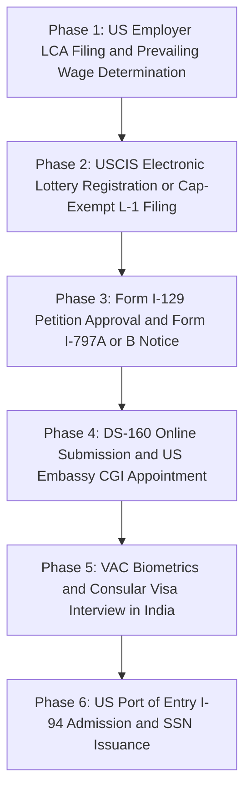

# USA Work Visa Guide 2026: H-1B Wage-Weighted Lottery, $215 Registration, L-1 Intra-Company Transfer, H-2B Seasonal Trades & EB-3 Green Card Pathway

The United States of America remains the world's premier employment destination for high-earning technology architects, healthcare professionals, corporate executives, and specialized industrial personnel. Unmatched US Dollar purchasing power, global career mobility, and a robust innovation economy attract hundreds of thousands of Indian professionals every year.

However, navigating US employment immigration in 2026 requires mastering profound structural updates implemented by **U.S. Citizenship and Immigration Services (USCIS)** and the **Department of Labor (DOL)**. Most notably, the traditional pure-chance H-1B draw has transitioned toward a **Wage-Weighted Selection Framework** tied to DOL prevailing wage tiers, the electronic registration fee stands at **$215 per beneficiary**, strict **beneficiary-centric anti-fraud verification** governs all cap submissions, and employers increasingly leverage **L-1 Intra-Company Transfers**, **H-2B Non-Agricultural Visas**, and **EB-3 Immigrant Sponsorship** as strategic alternatives.

This definitive 2026 master guide delivers an authoritative analysis of the **H-1B wage-weighted lottery mechanics**, complete **USCIS Form I-129 fee breakdowns**, head-to-head comparison of **H-1B vs. L-1A/L-1B vs. H-2B vs. EB-3**, step-by-step **US Embassy / CGI Federal India biometric & visa interview pipeline**, 10 occupation salary benchmarks in USD and INR, and the exact **AC21 Green Card extension roadmap** for Indian nationals.

---

## 1. H-1B vs. L-1 vs. H-2B vs. EB-3: Master Comparison Matrix (2026)

Choosing the correct US work visa classification is the single most decisive factor in your approval timeline and family work rights:

| Visa Category | Primary Target Applicant | Annual Numerical Cap | Prevailing Wage / Minimum Qualification | Maximum Stay Duration | Spouse Work Authorization (EAD)? |
| :--- | :--- | :--- | :--- | :--- | :--- |
| **H-1B Specialty Occupation** | IT, Engineers, Finance, Doctors (Bachelor's+) | **85,000 / year** (65,000 Regular + 20,000 US Master's) | DOL Prevailing Wage Levels I–IV (LCA mandatory) | **6 Years** (Extendable indefinitely via approved I-140) | **H-4 EAD** (Allowed only after I-140 approval) |
| **L-1A / L-1B Intra-Company Transfer** | Managers/Executives (L-1A) or Specialized Knowledge (L-1B) | **No Cap / No Lottery!** | 1 continuous year at Indian subsidiary within last 3 yrs | **7 Years** (L-1A) / **5 Years** (L-1B) | **YES — Automatic L-2S!** Spouse works from Day 1 without separate EAD |
| **H-2B Temporary Non-Agricultural** | Hospitality, Construction, Landscaping, Manufacturing | **66,000 / year** (33k H1 + 33k H2 + supplemental) | DOL Temporary Labor Certification (Prevailing wage) | Up to **3 Years** (1-year increments) | **No** (H-4 spouses cannot work) |
| **O-1A Extraordinary Ability** | Top AI Researchers, Founders, Senior Architects | **No Cap / No Lottery!** | Satisfy 3+ of 8 USCIS Extraordinary Criteria | **3 Years initial** + unlimited 1-yr extensions | **No** (O-3 spouses cannot work) |
| **EB-3 Employment Green Card** | Skilled Workers (2+ yrs exp), Professionals, Other Workers | **140,000 / year** (7% India per-country cap) | Mandatory DOL **PERM Labor Certification** | **Permanent Residence** (10-Year Green Card) | **YES — Unrestricted** upon I-485 EAD / Green Card |

> 📌 **Strategic Insight for Indian Professionals:** While the H-1B lottery suffers heavy oversubscription, the **L-1A / L-1B Intra-Company Transfer** remains **100% exempt from lotteries and annual caps**. Furthermore, L-2S spouses automatically receive work authorization incident to status upon US arrival, avoiding the multi-year H-4 EAD backlog!

---

## 2. The 2026 H-1B Wage-Weighted Lottery & Beneficiary-Centric Rules

USCIS completely overhauled H-1B cap selection to stop mass duplicate filings and prioritize higher-skilled, higher-compensated roles:

### 1. How the Wage-Weighted Selection Scales Odds
Instead of giving every applicant identical odds regardless of salary, USCIS assigns weighted lottery entries based on the **Department of Labor Occupational Employment and Wage Statistics (OEWS)** prevailing wage level offered on the registration:

| DOL Prevailing Wage Tier | Experience & Complexity Profile | Typical Compensation Percentile | Number of Lottery Entries | Selection Probability Multiplier |
| :--- | :--- | :--- | :--- | :--- |
| **Wage Level I (Entry)** | Junior analysts, recent graduates, entry engineers | 17th Percentile local wage | **1 Entry** | **1x Baseline** |
| **Wage Level II (Qualified)** | Experienced professionals (2–5 yrs experience) | 34th Percentile local wage | **2 Entries** | **2x Higher Odds** |
| **Wage Level III (Experienced)** | Senior specialists, lead engineers (5–8 yrs exp) | 50th Percentile local wage | **3 Entries** | **3x Higher Odds** |
| **Wage Level IV (Fully Competent)** | Principal architects, directors, specialists (8+ yrs) | 67th Percentile local wage | **4 Entries** | **4x Higher Odds** |

### 2. Beneficiary-Centric Integrity Controls
- **Passport-Bound Registration:** Every candidate must register using a valid, unexpired passport number.
- **Zero Multiple-Employer Gaming:** If 3 different IT consultancies submit registrations for the same Indian passport holder, the beneficiary is **NOT** given 3 separate chances in the general pool; USCIS consolidates the individual under their single passport and assigns entries solely based on the **highest wage level offered**. If selected, any of those registering employers may proceed to file Form I-129.

---

## 3. 2026 USCIS Fee Structure & Proclamation Litigation Updates

Understanding exact statutory filing fees prevents budget surprises for sponsoring employers and applicants:

| Fee / Filing Item | 2026 Statutory Amount | Who Pays (By Law)? | Key Exemptions & Notes |
| :--- | :--- | :--- | :--- |
| **H-1B Electronic Registration** | **$215 per beneficiary** | Sponsoring Employer | Paid during the March USCIS registration window |
| **Form I-129 Base Filing Fee** | **$780** (Standard) / **$460** (Small Employer ≤25 FTEs) | Sponsoring Employer | Applies to H-1B, L-1, and H-2B petitions |
| **Asylum Program Fee** | **$600** (Large) / **$300** (Small) / **$0** (Nonprofits) | Sponsoring Employer | Mandatory surcharge added to Form I-129 filings |
| **ACWIA Training Fee** | **$1,500** (>25 FTEs) / **$750** (≤25 FTEs) | Sponsoring Employer | Paid on initial H-1B and first extension (Waived for universities) |
| **Fraud Prevention & Detection Fee** | **$500** | Sponsoring Employer | One-time fee per new H-1B or L-1 sponsor change |
| **9/11 Response & Biometric Fee** | **$4,000** (H-1B) / **$4,500** (L-1) | **50/50 Rule Companies Only** | Applies only if employer has 50+ US staff and >50% are on H-1B/L-1 |
| **Optional Premium Processing (I-907)** | **$2,805** | Employer or Employee | Guarantees USCIS action within **15 business days** |
| **Proposed Consular $100k Surcharge** | **$0 (Vacated / Blocked)** | — | Vacated by Federal Court; **NOT collected** for Change of Status or active litigation stays |

> 💡 **Legal Protection:** By US federal statute, **the sponsoring employer is legally prohibited from deducting the ACWIA training fee, Fraud Prevention fee, or Asylum Program fee from the worker's wages** or requiring the employee to reimburse them.

---

## 4. Official Step-by-Step USA Employment Deployment Pipeline

Securing an approved US work visa from India requires coordinated filings across the US Department of Labor, USCIS, and the US Department of State (Consulate). The roadmap below details the exact sequence:

---

## 5. In-Depth Phase Breakdown: From India to the United States

### Phase 1: Prevailing Wage & Labor Condition Application (LCA - Form ETA-9035)
- **Wage Verification:** Before filing an H-1B petition, the US employer submits an electronic **Labor Condition Application (LCA)** to the **[U.S. Department of Labor FLAG Portal](https://flag.dol.gov)**.
- **Statutory Attestations:** The employer legally certifies that they will pay the foreign worker at least 100% of the prevailing wage for that occupation in that specific metropolitan area (MSA), and that hiring the worker will not adversely affect US workers' conditions. LCA certification typically takes **7 working days**.

### Phase 2: USCIS Registration & Cap Selection (Or Cap-Exempt Filing)
- **March Lottery:** For cap-subject H-1B roles, the employer enters the candidate's passport info and Wage Level (I–IV) into the **[myUSCIS Organizational Account](https://www.uscis.gov)** during March ($215 fee).
- **L-1 / Cap-Exempt Bypass:** Candidates transferring via L-1A/L-1B, working for universities/non-profit research institutes (cap-exempt H-1B), or filing H-2B seasonal petitions skip the March annual H-1B lottery entirely!

### Phase 3: Form I-129 Petition & Form I-797 Approval Notice
- Within the 90-day filing window (April–June), the employer submits the complete **Form I-129 Petition for a Nonimmigrant Worker** containing the certified LCA, Indian degree equivalency evaluation (proving the 3-year or 4-year Indian degree equals a 4-year US Bachelor's), and detailed specialty occupation job duties.
- Upon adjudication (2–5 months regular, or **15 business days** via $2,805 Premium Processing), USCIS issues the official **Form I-797 Notice of Action** (Approval Notice).

### Phase 4: DS-160 & US Embassy India Scheduling (CGI Federal)
- The applicant completes the online **Form DS-160 Nonimmigrant Visa Application** at **[ceac.state.gov](https://ceac.state.gov)** and pays the **MRV Visa Fee ($205 for H/L/O categories)**.
- The candidate creates a profile on the official **US Travel Docs India Portal** ([ustraveldocs.com/in](https://www.ustraveldocs.com/in/en/)) to book two appointments across India's five US Consular Posts (**New Delhi, Mumbai, Hyderabad, Chennai, or Kolkata**):
  1. **OFC (Offsite Facilitation Center / VAC):** Fingerprinting & digital photograph.
  2. **Consular Interview:** In-person interview at the US Embassy or Consulate.
  *(Note: Eligible applicants renewing an identical visa category within expiration rules may qualify for Interview Waiver / Dropbox processing—check current eligibility rules at scheduling).*

### Phase 5: The Consular Interview & Visa Stamping
- Bring your **Original Indian Passport**, **Form I-797 Approval Notice**, **DS-160 Confirmation**, **LCA Copy**, and **Employer Support Letter** to your interview.
- The Consular Officer verifies your educational credentials, specialized job duties, and employer legitimacy. Once approved, the passport is stamped with your **H-1B / L-1 Visa Foil** within **5 to 7 working days**.

### Phase 6: US Arrival, I-94 Record & Social Security Number (SSN)
- Upon landing at JFK, Newark, San Francisco (SFO), Chicago (ORD), or Dallas (DFW), the U.S. Customs and Border Protection (CBP) officer verifies your visa and generates an electronic **Form I-94 Arrival/Departure Record** matching your I-797 validity date.
- Visit your local **Social Security Administration (SSA)** office (or apply during onboarding) to receive your 9-digit **Social Security Number (SSN)**, enabling payroll setup, US credit history, and driver's license issuance.

For background on required Indian documentation and clearance protocols before leaving India, verify our [PCC & MEA Apostille Master Guide 2026](/blogs/police-clearance-certificate-pcc-gulf-european-visas-psk-apostille-guide-2026) and [Work Visa Check Online by Passport Guide](/blogs/work-visa-check-online-by-passport-number-2026-saudi-dubai-qatar-kuwait-europe).

---

## 6. High-Demand US Occupations & 2026 Salary Benchmarks (USD & INR)

The United States offers the highest gross and net take-home salaries globally for technical, medical, and specialized skilled personnel. Below are 2026 real-world compensation benchmarks across key employment visa categories (net monthly pay calculated after Federal Income Tax, FICA Social Security/Medicare 7.65%, and average State tax):

| Occupation / Role | Primary Visa Route | Typical Gross Annual Salary (USD) | Est. Monthly Net Pay (USD) | Est. Monthly Net Pay (INR) |
| :--- | :--- | :--- | :--- | :--- |
| **Senior Software / AI Systems Architect** | H-1B (Level III–IV) / L-1B | **$155,000 – $220,000** | $8,900 – $12,100 / mo | **₹747,000 – ₹1,016,000** |
| **Cloud / DevOps & Cybersecurity Lead** | H-1B (Level II–III) | **$130,000 – $175,000** | $7,600 – $9,900 / mo | **₹638,000 – ₹831,000** |
| **IT Engineering Manager / Director** | L-1A Intra-Company | **$170,000 – $240,000** | $9,600 – $13,000 / mo | **₹806,000 – ₹1,092,000** |
| **Registered Nurse (RN - BSN)** | EB-3 Schedule A / H-1B | **$85,000 – $118,000** | $5,250 – $7,000 / mo | **₹441,000 – ₹588,000** |
| **Electrical Power / Grid Engineer** | H-1B Specialty | **$105,000 – $145,000** | $6,300 – $8,400 / mo | **₹529,000 – ₹705,000** |
| **Mechanical / Semiconductor Engineer** | H-1B / L-1B | **$115,000 – $158,000** | $6,850 – $9,050 / mo | **₹575,000 – ₹760,000** |
| **Financial Quant / Risk Analyst** | H-1B Specialty | **$125,000 – $180,000** | $7,350 – $10,150 / mo | **₹617,000 – ₹852,000** |
| **Construction Superintendent / PM** | H-1B / L-1A | **$95,000 – $135,000** | $5,800 – $7,900 / mo | **₹487,000 – ₹663,000** |
| **Heavy Industrial / HVAC Technician** | H-2B / EB-3 Skilled | **$62,000 – $88,000** | $4,000 – $5,400 / mo | **₹336,000 – ₹453,000** |
| **Commercial Long-Haul CDL Driver** | H-2B / EB-3 Skilled | **$68,000 – $95,000** | $4,350 – $5,800 / mo | **₹365,000 – ₹487,000** |

*Note: Calculations based on 1 USD ≈ ₹84 INR. Residents working in zero-state-income-tax states such as **Texas, Florida, or Washington** retain an additional 5% to 9% net take-home pay compared to California or New York.*

Evaluating alternative English-speaking settlement options with faster Permanent Residency timelines? Read our [Canada Work Permit & LMIA Complete Guide 2026](/blogs/canada-work-permit-lmia-process-guide-2026-tfwp-jobs-salary-pr), [Australia Subclass 482 Core Skills Guide 2026](/blogs/australia-skills-in-demand-visa-subclass-482-complete-guide-2026-jobs-salary-tra-pr), and [UK Skilled Worker 70-Point Master Guide](/blogs/uk-skilled-worker-visa-complete-guide-2026-70-points-defined-cos-salary-list-ilr).

---

## 7. Navigating the EB-3 Green Card & Indian Backlog Strategy (AC21)

For Indian-born professionals, understanding how the temporary **H-1B/L-1** connects to the permanent **EB-3 or EB-2 Green Card** is critical:

1. **Step 1 — PERM Labor Certification:** The US employer conducts a mandatory US recruitment campaign (2–4 months + DOL processing) proving no qualified US worker applied.
2. **Step 2 — Form I-140 Immigrant Petition:** Filed with USCIS upon PERM approval. The day PERM was filed locks in your lifelong **Priority Date**!
3. **The India Backlog Reality & AC21 Protection:** Because US immigration law imposes a **7% annual per-country cap** per birth country, Indian-born EB-2 and EB-3 applicants experience multi-year Priority Date backlogs on the monthly **Visa Bulletin**.
   - **Crucial Safeguard (AC21 Section 104(c)):** Once your **Form I-140** is approved, you are **NOT** forced to leave the US after your 6-year H-1B maximum! You can extend your H-1B in **3-year increments indefinitely** until your Green Card priority date becomes current, AND your H-4 spouse qualifies for an unrestricted **H-4 EAD work permit**!
   - **L-1A Exception (EB-1C Multinational Manager):** Senior managers transferring on an **L-1A Visa** bypass PERM altogether and qualify under the priority **EB-1C category**, where Indian priority dates advance drastically faster than EB-2/EB-3!

---

## 8. Frequently Asked Questions (FAQs)

### Q1: How does the 2026 H-1B wage-weighted lottery affect fresh graduates vs. senior professionals?

**Answer:** Under the USCIS wage-weighted selection framework, candidates offered higher prevailing wage salaries receive significantly better lottery odds. A fresh graduate offered a **Wage Level I** salary receives **1 entry**, whereas an experienced specialist offered a **Wage Level III or Level IV** compensation package receives **3 to 4 entries** in the random draw. Consequently, senior engineers, specialists, and US Master's degree holders command dramatically higher selection probabilities than entry-level applicants.

### Q2: Can a candidate with a 3-year Indian Bachelor's degree (B.Sc, BCA, B.Com) qualify for an H-1B Visa?

**Answer:** A standard US H-1B requires the equivalent of a **4-year US Bachelor's degree**. Because most Indian B.Sc, BCA, or B.Com degrees are 3 years in duration, USCIS will require either: (1) an additional postgraduate qualification (such as an MCA, M.Sc, or MBA), OR (2) a formal **Educational & Experience Evaluation** under the USCIS **"3-for-1 Rule"**, where 3 years of progressive, specialized professional work experience equals 1 year of university education (meaning a 3-year Indian degree + 3 years verifiable IT/specialty experience equals a 4-year US Bachelor's).

### Q3: What happens if I lose my job in the US while on an H-1B or L-1 Visa?

**Answer:** Under federal USCIS regulations, if your employment is terminated voluntarily or involuntarily while inside the United States, you automatically receive a **single discretionary 60-calendar-day grace period** (or until your I-94 expiration date, whichever is shorter). During those 60 days, you retain lawful presence to find a new US employer to file an H-1B Transfer petition, apply for a Change of Status (e.g., to B-2 visitor or F-1 student), or depart the US without accruing unlawful presence.

### Q4: Can my spouse work immediately in the US if I travel on an H-1B vs. an L-1 Visa?

**Answer:** On an **L-1A or L-1B Visa**, your spouse enters on **L-2S status** and is legally authorized to work **automatically from Day 1** for any US employer, start a business, or work remotely without needing to apply for a separate Employment Authorization Document (EAD card). Conversely, on an **H-1B Visa**, your spouse enters on **H-4 status** and CANNOT legally work until **your Form I-140 Green Card petition is approved** (typically 1.5 to 2.5 years after starting the PERM process), at which point they can apply for an **H-4 EAD**.

### Q5: What is the difference between an H-1B Visa Stamp and an H-1B I-797 Approval Notice?

**Answer:** Your **Form I-797A / I-797B** is your underlying work authorization approval issued by USCIS inside the US, allowing you to legally live and work in America. Your **Visa Foil (Stamp)** placed in your passport by the US Embassy/Consulate in India is strictly an **entry travel document** allowing you to board an international flight and request entry at a US airport. If your passport visa stamp expires while you are inside the US, you can remain and work completely legally as long as your I-797 / I-94 remains valid—you only need a new visa stamp at a US Consulate if you travel outside the US and wish to return.

### Q6: Can Indian tradesmen (welders, drivers, mechanics, cooks) get a US H-2B or EB-3 Visa?

**Answer:** Yes, through specific non-IT pathways. **H-2B Temporary Non-Agricultural Visas** allow US hotels, resorts, construction firms, landscaping enterprises, and seasonal logistics companies to sponsor non-degree skilled and semi-skilled workers for temporary/peak-load contracts up to 3 years. Additionally, US trucking fleets, manufacturing plants, and food processing corporations sponsor blue-collar workers directly under the **EB-3 Skilled Worker / Other Worker** category via PERM Labor Certification—though applicants in India must account for the multi-year Visa Bulletin waiting queue for Indian birth nationals.

### Q7: Is it mandatory to have a job offer before applying for any USA Work Visa?

**Answer:** For virtually all standard employment categories (**H-1B, L-1, H-2B, and EB-3**), an active, verified sponsorship offer from a compliant US corporate employer is **strictly mandatory**—there is no independent "Job Seeker Visa" in the United States. The rare exceptions where individuals can self-petition without a specific employer job offer are the **EB-2 National Interest Waiver (NIW)** and **EB-1A Extraordinary Ability** immigrant petitions, which require exceptional documented impact of national importance to the United States.

### Q8: How much does the H-1B Electronic Registration cost in 2026, and can the candidate pay it?

**Answer:** The official USCIS electronic registration fee for the FY 2027 cap season is **$215 per unique beneficiary**, up from the historical $10 fee. Under US Department of Labor and USCIS regulations, the sponsoring employer must submit and pay the $215 registration fee and all mandatory Form I-129 statutory filing fees—candidates should never pay fraudulent third-party agencies claiming to "sell" H-1B lottery slots!

---

## 9. Conclusion: Strategic Checklist for USA Employment Success in 2026

Despite heightened USCIS compliance standards and competitive lottery dynamics, the United States remains an unrivaled wealth-building and career-accelerating market for global professionals. By targeting higher DOL wage tiers, utilizing cap-exempt **L-1 Intra-Company Transfers** where eligible, and locking in an early **Form I-140 Priority Date**, Indian applicants can secure long-term prosperity for their entire families.

Before commencing your US employment visa journey:
1. Verify your potential sponsor's historical LCA and H-1B track record through the official [USCIS H-1B Employer Data Hub](https://www.uscis.gov/tools/reports-and-studies/h-1b-employer-data-hub).
2. Ensure your academic degree (or 3-year degree + experience evaluation) strictly matches your specialty occupation code.
3. Never pay any unregistered broker claiming "guaranteed H-1B lottery wins" or selling fake job letters.
4. Prepare thoroughly for your **CGI Federal / US Embassy Consular Interview** with clear, concise explanations of your specialized project work and US employer structure.

For verified global career opportunities, international credential evaluation guidance, and compliant recruitment pipelines, explore our [WorkWise Visa Job Demand Directory](/jobs) and consult our destination mobility advisors today.
