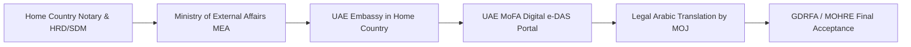
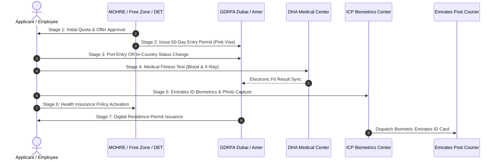

# Dubai Residence Visa & Permit Complete Master Guide 2026: 10 Official Pathways, Step-by-Step Application Process, Fees (AED & INR), Medical Screening & Official GDRFA/ICP Rules

The **United Arab Emirates (UAE)**—with **Dubai** serving as its global commercial, technological, and architectural capital—has established one of the world's most sophisticated, digitized, and accessible legal residency ecosystems. In 2026, navigating the Dubai residence permit system is governed by a modernized statutory framework spearheaded by **Federal Decree-Law No. 29 of 2021 on the Entry and Residence of Foreigners** and its expansive Executive Regulations enacted under **Cabinet Resolution No. 65 of 2022**.

Whether your objective is securing **company-sponsored employment**, incorporating an enterprise as a **commercial investor**, obtaining the coveted **10-Year UAE Golden Visa**, qualifying for the **5-Year Green Visa**, working remotely under the **Virtual Working Program**, or **sponsoring your family and dependent parents**, Dubai offers a clearly structured legal pathway. 

Crucially, the UAE government has fundamentally retired legacy, bureaucratic procedures. The historic practice of affixing physical visa sticker labels inside expatriate passports has been **100% abolished**. Today, your legal residency status is fully merged with your **digital biometric Emirates ID card**, verifiable in real-time across international airlines, border control gates, and government portals via the **[Federal Authority for Identity, Citizenship, Customs and Port Security (ICP)](https://www.icp.gov.ae)** and the **[General Directorate of Residency and Foreigners Affairs in Dubai (GDRFA)](https://www.gdrfad.gov.ae)**.

This exhaustive, authoritative master guide provides an end-to-end, 360-degree breakdown of the **10 official residency pathways, prerequisite document legalization pipelines, step-by-step application milestones, mandatory DHA medical fitness screening protocols, line-by-line government fee schedules (in AED and INR), grace periods, overstay penalty structures, and official government portal directories**.

---

## Master Directory of Official UAE & Dubai Government Portals

To protect yourself against unregulated intermediaries and fraudulent visa promises, all prospective residents must consult and interact with official government digital platforms:

| Government Authority / Entity | Jurisdiction & Function | Official Web Portal | Primary Smart Application |
| :--- | :--- | :--- | :--- |
| **GDRFA Dubai** | General Directorate of Residency and Foreigners Affairs (Dubai Entry Permits & Residency) | [gdrfad.gov.ae](https://www.gdrfad.gov.ae) | **Dubai GDRFA Smart App** |
| **ICP UAE** | Federal Authority for Identity, Citizenship, Customs and Port Security (Emirates ID & Federal Visas) | [icp.gov.ae](https://www.icp.gov.ae) | **UAEICP App** |
| **MOHRE** | Ministry of Human Resources and Emiratisation (Mainland Labour Contracts & Work Permits) | [mohre.gov.ae](https://www.mohre.gov.ae) | **MOHRE UAE App** |
| **U.AE** | The Official Portal of the United Arab Emirates Government | [u.ae](https://u.ae) | **UAE PASS / U.AE Portal** |
| **DHA** | Dubai Health Authority (Medical Fitness Screening & Occupational Health Screening) | [dha.gov.ae](https://www.dha.gov.ae) | **DHA App / Smart Salem** |
| **MoFA UAE** | Ministry of Foreign Affairs (Educational, Personal & Commercial Certificate Attestation) | [mofa.gov.ae](https://www.mofa.gov.ae) | **MoFA UAE App (e-DAS)** |
| **DLD (Cube)** | Dubai Land Department (Property Investor Visa & Golden Visa Services) | [dubailand.gov.ae](https://dubailand.gov.ae) | **Dubai REST App** |
| **Invest in Dubai / DET** | Department of Economy and Tourism (Mainland Commercial Licensing & Investor Residency) | [invest.dubai.ae](https://invest.dubai.ae) | **Invest in Dubai Portal** |
| **Amer Centers** | Official Semi-Government Typing & Visa Processing Centers in Dubai | [amer247.com](https://amer247.com) | **Amer Service Centers** |
| **Tadbeer** | Ministry-Licensed Centers for Domestic Workers (Housemaids, Nannies, Drivers) | [tadbeer.ae](https://www.tadbeer.ae) | **Tadbeer Smart Portal** |
| **RTA Dubai** | Roads and Transport Authority (Driving License Transfer & Vehicle Registration) | [rta.ae](https://www.rta.ae) | **RTA Dubai App** |
| **UAE PASS** | National Digital Identity & Digital Signature Provider for All Government Services | [uaepass.ae](https://www.uaepass.ae) | **UAE PASS App** |

---

## 1. Statutory Architecture: Understanding the Modern UAE Residency System

### Federal Decree-Law No. 29 of 2021 & Cabinet Resolution No. 65 of 2022
The legal foundation of modern Dubai immigration is grounded in **Federal Decree-Law No. 29 of 2021**, which comprehensively overhauled entry permits, visit visas, and residency tracks. Under its accompanying Executive Regulations (**Cabinet Resolution No. 65 of 2022**), the UAE government introduced a tiered, self-sustaining immigration ecosystem designed to decouple foreign residence from traditional employer sponsorship where appropriate, while strengthening statutory protections for salaried workers.

### The Unified Digital Residency Model (End of Passport Visa Stickers)
Historically, expatriates arriving in Dubai received an entry permit stamp, followed by physical stamping of a green/pink residence visa sticker on a passport page. Since Federal Cabinet reforms came into full effect:
1. **The physical passport visa sticker is formally phased out.**
2. **The physical biometric Emirates ID card serves as the single primary proof of residency.** It contains an embedded cryptographic microchip holding biometric fingerprints, digital facial scans, personal records, labor contract numbers, and residency validity.
3. When boarding international flights to the UAE or transiting through global customs checkpoints, international airlines verify residency status via real-time electronic API communication with the **ICP / GDRFA advance passenger information systems**.
4. Residents can instantly generate a digitally signed, QR-code-verified **Residency Details Certificate (Bayanati)** directly from the **ICP App** or **GDRFA Smart App** whenever required for banking, tenancy registration, or international consular travel.

---

## 2. The 10 Official Dubai Residence Permit Pathways (Complete Analysis)

Every foreign national residing legally in Dubai falls under one of 10 established residency streams. Selecting the correct pathway is critical to ensuring long-term immigration stability, family sponsorship eligibility, and tax-efficient asset accumulation.

### Pathway 1: Standard Employment Residence Visa (Company-Sponsored)
The standard employment visa remains the primary vehicle for professionals, executives, technicians, and craft workers moving to Dubai for salaried corporate employment.

#### Jurisdictional Dichotomy: Mainland vs. Free Zone
Employment in Dubai is legally divided into two distinct regulatory environments:
1. **Dubai Mainland Companies:** Regulated directly by the **[Ministry of Human Resources and Emiratisation (MOHRE)](https://www.mohre.gov.ae)** and the **[GDRFA](https://www.gdrfad.gov.ae)** under **Federal Decree-Law No. 33 of 2021 (The UAE Labour Law)**. The employer must secure a preliminary electronic quota, issue a standard bilingual MOHRE employment offer letter, and process wages through the Central Bank's **Wage Protection System (WPS)**.
2. **Dubai Free Zone Enterprises:** Regulated by autonomous Free Zone Authorities (e.g., **Dubai International Financial Centre - DIFC**, **Dubai Multi Commodities Centre - DMCC**, **Dubai Airport Freezone - DAFZA**, **Jebel Ali Free Zone - JAFZA**, **Dubai South**, **TECOM Group**). Free zone companies sponsor their workers directly through the respective authority's immigration portal in coordination with GDRFA. Employees are covered by the free zone’s employment regulations alongside the core principles of UAE labor law.

#### Occupational Skill Levels (MOHRE Classification)
MOHRE stratifies all employment occupations into 5 distinct skill bands, which dictate educational attestation prerequisites and minimum wage eligibility:
- **Skill Level 1 (Managerial & Executive):** Managing Directors, Department Heads, Chief Executives. *Requirement:* Attested Bachelor’s Degree or higher.
- **Skill Level 2 (Professionals):** Engineers, Doctors, Architects, IT Specialists, Lawyers, Certified Accountants. *Requirement:* Attested Bachelor’s Degree in the specialized field.
- **Skill Level 3 (Technicians & Associate Professionals):** Surveyors, Site Supervisors, Medical Technicians, Draftsmen. *Requirement:* Attested Diploma (2 to 3 years post-secondary).
- **Skill Level 4 (Skilled Craftsmen & Vocational Trades):** Certified Welders, Building Electricians, Plumbers, HVAC Technicians, Scaffolders. *Requirement:* Vocational training certificate or secondary school completion.
- **Skill Level 5 (Elementary & General Workers):** Construction Helpers, Material Handlers, Cleaners, Office Assistants. *Requirement:* No formal academic attestation required.

#### Statutory Employer Obligations: The "Zero-Cost" Mandate
Under **Article 6 of UAE Federal Decree-Law No. 33 of 2021**, the employer is legally prohibited from charging any recruitment fees, quota fees, entry permit charges, medical examination expenses, Emirates ID costs, or visa stamping charges to the employee. Any contractual clause deducting visa costs from employee salaries is legally void and subject to severe MOHRE penalties.

---

### Pathway 2: The UAE Golden Visa (10-Year Long-Term Residence)
Launched to attract global investors, exceptional innovators, top-tier executives, and high-achieving scholars, the **10-Year UAE Golden Visa** represents the pinnacle of Middle Eastern residency privileges.

#### Exclusive Strategic Privileges of the Golden Visa:
- **100% Self-Sponsored:** No local corporate sponsor, service agent, or mainland employer is required.
- **Unrestricted Travel Flexibility:** Unlike standard residency (which lapses if the holder remains outside the UAE for more than 180 consecutive days), Golden Visa holders can remain outside the UAE for any duration without their residency being invalidated.
- **Comprehensive Family Sponsorship:** The principal holder can sponsor their spouse, sons up to age 25 (or unlimited age if having special needs), and unmarried daughters of any age.
- **Unlimited Domestic Support:** Golden Visa holders are permitted to sponsor an unlimited number of domestic staff (drivers, nannies, housemaids) under licensed Tadbeer contracts.
- **Extended Family Survivor Coverage:** In the event of the primary Golden Visa holder's passing, their sponsored family members are permitted to retain their Golden Residency until the conclusion of its 10-year term.

#### Golden Visa Eligibility Sub-Categories:

| Golden Visa Category | Statutory Eligibility Threshold (2026) | Approving Authority & Portal |
| :--- | :--- | :--- |
| **Real Estate Investors** | Minimum property purchase value of **AED 2,000,000** ($545,000 USD). May be a single property or combined portfolio, completed or approved off-plan development. If mortgaged, a bank statement demonstrating AED 2M paid equity is accepted. | [Dubai Land Department Cube (DLD)](https://dubailand.gov.ae) / GDRFA |
| **High-Salary Executives & Professionals** | Minimum basic monthly salary of **AED 30,000** ($8,170 USD) under an active MOHRE/Free Zone contract, held in Skill Level 1 or 2. Must present an attested Bachelor's degree and 6 months bank statements. | [MOHRE](https://www.mohre.gov.ae) / [GDRFA](https://www.gdrfad.gov.ae) |
| **Entrepreneurs & Business Owners** | Ownership or partnership in an innovative SME registered in the UAE generating annual revenues of **AED 1,000,000+** ($272,000 USD), or approval from a government-certified business incubator. | [Ministry of Economy](https://www.moec.gov.ae) / Invest in Dubai |
| **Exceptional Talents (Doctors & Scientists)** | Practicing physicians licensed by DHA/MOHAP, or scientists endorsed by the **Emirates Scientists Council** possessing proven peer-reviewed research impact. | [Emirates Scientists Council](https://u.ae) / DHA |
| **Digital Coders & Software Engineers** | Programmers, AI engineers, and tech founders endorsed by the **UAE Artificial Intelligence Office** under the National Program for Coders. | [UAE AI Office / Coders HQ](https://ai.gov.ae) |
| **Outstanding Students & Graduates** | High school students graduating with 95%+ from accredited UAE schools, or university graduates with a cumulative GPA of **3.8+** (or top 100 global universities). | [Ministry of Education](https://www.moe.gov.ae) / GDRFA |

---

### Pathway 3: The UAE Green Visa (5-Year Self-Sponsored Residence)
Introduced under Cabinet Resolution No. 65 of 2022, the **5-Year Green Visa** bridges the gap between the standard 2-year employment visa and the 10-year Golden Visa. It requires **zero employer sponsorship** and grants complete professional autonomy.

#### Green Visa Sub-Categories:
1. **Skilled Professionals:**
   - Must hold an active employment contract categorized under MOHRE Skill Level 1, 2, or 3.
   - Minimum monthly salary of **AED 15,000** ($4,085 USD).
   - Mandatory attested Bachelor’s degree or higher educational diploma.
2. **Freelancers and Self-Employed Individuals:**
   - Must hold a valid **Freelance / Self-Employment Permit** issued directly by MOHRE or a recognized Dubai Free Zone (such as GoFreelance by TECOM, DAFZA, or Shams).
   - Minimum annual income from self-employment of **AED 360,000** ($98,000 USD) for the preceding two years, or proof of equivalent financial solvency.
   - Bachelor's degree or specialized diploma.
3. **Investors and Commercial Partners:**
   - Applicable to individuals investing in or establishing commercial enterprises in Dubai.
   - Requires ownership or partnership shares valued at **AED 1,000,000+**, approved commercial license from the Department of Economy and Tourism (DET), and local municipal establishment cards.

---

### Pathway 4: Dubai Commercial Investor / Partner Visa (2-Year to 3-Year)
For entrepreneurs and business founders who do not yet meet the AED 2M Golden Visa threshold, the standard **Commercial Investor / Partner Visa** provides a robust, proven residency framework.

- **Mainland Commercial Setup:** Incorporating a Limited Liability Company (LLC) or Sole Establishment via the **[Invest in Dubai Portal (invest.dubai.ae)](https://invest.dubai.ae)** or the Department of Economy and Tourism (DET). Expatriates enjoy **100% foreign commercial ownership** across more than 1,000 commercial and industrial activities under the amended Commercial Companies Law (Federal Decree-Law No. 32 of 2021).
- **Free Zone Business Setup:** Registering a Free Zone Establishment (FZE) or Free Zone Company (FZCO) in hubs like DMCC, Meydan, IFZA, or Dubai Silicon Oasis.
- **Residency Duration:** 2 Years (renewable indefinitely as long as the trade license remains active and valid).
- **Core Prerequisite Documents:** Valid Trade License, Memorandum of Association (MoA) demonstrating partnership capital, Immigration Establishment Card, and commercial lease agreement (Ejari).

---

### Pathway 5: Real Estate Property Investor Residence Visa (2-Year DLD)
Dubai’s property market provides a direct statutory bridge to legal residency:
- **Minimum Property Valuation:** **AED 750,000** ($204,200 USD) total gross purchase value as recorded on the official Title Deed issued by the **[Dubai Land Department (DLD)](https://dubailand.gov.ae)**.
- **Eligible Property Categories:** Completed, habitable residential apartments, townhouses, or villas. (Raw agricultural land and industrial plots are excluded).
- **Mortgage Criteria:** If the property is financed through a UAE Central Bank licensed mortgage lender, the buyer must have paid down a minimum equity of AED 750,000, validated by an official mortgage statement and **Bank NOC letter**.
- **Joint Ownership between Spouses:** Spouses are permitted to combine ownership shares to meet the AED 750,000 threshold, provided an attested marriage certificate is submitted.

---

### Pathway 6: Dubai Remote Work / Virtual Working Visa (1-Year Renewable)
Pioneered by the Dubai Department of Economy and Tourism, the **Virtual Working Program** allows digital nomads, multinational executives, and tech freelancers to live in Dubai while working for an employer or clients located entirely outside the United Arab Emirates.

- **Residency Duration:** 1 Year (renewable annually upon re-submitting updated income proof).
- **Statutory Eligibility Criteria:**
  - Valid passport with minimum 6 months validity.
  - Active employment contract with an overseas company (minimum 1-year contract validity remaining), or proof of foreign company ownership for business owners.
  - Minimum monthly income of **$3,500 USD** (or equivalent foreign currency).
  - Preceding 3 consecutive months of bank statements demonstrating salary credit.
  - Comprehensive health insurance coverage with UAE medical validity.
- **Tax Advantage:** Zero local income tax on all foreign-earned revenues.

---

### Pathway 7: Family Sponsorship Residence Visa (Spouse, Children, Parents)
A foreign resident holding any valid UAE residence permit (Employment, Investor, Green, or Golden) is statutorily entitled to sponsor their immediate family members, provided they satisfy municipal income benchmarks.

#### Salary Thresholds for Family Sponsorship:
- **Sponsoring Wife & Children (Male Sponsor):** Minimum monthly salary of **AED 4,000**, or **AED 3,000 plus company-provided furnished accommodation**.
- **Sponsoring Husband & Children (Female Sponsor):** Under current GDRFA guidelines, a woman employed in professional occupations (engineers, doctors, teachers, corporate executives) earning **AED 4,000+** can sponsor her spouse and children. Other professions may sponsor with a minimum salary of **AED 10,000+** upon obtaining standard GDRFA approval.
- **Sponsoring Parents (Both Parents Mandatory):** Under UAE immigration statutes, expatriates must sponsor **both father and mother together**, unless an official death certificate, divorce decree, or institutional dependency proof is attested. Minimum salary requirement is **AED 20,000**, or **AED 19,000 plus a two-bedroom registered tenancy contract (Ejari)**. A refundable humanitarian deposit (typically AED 2,500 to AED 5,000) and comprehensive private medical insurance are mandatory.
- **Dependent Age Caps:**
  - Sons can be sponsored up to the age of **25 years** (extended from age 18 under Cabinet Resolution 65/2022). Unmarried sons with documented medical disabilities have no age cap.
  - Unmarried daughters of **any age** can be sponsored indefinitely until marriage.

---

### Pathway 8: Dubai Retirement Residence Visa (5-Year Renewable)
Designed for global citizens aged 55 and older seeking to spend their retirement years in Dubai.
- **Age Requirement:** 55 Years of age or older at the date of application.
- **Financial Eligibility (Must meet at least ONE):**
  1. *Real Estate Property:* Ownership of property in Dubai valued at not less than **AED 1,000,000** (gross value on DLD Title Deed).
  2. *Financial Savings:* Fixed term deposit of not less than **AED 1,000,000** deposited in a UAE local bank for a locked minimum duration of 3 years.
  3. *Active Monthly Income:* Guaranteed active pension or fixed monthly income of not less than **AED 20,000** (or AED 15,000 for select legacy programs), supported by 6 months of bank statements.

---

### Pathway 9: Domestic Workers Residence Visa (Tadbeer Centers)
Governed under **Federal Decree-Law No. 9 of 2022 on Domestic Workers**, private households and expatriate sponsors hire domestic personnel—including housemaids, private drivers, baby nannies, domestic cooks, private tutors, and home nurses—exclusively through accredited **[Tadbeer Centers (tadbeer.ae)](https://www.tadbeer.ae)**.
- **Permit Duration:** 1 Year or 2 Years.
- **Sponsor Salary Benchmark:** Expatriate sponsors must demonstrate a minimum monthly income of **AED 25,000+** to hire domestic personnel on direct sponsorship, or utilize Tadbeer’s institutional employment agency contracts.
- **Worker Rights:** Mandatory 12 hours of daily rest, 30 days paid annual leave, medical insurance, and private quarters.

---

### Pathway 10: Student Residence Visa (Accredited Higher Education)
Full-time students admitted to accredited universities, design colleges, and higher institutes located in Dubai (including Dubai International Academic City - DIAC and Dubai Knowledge Park) receive student residence visas sponsored directly by their academic institution or by their resident parents. High-performing university graduates (GPA 3.8+) can transition directly into the 10-Year Golden Visa.

---

## 3. Prerequisite Foundation: Document Legalization & Attestation Pipeline

Submitting un-attested or improperly legalized documents is the single leading cause of Dubai residence visa rejections. If your visa category requires educational degrees, marriage certificates, or birth certificates, you must complete the multi-jurisdictional attestation chain:

### Phase 1: Home Country Authentication (e.g., India, Pakistan, UK, Philippines)
1. **Notary Public:** Verification of original certificates.
2. **State Authority / HRD / Home Department:** State-level verification (e.g., Regional Authentication Centres, Higher Education Commission, or State HRD Departments).
3. **Ministry of External Affairs (MEA):** National federal authentication stamp or Apostille.

### Phase 2: Consular Legalization
- **UAE Embassy / Consulate:** Submission of the MEA-attested document to the UAE Embassy in New Delhi, Islamabad, Manila, or London for official consular seal endorsement.

### Phase 3: Digital MoFA UAE Attestation (e-DAS)
Upon arriving in Dubai (or online prior to arrival), the document must receive final statutory legalization through the **[Ministry of Foreign Affairs (MoFA UAE)](https://www.mofa.gov.ae)**:
- Submit digital scans through the **MoFA Mobile App** or website.
- Pay the statutory government attestation fee (**AED 150 per educational or personal certificate**).
- Receive an electronic attestation certificate containing a verifiable QR code.

### Phase 4: Sworn Arabic Legal Translation
Under UAE civil procedure rules, all documents drafted in languages other than Arabic must be translated by an official translator licensed by the **UAE Ministry of Justice (MOJ)**.

---

## 4. The 7-Stage End-to-End Application Lifecycle (Zero Guesswork)

Navigating a Dubai residence permit involves a precise sequential lifecycle. Deviating from this order can result in application freezes or financial overstay penalties:

---

### Stage 1: Preliminary Quota & Work Offer Approval
- *Mainland:* The employer applies to MOHRE for work quota approval. The prospective employee signs the standard bilingual **MOHRE Job Offer Letter**, outlining exact basic salary, allowances, job code, and notice periods.
- *Free Zones:* The enterprise registers the employment contract directly on the free zone's digital portal (e.g., DMCC Member Portal, DIFC Portal).
- *Investors / Golden Visa:* Preliminary trade license approval or DLD real estate nomination certificate is uploaded.

---

### Stage 2: Entry Permit Issuance ("Pink Visa" / Electronic e-Visa)
Once preliminary approvals are secured, the **Employment Entry Permit** is issued through the **GDRFA Dubai Smart Portal** or an accredited Amer Center:
- **Validity:** The entry permit is valid for **60 days** from the date of issue.
- **Entry Purpose:** It grants the legal right to enter the UAE (if abroad) or modify status (if already inside Dubai on a visit or tourist visa).
- **Format:** Fully digital PDF document featuring an official GDRFA QR code and entry permit file number.

---

### Stage 3: Entry into Dubai vs. In-Country Status Modification
Once the Entry Permit is generated, the applicant must activate it within 60 days via one of two mechanisms:
1. **Entering the UAE from Abroad:** The applicant presents the digital Entry Permit PDF at immigration e-gates or passport control counters at Dubai International Airport (DXB). Immigration officers stamp the entry date, transitioning the applicant to active pre-residency status.
2. **In-Country Status Change ("Tajdeed / Tagheer Al Wadha"):** If the applicant is already physically present in Dubai on a tourist visa, visit visa, or cancelled residency, they **do not need to exit the country**. An electronic **Status Change Application** is submitted via GDRFA / Amer:
   - *Government Fee:* Approximately **AED 650 to AED 750**.
   - *Result:* The applicant's legal status is instantaneously converted from visitor to resident without stepping foot outside Dubai.

---

### Stage 4: DHA Mandatory Medical Fitness Screening
Under UAE federal health legislation, every expatriate aged 18 and older applying for a residence permit must undergo mandatory screening for communicable diseases at an authorized **Dubai Health Authority (DHA) Medical Fitness Center** or **Smart Salem VIP Center**.

#### Key DHA Medical Centers Across Dubai:
- **Smart Salem Centers (AI-Powered VIP 30-Minute Results):** City Walk, DIFC (Index Tower), Dubai Knowledge Park.
- **Standard DHA Fitness Centers:** Al Muhaisnah Centre, Al Karama Centre, Al Garhoud Centre, Al Quoz Centre, Uptown Mirdif.

#### The Medical Examination Protocol:
1. **Chest X-Ray (Posteroanterior View):** Screened for active pulmonary tuberculosis or manifestation of untreated mycobacterial lesions.
2. **Venous Blood Draw:** Tested for:
   - **HIV / AIDS (Human Immunodeficiency Virus):** Mandatory for all categories.
   - **Hepatitis B & C:** Mandatory for 6 high-contact professional classifications:
     - Nannies, domestic helpers, and babysitters.
     - Food handlers, restaurant cooks, and beverage staff.
     - Barbershop, hair salon, and beauty spa operatives.
     - Nursery workers and kindergarten staff.
     - Healthcare clinic, hospital, and dental laboratory personnel.
     - Health club, gymnasium, and sports facility attendants.
   - **Syphilis:** Screened across standard and domestic classifications.

#### Medical Fitness Results Turnaround:
- *Standard Service:* Results delivered via SMS and email within **24 to 48 hours**.
- *VIP / Smart Salem Service:* Results processed via automated robotic phlebotomy and AI chest radiography in **30 minutes to 2 hours**.
- *Digital Integration:* DHA syncs the electronic "FIT" certificate directly into the GDRFA immigration database.

---

### Stage 5: Emirates ID Application & Biometric Registration (ICP)
Concurrent with or immediately following the medical test, an official application for the **Emirates Identity Card** is submitted through the ICP portal or an accredited Amer/typing center.
- **Biometric Appointment:** If the applicant is applying for an Emirates ID for the very first time, they must visit an **ICP Customer Happiness Center** (e.g., Al Barsha, Al Yalayis, Al Rashidiya, Jaffiliya):
  - 10-digit digital fingerprint scanning.
  - High-resolution iris recognition scan.
  - Digital biometric facial photograph.
- **Renewals:** Existing cardholders renewing residency are generally exempt from re-taking biometrics unless an updated facial profile is requested by ICP.

---

### Stage 6: Mandatory Health Insurance Policy Activation
In strict compliance with **Dubai Health Insurance Law (Law No. 11 of 2013)**, no residence visa can be finalized without active health insurance coverage:
- **Mainland Workers:** The employer is legally required to provide and fund compliant medical insurance.
- **Essential Benefits Plan (EBP):** Designed for workers earning under AED 4,000/month, providing statutory outpatient, emergency, maternity, and inpatient care capped at AED 150,000 per annum.
- **Enhanced Comprehensive Insurance:** Executive, investor, and family policies offering broader hospital networks, dental, and optical coverage.
- **Digital Health Insurance Integration (Basmah System):** Insurance providers upload the policy directly into the DHA electronic registry, automatically unfreezing the GDRFA residence permit generation system.

---

### Stage 7: Digital Residence Permit Issuance & Emirates ID Delivery
With medical clearance verified, biometrics captured, and insurance activated:
1. GDRFA approves the final **Residency Issuance (Injaz)** application.
2. The digital residence permit is generated and available instantly on the **GDRFA Smart App** and **UAEICP App**.
3. ICP produces the physical smart Emirates ID card and hands it over to **Emirates Post**.
4. Emirates Post delivers the card directly to the applicant's company PRO, private PO Box, or selected postal branch within **2 to 5 business days**.

---

## 5. Exhaustive Government Fee & Cost Breakdown Matrix (2026 Official Benchmarks)

Residency costs vary depending on the governing jurisdiction, VIP processing speeds, and validity duration. Below is an exhaustive financial schedule compiled from official GDRFA, MOHRE, and Amer fee benchmarks (calculated at a standard conversion of **1 AED = ₹22.80 INR**):

### Comprehensive Comparative Cost Ledger

| Visa Category | Government Body / Step | Official Fee (AED) | Approx. Fee in USD | Total in Indian Rupee (INR) | Primary Responsibility |
| :--- | :--- | :--- | :--- | :--- | :--- |
| **Mainland Employment (2 Years)** | MOHRE Quota & Offer Approval | 250 – 350 AED | $68 – $95 | ₹5,700 – ₹8,000 | **Employer** (Mandatory by Law) |
| | Entry Permit (Employment) | 250 – 350 AED | $68 – $95 | ₹5,700 – ₹8,000 | **Employer** |
| | In-Country Status Change (If applicable)| 650 – 750 AED | $177 – $204 | ₹14,800 – ₹17,100 | **Employer** |
| | DHA Medical Fitness (Standard 48hr)| 260 – 320 AED | $70 – $87 | ₹5,900 – ₹7,300 | **Employer** |
| | DHA Medical VIP / Smart Salem (30m)| 700 – 750 AED | $190 – $204 | ₹16,000 – ₹17,100 | Optional Upgrade |
| | Emirates ID Application (2 Years) | 270 – 370 AED | $73 – $100 | ₹6,150 – ₹8,400 | **Employer** |
| | MOHRE Electronic Labour Card (2 Yrs)| 300 – 1,200 AED | $82 – $326 | ₹6,800 – ₹27,400 | **Employer** (Based on MoHRE tier) |
| | GDRFA Residency Issuance (2 Years)| 500 – 650 AED | $136 – $177 | ₹11,400 – ₹14,800 | **Employer** |
| | **Estimated Total Mainland Package** | **2,800 – 4,500 AED**| **$760 – $1,225**| **₹64,000 – ₹1,02,000**| **100% Employer Cost** |
| | | | | | |
| **10-Year Golden Visa (Self-Sponsored)**| Initial Eligibility Nomination | 250 – 350 AED | $68 – $95 | ₹5,700 – ₹8,000 | Applicant |
| | In-Country Status Change | 650 – 750 AED | $177 – $204 | ₹14,800 – ₹17,100 | Applicant |
| | DHA Medical Fitness Screening | 260 – 750 AED | $70 – $204 | ₹5,900 – ₹17,100 | Applicant |
| | Emirates ID Issuance (10 Years) | 1,070 – 1,150 AED| $290 – $313 | ₹24,400 – ₹26,200 | Applicant (Full 10-Yr validity) |
| | GDRFA 10-Year Visa Stamping | 2,650 – 2,850 AED| $720 – $776 | ₹60,400 – ₹65,000 | Applicant |
| | **Estimated Total Golden Visa Package**| **4,880 – 5,850 AED**| **$1,330 – $1,590**| **₹1,11,000 – ₹1,33,000**| **Self-Funded Investment** |
| | | | | | |
| **5-Year Green Visa (Self-Sponsored)** | Entry Permit & Status Adjustment | 900 – 1,100 AED | $245 – $300 | ₹20,500 – ₹25,000 | Applicant |
| | DHA Medical Fitness (Standard) | 260 – 320 AED | $70 – $87 | ₹5,900 – ₹7,300 | Applicant |
| | Emirates ID Issuance (5 Years) | 570 – 650 AED | $155 – $177 | ₹13,000 – ₹14,800 | Applicant (Full 5-Yr validity) |
| | GDRFA 5-Year Residence Stamping | 1,200 – 1,450 AED| $326 – $395 | ₹27,300 – ₹33,000 | Applicant |
| | **Estimated Total Green Visa Package** | **2,930 – 3,520 AED**| **$796 – $958** | **₹66,800 – ₹80,200** | **Self-Funded Professional** |
| | | | | | |
| **Family Sponsorship (Per Dependent)** | Entry Permit for Family Member | 350 – 500 AED | $95 – $136 | ₹8,000 – ₹11,400 | Sponsor / Family Head |
| | Status Change Inside UAE | 650 – 750 AED | $177 – $204 | ₹14,800 – ₹17,100 | Sponsor / Family Head |
| | DHA Medical Test (Adults 18+ only)| 260 – 320 AED | $70 – $87 | ₹5,900 – ₹7,300 | Sponsor / Family Head |
| | Emirates ID (2-Year Validity) | 270 – 370 AED | $73 – $100 | ₹6,150 – ₹8,400 | Sponsor / Family Head |
| | GDRFA Residence Issuance (2 Years)| 500 – 650 AED | $136 – $177 | ₹11,400 – ₹14,800 | Sponsor / Family Head |
| | Basic EBP Health Insurance (Annual) | 650 – 950 AED | $177 – $258 | ₹14,800 – ₹21,600 | Sponsor / Family Head |
| | **Estimated Total Per Family Dependent**| **2,680 – 3,540 AED**| **$728 – $962** | **₹61,000 – ₹80,700** | **Sponsor Outlay** |

---

## 6. Medical Fitness Screening Protocol & "Fit vs. Unfit" Criteria (DHA)

The Dubai Health Authority operates under zero-compromise federal public health directives. Understanding how the DHA assesses medical conditions protects applicants from unexpected repatriation:

### 1. Pulmonary Tuberculosis (TB) Screening & Healed Scar Protocol
- **Screening Method:** High-resolution digital chest radiography.
- **Active Tuberculosis:** Individuals diagnosed with active pulmonary TB are deemed medically unfit. They receive immediate containment and treatment under DHA supervision, followed by statutory repatriation.
- **Old, Inactive, or Healed Calcified Scars:** Historically, any chest scar resulted in permanent disqualification. Under updated UAE ministerial directives, expatriates displaying old, inactive, or calcified scars undergo specialized **Sputum Smear and Culture Testing (or GeneXpert PCR testing)**:
  - If tests confirm the scar is non-infectious and inactive, the applicant is granted a conditional **Medical Fitness Certificate**.
  - The resident receives a 1-year residency permit and is placed under the **DHA TB Preventive Surveillance Program**, requiring periodic check-ups at the Al Muhaisnah Center.

### 2. Human Immunodeficiency Virus (HIV / AIDS)
All incoming and renewing expatriates undergo ELISA and confirmatory Western Blot serological testing for HIV antibodies. Detection of HIV infection results in an absolute "Unfit" declaration, cancellation of immigration proceedings, and safe consular repatriation.

### 3. Viral Hepatitis (B & C)
- **General Salaried & Professional Employees:** Tested for Hepatitis, but an active diagnosis does not result in disqualification unless applying for regulated high-contact occupations.
- **Regulated High-Contact Occupations:** For the 6 designated categories (food handlers, domestic maids, nursery staff, salon staff, healthcare personnel), a Hepatitis B or C positive result triggers disqualification.
- **Hepatitis B Vaccination:** All personnel in regulated categories testing negative are administered a mandatory 3-dose Hepatitis B vaccination series (AED 50 per dose).

---

## 7. Grace Periods, Overstay Penalties & Official Visa Cancellation Rules

Immigration discipline in Dubai is maintained through strict automated penalty algorithms enforced by the GDRFA and ICP central databases:

### The Unified Grace Period Structure (2026 Standards)
When a residence visa expires or is formally cancelled, the resident is granted an automatic legal **Grace Period** to either exit the UAE without penalties or transition to a new legal visa status:
- **Golden Visa & Green Visa Holders:** **180 Days (6 Months)** grace period from expiration or cancellation.
- **Skilled Professionals (MOHRE Skill Levels 1, 2, 3) & Property Investors:** **90 Days** grace period.
- **Standard Employment (Skill Levels 4 & 5) & Domestic Staff:** **60 Days** grace period.
- **Standard Tourist / Visit Visas:** **30 Days** grace period.

### Overstay Fines Architecture
Under unified federal regulations, overstay penalties across all visa classifications are strictly standardized:
- **Flat Rate:** **AED 50 ($13.60 USD / ₹1,140 INR) per day** for every single day of unauthorized overstay following the expiration of the statutory grace period.
- **Overstay Fee Settlement:** Overstay fines must be paid at an Amer Center, ICP border counter, or online via the GDRFA portal before an exit pass (outpass) is granted or a new status change can be executed.

### Official Residence Visa Cancellation Procedure
Before leaving employment or moving to another company, the existing residency must be legally terminated:
1. **MOHRE Work Permit Cancellation:** The employer submits a joint cancellation application signed by both employee and company representative, verifying that all statutory salaries, overtime payments, and end-of-service gratuities have been fully settled through WPS.
2. **GDRFA Residency Cancellation:** The Amer/GDRFA portal cancels the residence permit file. An official **Cancellation Paper (Exit Permit Document)** is generated.
3. The individual enters their designated grace period window.

---

## 8. Post-Residency Integration: Banking, Tenancy (Ejari), Driving License & UAE PASS

Acquiring your Emirates ID unlocks the full digital and economic infrastructure of the UAE:

### 1. Activating UAE PASS (National Digital Identity)
Download the **UAE PASS Mobile App** ([uaepass.ae](https://www.uaepass.ae)) and scan your new Emirates ID card at any smart kiosk. UAE PASS provides biometric face-matching authentication, granting instant single-sign-on access to over 6,000 government and private services (Dubai Police, DEWA, GDRFA, banks, telecom operators).

### 2. Opening Commercial & Personal Bank Accounts
With an active Emirates ID and digital residency document, residents can instantly open zero-balance digital bank accounts or premier personal accounts:
- **Instant Digital Neobanks:** **Wio Personal / Wio Business**, **Liv by Emirates NBD**, **Mashreq Neo**.
- **Tier-1 Full-Service Banks:** Emirates NBD, First Abu Dhabi Bank (FAB), Abu Dhabi Commercial Bank (ADCB), Dubai Islamic Bank (DIB).

### 3. Registering Residential Tenancy (Ejari System)
To rent an apartment or villa in Dubai, contracts must be registered with the **Dubai Land Department** through the **Ejari System** via the **Dubai REST App**:
- Documents required: Emirates ID copy, passport copy, landlord Title Deed, unified tenancy contract, DEWA premise number.
- The Ejari certificate is a mandatory prerequisite if you intend to sponsor family members or hire domestic staff.

### 4. RTA Driving License Transfer & "Golden Chance" Scheme
- **Direct License Swap:** Citizens holding driver's licenses from 32 recognized nations (e.g., USA, UK, Canada, Germany, GCC nations, Australia) can directly exchange their home license for a UAE Driving License at an RTA customer happiness center without driving lessons or road tests.
- **The "Golden Chance" Scheme (Non-Exempt Nations including India, Pakistan, Philippines):** Expatriates holding a valid driver's license from non-swap countries are permitted to bypass mandatory classroom theory classes and practical driving lessons. They can sit for a **one-time direct theory test and final RTA road test**. Passing on the first attempt yields an immediate UAE Driving License.

---

## 9. Common Rejection Pitfalls, Security Bans & Legal Remedies

Even qualified applicants encounter administrative delays or rejections due to avoidable compliance errors:

| Rejection Cause / Pitfall | Root Cause & Legal Mechanism | Corrective Remedy & Resolution Pipeline |
| :--- | :--- | :--- |
| **Name Discrepancies** | Variations in naming sequence (e.g., single name on passport, missing surname, transposition of father's name on educational certificates vs. passport). | Execute an official name rectification affidavit at your country's consulate, or apply for an amended passport before filing immigration entry permits. |
| **Active Financial or Police Cases** | Unsettled debt, auto-loan defaults, or unresolved civil disputes from prior stays in the UAE triggering an **Immigration Travel Ban**. | Conduct a pre-visa legal status check via the **Dubai Police Smart App** or **Dubai Courts Portal (dc.gov.ae)**. Pay outstanding obligations and secure a formal Court Clearance Certificate. |
| **Existing Uncancelled Visa File** | Holding an old residency file from a former employer that was never formally cancelled on the GDRFA database. | Request a formal file closure / archival cancellation through an Amer Center. |
| **Un-attested Educational Degrees** | Uploading university degrees lacking the mandatory MoFA UAE electronic QR-code attestation. | Route the original certificate through the 4-phase legalization pipeline (Notary -> MEA -> UAE Embassy -> MoFA e-DAS). |
| **Submitting Blurred Scans** | Uploading mobile camera photographs instead of high-resolution 300 DPI flatbed optical color scans. | Resubmit high-definition flatbed optical color scans showing all four document edges and machine-readable zones (MRZ). |
| **Working on a Visit / Tourist Visa** | Engaging in commercial employment while holding a tourist visa. | **Strictly illegal.** Carries fines up to AED 100,000 for employers, immediate deportation, and permanent labor blacklisting for workers under Federal Decree-Law No. 33 of 2021. |

---

## 10. Frequently Asked Questions (25 Authoritative Technical FAQs)

### Q1: Can I convert a 30-day or 60-day tourist visa into a residence permit without leaving Dubai?
**Answer:** **Yes, absolutely.** You do not need to exit the UAE. Once your employer or business entity receives your official 60-Day Employment Entry Permit, your PRO or Amer center will file an **In-Country Status Change (Status Modification)** application through GDRFA. Upon paying the statutory government fee (approx. **AED 650 to AED 750**), your legal status transitions instantly to an active residence applicant without leaving the country.

### Q2: How long does the entire Dubai residence visa process take from start to finish?
**Answer:** When expedited smoothly, the complete end-to-end timeline spans **7 to 14 business days**:
- Entry Permit Issuance: 24 to 48 hours.
- Status Change: 24 hours.
- Medical Fitness Test: 30 minutes (Smart Salem VIP) to 48 hours (Standard DHA).
- Emirates ID Biometrics: 1 business day (depending on appointment).
- Residence Visa Approval & Digital Stamping: 24 to 48 hours.
- Physical Emirates ID Card Courier Delivery: 2 to 4 business days via Emirates Post.

### Q3: Is a physical visa sticker still stamped inside my passport in 2026?
**Answer:** **No.** In accordance with Federal Cabinet Resolutions, physical passport visa stickers have been entirely discontinued across the UAE. Your official biometric **Emirates ID card** is your sole, statutory proof of residency. When travelling internationally, airline border systems check your validity electronically via advance passenger information linked to your passport number and digital residency record.

### Q4: What happens if I stay outside Dubai for more than 6 months (180 days)?
**Answer:** 
- **Standard Residence Visa Holders (Employment, Investor, Family):** If you remain outside the UAE for more than **180 consecutive days**, your residence visa is automatically rendered inactive/nullified by immigration systems. (Exceptions exist for approved overseas medical treatment, military service, or government scholarship study).
- **Golden Visa Holders:** **Completely exempt.** Golden Visa holders can remain outside the UAE for any duration (even multiple years) without losing their 10-year residency status.

### Q5: Can I sponsor my family if my salary is below AED 4,000?
**Answer:** Under GDRFA statutory rules, the strict baseline salary threshold for male sponsors is **AED 4,000 per month**, or **AED 3,000 plus company-provided accommodation** verified by an official MOHRE labor contract and salary certificate. Applications below this financial threshold are automatically rejected by system algorithms.

### Q6: Can I buy property in Dubai to get a residence visa, and what is the minimum price?
**Answer:** Yes. Dubai offers two property investor routes:
1. **2-Year Property Investor Visa:** Minimum total property purchase value of **AED 750,000** ($204,200 USD) on the DLD Title Deed.
2. **10-Year Golden Visa:** Minimum total property purchase value of **AED 2,000,000** ($545,000 USD). Both completed properties and approved off-plan units with verified equity satisfy the criteria.

### Q7: If I get rejected in the DHA medical test for Hepatitis B, will I be deported?
**Answer:** **Only if you are employed in one of the 6 regulated high-contact categories** (food handlers, domestic staff, nannies, salon/barber workers, kindergarten staff, healthcare professionals). If you work in standard corporate, IT, construction, engineering, or office roles (MOHRE Skill Levels 1, 2, 3, 4, 5 outside food/beauty), a Hepatitis B diagnosis does **not** result in deportation.

### Q8: What is the fine if my visa expires and I overstay in Dubai?
**Answer:** Overstay fines are unified at a flat rate of **AED 50 ($13.60 USD / ₹1,140 INR) per calendar day**. Fines begin accruing immediately following the expiration of your statutory grace period (which ranges from 60 to 180 days depending on your visa tier).

### Q9: Can an employee pay for their own employment residence visa?
**Answer:** **No, this is strictly illegal.** Under **Article 6 of UAE Federal Decree-Law No. 33 of 2021**, employers are legally obligated to cover 100% of all visa, work permit, medical, and Emirates ID expenses. It is unlawful for a company to deduct visa costs from your salary or demand reimbursement if you resign.

### Q10: What is the difference between a mainland residence visa and a free zone residence visa?
**Answer:** 
- A **Mainland Visa** is issued under the regulatory dual jurisdiction of **MOHRE** and **GDRFA Dubai**, governed by the UAE Labour Law, and paid through the Central Bank’s Wage Protection System (WPS).
- A **Free Zone Visa** is issued through autonomous Free Zone Authorities (DMCC, DIFC, JAFZA, DAFZA) in coordination with GDRFA. Free zones have their own employment regulations, internal dispute mediation boards, and quota structures. Both visas grant identical rights to live anywhere in Dubai.

### Q11: What is the "Green Visa" and who is eligible?
**Answer:** The Green Visa is a **5-year self-sponsored residence permit** introduced in late 2022. It requires no corporate sponsor. It is available to:
1. Skilled employees earning AED 15,000+/month with a bachelor's degree.
2. Freelancers holding an official MOHRE/Free Zone freelance permit with annual revenue of AED 360,000+.
3. Investors/partners holding commercial trade licenses.

### Q12: Can I sponsor my parents for a Dubai residence visa?
**Answer:** Yes, provided you earn a minimum salary of **AED 20,000** (or AED 19,000 plus an approved 2-bedroom Ejari tenancy). Under immigration rules, you must sponsor **both parents together** unless an official death or divorce certificate is attested. A refundable humanitarian deposit and comprehensive private medical insurance are mandatory.

### Q13: Can I work for another company on a freelance visa?
**Answer:** Yes. If you hold a valid **Freelance Permit and Green Visa**, or an official **MOHRE Temporary / Part-Time Work Permit**, you can legally provide services, consult, and issue invoices to multiple corporate clients across the UAE without legal breach.

### Q14: How does the UAE Golden Visa for executive managers work?
**Answer:** Executive managers and professionals can qualify for the 10-Year Golden Visa without investing capital if they meet 4 conditions:
1. Hold an attested Bachelor’s Degree or Master's Degree.
2. Hold an active employment contract categorized under MOHRE Skill Level 1 or 2.
3. Earn a minimum **basic monthly salary of AED 30,000** ($8,170 USD).
4. Provide official UAE bank statements reflecting this salary credit for the past 6 months.

### Q15: How can I check if I have a travel ban or police case before applying for a visa?
**Answer:** Dubai residents and previous visitors can check their legal status online through the **Dubai Police Smart App** using the "Criminal Status of Financial Cases" service, or submit an official inquiry through the **Dubai Courts Portal (dc.gov.ae)**.

### Q16: Can I get a residence permit in Dubai without having a job or business?
**Answer:** Yes, through 3 official routes:
1. **Property Investor Visa:** Purchase real estate valued at AED 750,000+ (2-year visa) or AED 2,000,000+ (10-year Golden Visa).
2. **Dubai Virtual Working Program:** If you earn $3,500+/month from an overseas remote job.
3. **Retirement Visa:** If you are aged 55+ with financial savings of AED 1M+ or a pension of AED 20k+/month.

### Q17: What is the "Smart Salem" center?
**Answer:** Smart Salem is the UAE's premier AI-powered, luxury medical fitness testing facility operating in City Walk, DIFC, and Dubai Knowledge Park. It utilizes autonomous robotic blood collection, paperless facial scanning, and AI chest x-ray diagnostics to deliver official DHA-certified medical fitness results in just **30 minutes**.

### Q18: What is an Ejari and why is it mandatory for visa sponsorship?
**Answer:** **Ejari** (Arabic for "My Rent") is the mandatory electronic tenancy registration system operated by the **Dubai Land Department**. An attested Ejari tenancy contract proves you have adequate, non-overcrowded housing, and is an unyielding prerequisite for sponsoring a spouse, children, or dependent parents.

### Q19: Can a husband be sponsored by his working wife in Dubai?
**Answer:** Yes. Under current GDRFA guidelines, a woman employed in professional classifications (engineering, medicine, education, corporate management) earning **AED 4,000+** can sponsor her husband and children. For other professions, approval is routinely granted if the monthly salary exceeds **AED 10,000**.

### Q20: What is the grace period if my employment contract is terminated?
**Answer:** Following formal cancellation of your residence permit, skilled employees (MOHRE Skill Levels 1, 2, and 3) receive an automatic **90-day grace period** to look for a new job or change status. Golden and Green Visa holders receive a **180-day grace period**.

### Q21: Can I open a bank account in Dubai while on an Entry Permit?
**Answer:** No. Central Bank of the UAE compliance rules require an active, physical biometric **Emirates ID** and approved digital residence permit to open a permanent personal checking account. Some digital platforms allow temporary wallet setups, but full account functionality requires complete residency issuance.

### Q22: What is the "Tadbeer" system for domestic workers?
**Answer:** **Tadbeer** centers are state-regulated service hubs established by MOHRE to govern the transparent recruitment, legal contracting, visa processing, and medical coverage of domestic helpers, housemaids, and private family drivers under **Federal Decree-Law No. 9 of 2022**.

### Q23: Is health insurance mandatory for everyone living in Dubai?
**Answer:** **Yes.** Under **Dubai Health Insurance Law No. 11 of 2013**, health insurance is compulsory for every resident. Your residence visa cannot be finalized on the GDRFA system until your insurance provider verifies your active policy through the DHA electronic **Basmah** database.

### Q24: What is the "Golden Chance" driving license test in Dubai?
**Answer:** It is an accelerated RTA initiative allowing expatriates holding a valid driver's license from non-swap countries (like India, Pakistan, Philippines) to take **one direct theory exam and one direct practical road test** without attending mandatory driving school classes. Passing grants an immediate UAE driving license.

### Q25: Can I sponsor my brother or sister for a Dubai residence visa?
**Answer:** Under standard immigration statutes, residence sponsorship is restricted to primary dependents (spouse, children, parents). Sponsoring siblings requires special **Humanitarian Exception Approval** from the General Director of GDRFA, supported by proof of total dependency, absence of other family care, and a substantial financial deposit.

---

## 11. Authoritative Government Directory & WorkWise Visa Overseas Desks

Achieving legal residency in Dubai demands adherence to verified institutional pathways. For personalized dossier audits, document attestation, corporate employment verification, and international deployment coordination, prospective expatriates and corporate partners can connect with our specialized desks:

### Official Government Portals for Direct Application:
- 🏛️ **GDRFA Dubai Smart Immigration Portal:** [gdrfad.gov.ae](https://www.gdrfad.gov.ae)
- 🆔 **Federal Authority for Identity & Citizenship (ICP):** [icp.gov.ae](https://www.icp.gov.ae)
- 💼 **Ministry of Human Resources & Emiratisation (MOHRE):** [mohre.gov.ae](https://www.mohre.gov.ae)
- 🏥 **Dubai Health Authority Medical Fitness:** [dha.gov.ae](https://www.dha.gov.ae)
- 🏢 **Invest in Dubai Commercial Licensing:** [invest.dubai.ae](https://invest.dubai.ae)
- 📑 **Ministry of Foreign Affairs Certificate Attestation (MoFA):** [mofa.gov.ae](https://www.mofa.gov.ae)
- 🏡 **Dubai Land Department Real Estate Investor Cube:** [dubailand.gov.ae](https://dubailand.gov.ae)

---

### WorkWise Visa Regional Placement & Legal Guidance Network

Candidates and corporate clients across India seeking verified guidance on **Dubai Employment Visas, Golden Visas, Document Attestation, and Skill Testing** are invited to connect with our regional branches:

- **Corporate Headquarters (Noida, NCR):**
  WorkWise Visa Solutions, B-Wing, Sector 62, Electronic City, Noida, UP 201301.
  *Specialization:* Corporate Free Zone setup, Golden Visa documentation, executive transfers, European Blue Cards.
  *Direct Hotline:* [+91 8130161603](https://wa.me/918130161603?text=Hi%20WorkWise%20Visa,%20I%20need%20assistance%20with%20Dubai%20Residence%20Permit!)

- **Regional Operational Headquarters (Patna, Bihar):**
  WorkWise Visa Overseas Desk, Fraser Road, Near Dak Bungalow Crossing, Patna, Bihar 800001.
  *Specialization:* Gulf trade testing, GAMCA medical coordination, eMigrate POE clearances, MoFA attestation.
  *Direct Hotline:* [+91 8130161603](https://wa.me/918130161603?text=Hi%20WorkWise%20Patna,%20I%20want%20to%20apply%20for%20Dubai%20Residency!)

- **Saran & Siwan District Branch:** Station Road, Near Babunia More, Siwan, Bihar 841226.
- **Gopalganj District Branch:** Post Office Road, Main Market, Gopalganj, Bihar 841428.
- **Gorakhpur & Purvanchal Hub:** Mohaddipur Commercial Complex, Gorakhpur, UP 273008.

---

### Direct Online Resources & Verification Tools
👉 **Direct WhatsApp UAE Residency Desk:** [+91 8130161603](https://wa.me/918130161603?text=Hi%20WorkWise%20Visa,%20I%20am%20applying%20for%20Dubai%20Residence%20Permit%202026!)  
📋 [**Explore Active Global & Gulf Job Demands**](/jobs) | 🇦🇪 [**View UAE Country & Visa Guide**](/countries/uae) | 🏢 [**Explore All Branch Office Locations**](/locations) | 🔍 [**Track Your Visa Application Online**](/track-application)
